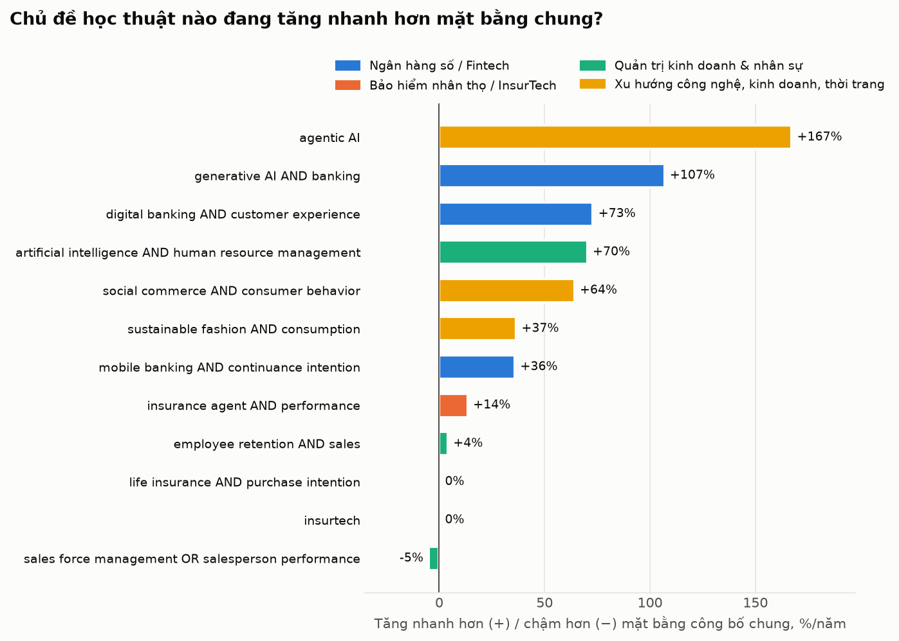
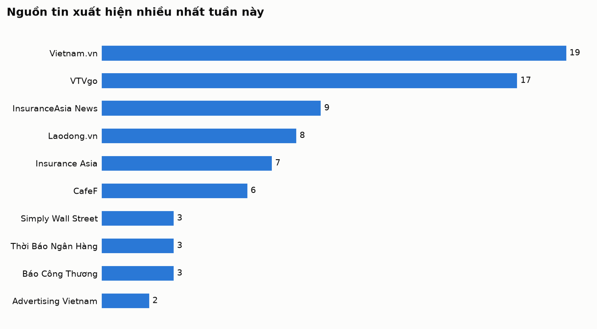
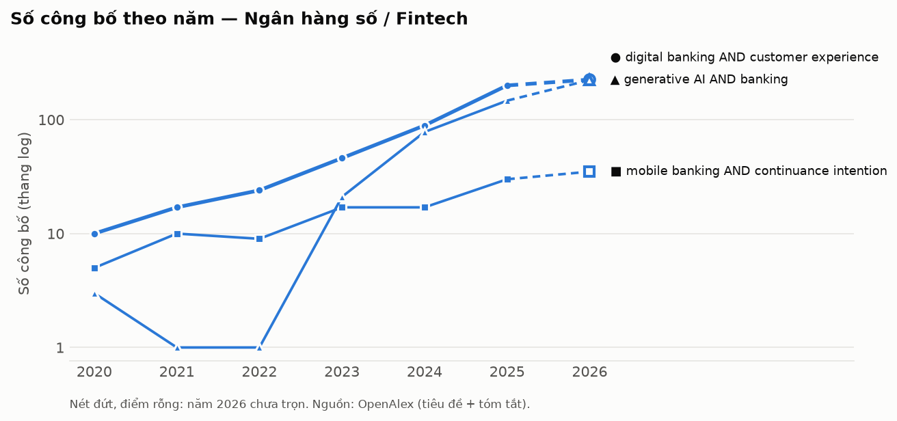
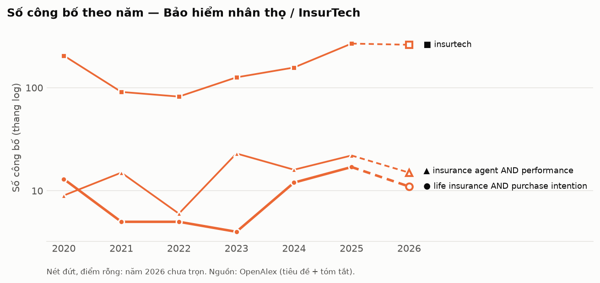
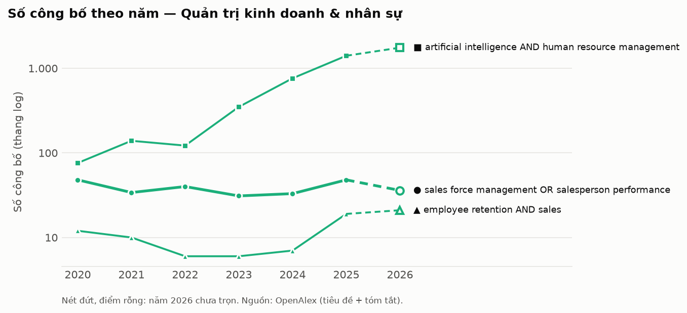
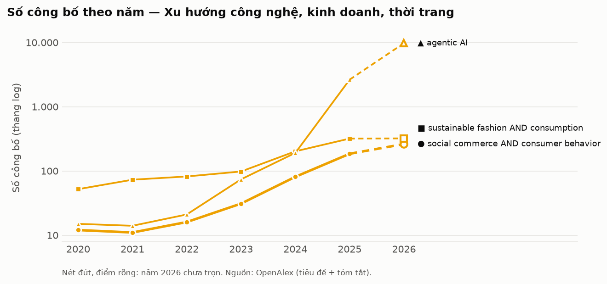

# Research Radar · Tuần 41/2026

> **Ngày chạy:** 11/10/2026 · **Cửa sổ tin:** 30 ngày · **Thị trường:** Việt Nam, đặc biệt Đồng bằng sông Cửu Long; đối chiếu Đông Nam Á và thế giới

**Bản PDF khổ A4:** [tải về](pdf/2026-10-11.pdf)

## Tóm tắt điều hành

**5 điểm đáng chú ý nhất tuần**
1. Thắt chặt quản lý kênh phân phối bảo hiểm — Doanh nghiệp bảo hiểm bắt buộc phải báo cáo định kỳ về đại lý qua ngân hàng và đại lý vi phạm nhằm củng cố niềm tin thị trường (Tạp chí Kinh tế - Tài chính Online ngày 09/10/2026, VTVgo ngày 10/10/2026).
2. Lãi suất huy động vượt mốc 9%/năm — Lãi suất tiền gửi kỳ hạn ghi nhận mức 9,4% đến 9,6%/năm, gia tăng áp lực cạnh tranh hút dòng vốn tích lũy đối với các sản phẩm tài chính dài hạn (Laodong.vn ngày 09/10 và 10/10/2026, CafeF ngày 10/10/2026).
3. Chợ truyền thống duy trì thị phần áp đảo — Chợ dân sinh vẫn nắm giữ 60% thị phần bán lẻ bất chấp sự trỗi dậy của thương mại điện tử, khẳng định ưu thế của phương thức tương tác trực tiếp (Báo Dân Việt ngày 11/10/2026).
4. Phát triển bảo hiểm nhúng (Embedded Insurance) — Các nền tảng số và ngân hàng tích cực tích hợp sản phẩm bảo hiểm trực tiếp trên ứng dụng nhằm đơn giản hóa quy trình và gia tăng tính minh bạch (Thời báo Tài chính Việt Nam và Insurance Asia ngày 11/10/2026).
5. Luồng dịch chuyển lao động ra nước ngoài tăng mạnh — Ghi nhận 102.000 lao động xuất khẩu trong 9 tháng, tác động trực tiếp đến biến động nhân sự nội địa và phát sinh nhu cầu bảo vệ tài chính cho kiều hối gia đình (Báo Tuổi Trẻ ngày 11/10/2026).

**3 việc nên làm tuần này**
- Cho luận án: Xây dựng khung mô hình nghiên cứu định lượng về tác động của sự minh bạch pháp lý kênh phân phối (biến độc lập) đến lòng tin và tỷ lệ duy trì hợp đồng tài chính dài hạn của người tiêu dùng (biến phụ thuộc).
- Cho đội kinh doanh: Điều chỉnh kịch bản bán hàng khu vực Đồng Tháp sang tập trung vào quyền lợi bảo vệ rủi ro y tế và sinh mạng thay vì nhấn mạnh tích lũy lãi suất; đồng thời duy trì tiếp cận tư vấn trực tiếp (face-to-face) tại các khu vực chợ truyền thống, tiểu thương.
- Cần kiểm chứng thêm: Kiểm chứng nguồn gốc và điều kiện áp dụng của mức lãi suất huy động 9,6%/năm (do Laodong.vn phản ánh ngày 10/10/2026) để nắm rõ kỳ hạn, hạn mức gửi cụ thể trước khi đối chiếu với bài toán tài chính của khách hàng.

## Mục lục

1. [Ngân hàng số / Fintech](#digital-banking)
2. [Bảo hiểm nhân thọ / InsurTech](#life-insurance)
3. [Quản trị kinh doanh & nhân sự](#management-hr)
4. [Xu hướng công nghệ, kinh doanh, thời trang](#tech-business-fashion)

## Bản đồ độ nóng học thuật

| Hạng | Chủ đề (từ khoá chính) | So với mặt bằng chung |
|---:|---|---:|
| 1 | [Ngân hàng số / Fintech](#digital-banking) | **+73%/năm** |
| 2 | [Xu hướng công nghệ, kinh doanh, thời trang](#tech-business-fashion) | **+64%/năm** |
| 3 | [Bảo hiểm nhân thọ / InsurTech](#life-insurance) | **+0%/năm** |
| 4 | [Quản trị kinh doanh & nhân sự](#management-hr) | **-5%/năm** |

CAGR chuẩn hoá = tốc độ tăng số công bố của từ khoá chia cho tốc độ tăng tổng công bố OpenAlex, giai đoạn các năm đã trọn vẹn.

## Ai đang đưa tin nhiều nhất

---

## 1. Ngân hàng số / Fintech

| # | Xu hướng | Tín hiệu | Một câu vì sao đáng chú ý |
|---|---|---|---|
| 1 | Trí tuệ nhân tạo (AI) và Smart Agents tái định hình dịch vụ ngân hàng | ●●● Mạnh | Trợ lý tài chính AI và Smart Agents tham gia quản lý chi tiêu, đe dọa trực tiếp đến nguồn thu truyền thống của ngân hàng [13][33]. |
| 2 | Mặt bằng lãi suất huy động ngân hàng vượt ngưỡng 9%/năm | ●●● Mạnh | Lãi suất tiền gửi neo ở mức cao từ 8,5% đến 9,6%/năm kích thích cạnh tranh nguồn vốn tiết kiệm đối với các sản phẩm tài chính khác [16][18][21]. |
| 3 | Tăng tốc thanh toán số đi kèm sức ép an toàn vận hành và bảo vệ khách hàng | ●●○ Trung bình | Quy mô thanh toán số mở rộng kéo theo rủi ro gian lận, buộc ngân hàng và các bên liên quan gia tăng biện pháp phòng thủ [1][5][23]. |
| 4 | Mở rộng độ phủ ngân hàng số địa phương và tinh tế hóa trải nghiệm người dùng | ●●○ Trung bình | Dịch vụ ngân hàng số mở rộng tới cấp thôn bản và vùng nông thôn, đòi hỏi thiết kế ứng dụng tập trung vào sự tinh tế [26][36][38]. |
| 5 | Nâng cấp chuẩn hạ tầng dữ liệu ISO 20022 và kiểm soát an toàn tín dụng | ●●○ Trung bình | Ngành ngân hàng chuẩn hóa hệ thống thanh toán quốc gia theo ISO 20022 song song với điều chỉnh trần tỷ lệ cho vay trên tiền gửi [17][30]. |

---

#### 1. Trí tuệ nhân tạo (AI) và Smart Agents tái định hình dịch vụ ngân hàng · ●●● Mạnh
- **Diễn biến:** The Korea Daily ngày 11/10/2026 đưa tin về việc các Smart Agents ứng dụng AI đe dọa nguồn thu của ngân hàng và xóa bỏ tình trạng "thuế lười biếng" (laziness tax) [13][14]. Cùng ngày 11/10/2026, Vietnam.vn nêu yêu cầu ứng dụng AI trong ngân hàng cần tự động hóa đi đôi với kiểm soát chặt [3]. Trước đó, Analytics Insight ngày 10/10/2026 công bố Visa đưa trợ lý tài chính AI (AI Financial Assistant) vào ứng dụng ngân hàng nhằm cung cấp thông tin chi tiêu và kiểm soát thẻ [33]. Thời Báo Ngân Hàng ngày 10/10/2026 nhấn mạnh chuyển đổi số ngành ngân hàng bước vào kỷ nguyên dữ liệu và AI [19].
- **Bằng chứng định lượng:** Doanh thu ngân hàng đứng trước rủi ro 100 nghìn tỷ Won (100 Trillion Won) từ Smart Agents, theo The Korea Daily công bố ngày 11/10/2026 [13].
- **Insight xã hội/khách hàng:** *(đây là diễn giải)* Người tiêu dùng ngày càng dựa vào các công cụ AI tự động để tối ưu hóa chi phí và quản lý tài chính cá nhân, thay vì duy trì thói quen chi trả hoặc gửi tiền thụ động tại một ngân hàng cố định.
- **Câu hỏi nghiên cứu tiềm năng:** Mức độ ứng dụng trợ lý tài chính AI (biến độc lập) tác động như thế nào đến lòng trung thành của khách hàng đối với dịch vụ ngân hàng số (biến phụ thuộc)?
- **Hàm ý kinh doanh:** Đội ngũ kinh doanh bảo hiểm cần trang bị kỹ năng phân tích dòng tiền cá nhân dựa trên các ứng dụng số để tư vấn kế hoạch dự phòng cho khách hàng có thói quen quản lý chi tiêu bằng AI.

#### 2. Mặt bằng lãi suất huy động ngân hàng vượt ngưỡng 9%/năm · ●●● Mạnh
- **Diễn biến:** Laodong.vn liên tục ghi nhận các mức lãi suất cao trong ngày 09/10 và 10/10/2026 [16][18][35]. Ngày 10/10/2026, CafeF dẫn ý kiến Ngân hàng Nhà nước cho biết tốc độ tăng lãi suất tiền gửi đang chậm lại dù mặt bằng đã vượt mốc 9% [21]. VTVgo ngày 11/10/2026 đưa tin các ngân hàng chủ động giảm lãi suất cho vay nhằm hỗ trợ tăng trưởng [7].
- **Bằng chứng định lượng:** Loạt ngân hàng áp dụng lãi suất trên 8,5% theo Laodong.vn ngày 10/10/2026 [16]; mức lãi suất tiết kiệm đạt 9,6%/năm (gửi 100 triệu đồng nhận lãi 9,6 triệu đồng) theo Laodong.vn ngày 10/10/2026 [18]; lãi suất gửi kỳ hạn 6 tháng đạt 9,4%/năm cho khoản tiền 500 triệu đồng theo Laodong.vn ngày 09/10/2026 [35]; lãi suất tiền gửi lên trên 9% theo CafeF ngày 10/10/2026 [21].
- **Insight xã hội/khách hàng:** *(đây là diễn giải)* Mức sinh lời từ tiền gửi ngân hàng cao ngắn hạn khiến khách hàng cá nhân có tâm lý ưu tiên bảo toàn vốn và tích lũy tiền mặt hơn là cam kết các kế hoạch tài chính dài hạn.
- **Câu hỏi nghiên cứu tiềm năng:** Sự gia tăng của mặt bằng lãi suất tiền gửi ngân hàng (biến độc lập) ảnh hưởng như thế nào đến tỷ lệ duy trì hợp đồng bảo hiểm nhân thọ đóng phí định kỳ (biến phụ thuộc)?
- **Hàm ý kinh doanh:** Chuyển trọng tâm tư vấn sang phân tích giá trị bảo vệ sức khỏe và rủi ro sinh mạng thay vì so sánh tỷ suất tích lũy với lãi suất tiết kiệm ngắn hạn.

#### 3. Tăng tốc thanh toán số đi kèm sức ép an toàn vận hành và bảo vệ khách hàng · ●●○ Trung bình
- **Diễn biến:** Báo Đầu tư và Vietnam.vn ngày 11/10/2026 phản ánh việc thanh toán số tăng tốc khiến ngân hàng đối mặt rủi ro mới và đặt ra yêu cầu kép về hạ tầng cùng an toàn [1][5]. Báo Kinh tế đô thị ngày 11/10/2026 nêu thanh toán số không còn là việc riêng của ngân hàng [6]. VTVgo và Tạp chí điện tử Thương Trường trong các ngày 09/10 và 10/10/2026 liên tục đề cập yêu cầu giao dịch ngân hàng số an toàn, phòng ngừa lừa đảo và bảo vệ khách hàng [23][24][34].
- **Bằng chứng định lượng:** Chưa tìm thấy nguồn xác nhận số liệu cụ thể trong danh sách tin.
- **Insight xã hội/khách hàng:** *(đây là diễn giải)* Khách hàng ngày càng lo ngại về các vụ lừa đảo công nghệ cao, khiến nhu cầu về các phương thức xác thực an toàn trở thành yếu tố quyết định mức độ tin cậy của dịch vụ trực tuyến.
- **Câu hỏi nghiên cứu tiềm năng:** Mức độ nhận thức về rủi ro lừa đảo thanh toán số (biến độc lập) tác động như thế nào đến ý định tiếp tục sử dụng ứng dụng tài chính số của người tiêu dùng (biến phụ thuộc)?
- **Hàm ý kinh doanh:** Hướng dẫn khách hàng thực hiện thanh toán phí bảo hiểm trực tiếp qua cổng thanh toán bảo mật chính thống của doanh nghiệp bảo hiểm để ngăn ngừa rủi ro gian lận trung gian.

#### 4. Mở rộng độ phủ ngân hàng số địa phương và tinh tế hóa trải nghiệm người dùng · ●●○ Trung bình
- **Diễn biến:** VTVgo ngày 11/10/2026 đưa tin về ngân hàng số VCB Digibank [2]. Trước đó, VTVgo ngày 09/10/2026 phản ánh ngân hàng số len lỏi khắp mọi miền [36], và Báo Dân tộc và Phát triển ngày 10/10/2026 ghi nhận mô hình "Thôn số" tại Yên Minh [26]. Về khía cạnh trải nghiệm, CafeF ngày 09/10/2026 nêu yêu cầu ứng dụng ngân hàng quan tâm người dùng tinh tế trong từng thao tác [38], và Báo Tây Ninh ngày 09/10/2026 đưa tin về hoạt động ngân hàng bán lẻ lấy khách hàng làm trung tâm tại BIDV [39].
- **Bằng chứng định lượng:** Chưa tìm thấy nguồn xác nhận số liệu cụ thể trong danh sách tin.
- **Insight xã hội/khách hàng:** *(đây là diễn giải)* Tại các khu vực ngoài đô thị như Đồng bằng sông Cửu Long hay vùng sâu, người dân tiếp cận tài chính số dễ dàng hơn qua các mô hình cộng đồng và giao diện đơn giản, thân thiện.
- **Câu hỏi nghiên cứu tiềm năng:** Yếu tố trải nghiệm cá nhân hóa trên ứng dụng ngân hàng số (biến độc lập) có ảnh hưởng như thế nào đến quyết định mua chéo sản phẩm tài chính (biến phụ thuộc) tại thị trường nông thôn?
- **Hàm ý kinh doanh:** Phối hợp với các chi nhánh ngân hàng đối tác tại địa phương để số hóa quy trình nộp hồ sơ yêu cầu bảo hiểm ngay trên ứng dụng ngân hàng số cho khách hàng khu vực tỉnh.

#### 5. Nâng cấp chuẩn hạ tầng dữ liệu ISO 20022 và kiểm soát an toàn tín dụng · ●●○ Trung bình
- **Diễn biến:** Thời Báo Ngân Hàng ngày 10/10/2026 thông tin ngành Ngân hàng triển khai chuẩn ISO 20022 trong hệ thống thanh toán quốc gia [17]. Cùng ngày, CafeF đưa tin Ngân hàng Nhà nước ban hành thông tư quy định mới nhằm duy trì an toàn hoạt động [27]. MoneyF ngày 10/10/2026 đưa tin về trần tỷ lệ cho vay trên tiền gửi (LDR) khiến các ngân hàng lớn chịu áp lực điều chỉnh [30].
- **Bằng chứng định lượng:** Trần cho vay trên tiền gửi tăng lên mức 95%, theo MoneyF công bố ngày 10/10/2026 [30].
- **Insight xã hội/khách hàng:** *(đây là diễn giải)* Chuẩn hóa dữ liệu tài chính giúp giao dịch minh bạch hơn, nhưng các hạn chế an toàn vốn khiến ngân hàng kiểm soát chặt chẽ hơn hoạt động tín dụng ra thị trường.
- **Câu hỏi nghiên cứu tiềm năng:** Mức độ chuẩn hóa dữ liệu thanh toán quốc gia theo ISO 20022 (biến độc lập) tác động như thế nào đến hiệu quả xử lý giao dịch tài chính liên thông (biến phụ thuộc)?
- **Hàm ý kinh doanh:** Chuẩn bị sẵn tài liệu đối soát giao dịch thu phí định kỳ tương thích với các thông số dữ liệu chuẩn hóa của ngân hàng thu hộ để tránh gián đoạn dịch vụ.

---

#### Tín hiệu yếu cần theo dõi
- Ngân hàng số Revolut nộp hồ sơ xin giấy phép hoạt động ngân hàng số tại Philippines, phản ánh xu hướng mở rộng thị phần tại Đông Nam Á của các fintech quốc tế (nguồn: briefasia.com, 11/10/2026) [10].
- Đơn vị IIMMPACT chuyển dịch mô hình từ ứng dụng người tiêu dùng sang cung cấp nền tảng thanh toán hóa đơn (Platform-as-a-service) (nguồn: KLSE Screener, 11/10/2026) [12].
- Ngân hàng Nhà nước báo cáo về việc chưa thành lập sàn giao dịch vàng, cho thấy sự thận trọng về mặt pháp lý đối với các sàn tài sản số hóa hoặc kênh giao dịch tập trung mới (nguồn: Laodong.vn, 10/10/2026) [20].

<b>Nguồn tin (40 tin, Google News)</b> — số trong [ ] khớp trích dẫn, ★ = được trích

- [★ [1] Thanh toán số bùng nổ, ngân hàng đối mặt rủi ro mới - baodautu (2026-10-11)](https://news.google.com/rss/articles/CBMiiwFBVV95cUxOWVRtNHVIemgzLUxfUjE1dVNnalE4VHpZZXZGUGFQRVg0bUZQcVd5R3g2VjJTemZzcDJKUm9ka1NVTXg3Q1ZfWWJBQzQ4cXhJUm5qV0dsdmsxQUFRcUVUcVVreTBURjMtM0o1MEFjNGFJUUpiemk2Y3JsbER1cTU0UHhQeEJEallCVi0w?oc=5)
- [★ [2] Ngân hàng số VCB Digibank – Dẫn lối tương lai - VTVgo (2026-10-11)](https://news.google.com/rss/articles/CBMiQEFVX3lxTE9PTjUyVXRsdjUzMFZGcDI1RmkzR3FFRmxIWEZFS0F3THo2RnNKNE92ckhhNWpkbW9rR2Z6aC0wV3Q?oc=5)
- [★ [3] Ứng dụng AI trong ngành Ngân hàng: Tự động hóa nhưng phải kiểm soát chặt - Vietnam.vn (2026-10-11)](https://news.google.com/rss/articles/CBMimgFBVV95cUxOZ3UyaGR3eS1tSERuZHpnZUpRWnFLRHRlQ21PQ1RxWG9YZVlYVFlFM2ZMc2lHdE9nZVlQOVhXd1d2Q3plN2I0QWNEUVpTWnNuMnRNanFpUklDVzNtU0ltZDQxZ1hGaGZEV1Ftc3ctcGo4ZDNQTWEyRjAyR2MtelV0T2dVcTVYZXZ0X2tCMmtlZEZRRFE1Si1sc3RR?oc=5)
- [[4] Chuyển đổi số ngân hàng gắn với an toàn hoạt động - VTVgo (2026-10-11)](https://news.google.com/rss/articles/CBMiQEFVX3lxTFB4bWJYcHF3cktvOHU0SlRqUDh2cElZXzRhaUdrMk53ZnZhQTk2U2FXUFJxYWpJeEFUOHR3aDgtQkY?oc=5)
- [★ [5] Thanh toán số ‘tăng tốc’, yêu cầu kép về hạ tầng và an toàn - Vietnam.vn (2026-10-11)](https://news.google.com/rss/articles/CBMihgFBVV95cUxNRDd1aUVMc1NMSUVlQ1hDTlVXWGlhS1gyT2NpYUpTbUJidjZMT0lza1ZBZTg0OEdsZVdoZmRJdW1qUFRYTDVMLURpZUR1RkZxS3oxZWxzcnFHakNkeWEtLW94N1RwTElRZzNYNVB6LUc2NUZpNHcwcGhWMjZzVENiWFhuSmZTZw?oc=5)
- [★ [6] Thanh toán số không còn là chuyện riêng của ngân hàng - Báo Kinh tế đô thị (2026-10-11)](https://news.google.com/rss/articles/CBMikgFBVV95cUxPdE1uTDA5QURCeEdOVW9wU0wwX1Rsa0lXRHlBM1NrRHVISWVhbFhQSnV6TGVKN1pNUDZzdm9Kb3ZCSUEtQ2IycUpRSEZWQkpJcThUOFl2VjUwenBvYzItTmtQaTM3RW0xeVIzN09obDU0cTV5X0lUNEYyYWNmNl9ncHk3ZVlqaFdrRFlpZkNxX1JSQQ?oc=5)
- [★ [7] Ngân hàng chủ động giảm lãi suất, hỗ trợ tăng trưởng - VTVgo (2026-10-11)](https://news.google.com/rss/articles/CBMiSEFVX3lxTFByOGNPTzJsUTZzR2RsT1Z2bXFfUmVWUUk3Y1plZW85UTliMkYxbkZtTWUzc1Y4Z3ZmVXd4c2dfRm5tV1h2R3R3RQ?oc=5)
- [[8] Tạp chí kinh tế cuối tuần | 01/11/2025 | Chiến lược phát triển thị trường bán lẻ Việt Nam - VTVgo (2026-10-11)](https://news.google.com/rss/articles/CBMiQEFVX3lxTE1xQ1RucWw2Y3RrUHVjblhOQWcyVmVleDl5bjR1N3cyRHo3UFNUVURjZ2JMcUFnYldZdVp4RGFQQUw?oc=5)
- [[9] RMIT Hack-A-Venture 2026: Cuộc thi đổi mới sáng tạo công nghệ dành cho sinh viên toàn quốc - Advertising Vietnam (2026-10-11)](https://news.google.com/rss/articles/CBMixwFBVV95cUxPVGJQdTFuaFV0SkNwWjRLNzU0cExxQ25lVUx2N2h6a1ZnbVk4S0EyUFhOdUVDaUMtcHJTTEZ4Z2NqWEppVDZEMF9rVjdRSUlZX09UejFIZy1KZF8tcjJYM2x3YmRfczc0YnJoR0dTNnl0Q3VlekFRTXo5YkVpalhxMGxIMjlGa2lXNmJuaml6Z2p0MElUMWdEazdOaUl5WW9pQ0tUNS11bDgta0llOS1Ndnp2QmlRV2xjQlhaLS1xRDZFTWxtNlo4?oc=5)
- [★ [10] Revolut Pursues Digital Banking Licence in the Philippines - www.briefasia.com (2026-10-11)](https://news.google.com/rss/articles/CBMijgFBVV95cUxOc09DcTNrckVPRC1zaGpuWFFrYUlsaVh2NnJDMkZmRkVFLXVWUkw3OFpPY3JnV2Z3c1B2UjRGQ0o3TnlJd0N0Nmx5dmxmeHZaYnA4Z252QThWaDhfRDlLUHV2OGhTNnB2dTN1ZGdTZFloUkxKUFZvS29PUzBoZ0syZmJpWmZ3NjFLQ0dudEVB?oc=5)
- [[11] 3 Penny Stocks With Revenue Growth Over 1% - Simply Wall Street (2026-10-11)](https://news.google.com/rss/articles/CBMiwwFBVV95cUxPck1RYktyM2U5UDVYTkFEZFNmT3dyZlJSZnlNb2R4ckMzay1UdTFuTVVsOFNoX1o0bnpjdE5WRS1TeDZCV0I4cjQ5UmsyNFlBLWxudnlaT2ZwdmVOSEQtV1ZMMl94VlBKTUpJSGxfUHR4dFZRS0xIR21XSjhYSFdraFBxZVVHb3JFdnNBM1dnXzdEX2MzbEJHbDd4VEdmbjVkRVRxTjc1b2xhYzNXbEhPdXRGaXNDZ0JRWDVySEdvbXVuOHfSAcgBQVVfeXFMTW1DeU40Rzd2MlBDUFhBLTRtTmFnaWoyMWJtWi1vazR6aXlIakhQS2JkVEtwb0lKLUJfLXFVRzlJUnprR0FlZXNvR1E0dWhaZHk5ZUt4MEVZZ0xGRkpneVlGNTA4UWlDNUxVMDFQa21ISmtJNmFodUx4cU5lcl91NXc4Q1hmQkhKZlpvOHdQZjBlZXdVb3lBalUxRmVUdlVjR21lWmZCcnpGd2VMWnlScU15X3BsQVpWbUZjYmRrQjh4ejlDWWJhejE?oc=5)
- [★ [12] Platform-as-a-service: IIMMPACT builds bill payment business after consumer app pivot - KLSE Screener (2026-10-11)](https://news.google.com/rss/articles/CBMizwFBVV95cUxOLVhubTJMamgzX2FlV3pPakR2Zk1XYTl5blc2UWhDVEFWUnZsNllnc1Zpbk1seTl1YnhKZ2Q3MUlHVFBmNjBuZFpLLWNqWWN6WXRtRjJjMTRpYjRITFRVME9UVnJFdC1ueVg0ZC00YnNTU1VjaUk4WVNRczZFQlJiaUo4SVNpZVlTR09zZWgyQ2N4VVVRa1lzNjlsZFFVaW4za0lMQU5Kb3lrT1I5MG56WE5hcXRvaWtpSTAzbmdSdGsxdzNPLWJ6TnVxVjNZazQ?oc=5)
- [★ [13] AI Banking — 100 Trillion Won Bank Revenue at Risk from Smart Agents - The Korea Daily (2026-10-11)](https://news.google.com/rss/articles/CBMiX0FVX3lxTFBlZDY2ZGZ2Q1ZWUVMwSzZiazBzT3hwa2xfOERSTmlNMTNmek5mOENRUU1jelI4dUF3YzhxSFFPRmY0blotTk9hRFIzRW9mMkc4d3JmODJ6T2g0UVpQeUNN?oc=5)
- [★ [14] AI banking agent — How Artificial Intelligence Is Ending the Laziness Tax and Transforming Global Finance - The Korea Daily (2026-10-11)](https://news.google.com/rss/articles/CBMickFVX3lxTE8xaGtkU0VUNFkya290US1ZVXNIQlVUdnpGYlFXSEdQbFFJeUNaM1F0c3J3YWxlQWNXS3Jnai1qV0dhNzlfSGV0SDkwUVhVWGEta2VTRU0tN3dvNHRaVllNWWdPa1psYlVQaXN4c3I2VFlndw?oc=5)
- [[15] UAE, Jordan face largest share of jobs at risk from AI in Middle East, says World Bank - Khaleej Times (2026-10-11)](https://news.google.com/rss/articles/CBMivwFBVV95cUxOaXA4dTk2X3owTURPZDhYLV90MU8xODktdGtTUUs3QmZBZ0RqNm1YMWppdFZnMW1tMUZHdllsd1BmSGFuRjlwQklHM05RTGFtZkk0MGs5TGZqUmVTRlJMUWNaX3RHNklsVjd4VGdFbi1GU0V6MGhJTHROZklxY3hUTTBOcTd6RjM1RkJHbTBidnk3QVZVbkhuMWFOVEc0eklkUm4xOWFjV3Z4N3pUREV5OTRaMVhVM1ZtVWc5bDV2b9IBxwFBVV95cUxQeHBWLTlhY21mbEFtNUZPckgwTTVZTVJWSlpLOVlFU29tUl9SVXhzWC1ZYkk1RFJqRER0c2QtZXFPclNXX3MtYk0zbTlUYzB0NllPektnU0tXZzVtQWgzNlJxeW1ManYwa3g2Y2s4cDF3M19sak1RcUxsRWRDYUg3YzFGblJKR0ROOHp2OHdMaTZNaHdFVllabGtOd3JkQ0xFRURBeDdDVHpBaXR1SE83YzlBQ2FacXVPSFRYcVBfWGlXaENYZHlv?oc=5)
- [★ [16] Lãi suất ngân hàng hôm nay 11.10: Loạt ngân hàng có lãi suất trên 8,5% - Laodong.vn (2026-10-10)](https://news.google.com/rss/articles/CBMirAFBVV95cUxOUGlXczhRVjVEUUJDYlNyc3luUGYtREJxbGlWMDRTOWRHdDM1eU1XSGU1cUJKY21yUlFUUDNFTS1rMXByOGhZR3N1dWdzT0Y5dVBreUpVQ2JZMkNwVVNCQXZVS0xSdFZ5M2VacmxZc0JRc1JpSDRwTmw2aENGUExtVUxsSktaa3NjQklOVnJqTnJEbEFOeGxvZkVuTXU5X0RuT3I0SWdJRFlaMFZX?oc=5)
- [★ [17] Ngành Ngân hàng triển khai chuẩn ISO 20022 trong hệ thống thanh toán quốc gia - Thời Báo Ngân Hàng (2026-10-10)](https://news.google.com/rss/articles/CBMitwFBVV95cUxOZG9mbXF4ZjQ0bkF2Nkk4aEJSc2dicURmTVZ3S2FnOGh3TWJfS1U0cm9udFdWQmdvalBfbWtwODFvVlRxcXh4UHppWWUyUXRTUmJiNjdiY1FUYlBBWjVmcThwdHJvMWxYbldEbDR5RkpHY0lBSXlDUDdkMTFzdkp1bXl2SFVYd1oxX2lWeW5jTHhZNTBHbWxrWGxDbXNHRXAtQnFhcnI4OV95ZU9TaGZpMHN2Y2dBMU0?oc=5)
- [★ [18] Lãi suất tiết kiệm 9,6%/năm, gửi 100 triệu đồng nhận lãi tới 9,6 triệu đồng - Laodong.vn (2026-10-10)](https://news.google.com/rss/articles/CBMitwFBVV95cUxPeXBvWlN4WllPQ1gwVV9iM2IzdGR2dVVmT3pGQ1pnWlVQRFFQdmNXRkl5clVpRnJyQVVheWpscEJhOHZnX0tqSkdvVVczckg1SkRQNEloYUpldXE5YUpwYjJnUXRYTDhpSjBvOTdMM1pwS2hFQi1TNFlTcTh2QWtfVW9Db0plN1lhd2JhY1lJTHR2ZkNJamZqRUp1Y3JYV3ppVHpURDZGcUUxbHFKY3VMVXJ4SXM4dkU?oc=5)
- [★ [19] Chuyển đổi số ngân hàng: Giữ vững vai trò tiên phong trong kỷ nguyên dữ liệu và trí tuệ nhân tạo - Thời Báo Ngân Hàng (2026-10-10)](https://news.google.com/rss/articles/CBMi2AFBVV95cUxPZF96bnZlckhrWUtqNGNSUFBYZmNzU1FYRk5xcEdxRGxHOTQtSTI0MWdjb2RDSmtjTXRYVTlPb3AwNVpRSm40X09BNmlYblFOZUFrdzN5ZlhnVDFQbGY2NXRkWk9taVR4S2REVEN2aTdPMEZYMlVyRXN1NmI2U2ZWajRDbXQwSEoyemYtSDQxT1gybW5mN3dDbmI3U1NFWXYzRVozMkRxOFkyWWxJOUZoZmEyUndiUDMwc2ZpWjB5bW5TVWJfYjBUWFdOTDU0UUlLRV8xNjZKeEw?oc=5)
- [★ [20] Ngân hàng Nhà nước báo cáo về việc chưa thành lập sàn giao dịch vàng - Laodong.vn (2026-10-10)](https://news.google.com/rss/articles/CBMirwFBVV95cUxPRDEzRENIa0xmMVpmdGkzb214cTJpUXNJbXZlc2Rvck05OHRmX1FoWThaN0lmOTVEdzdQUTM0RE96UnFURXVIR00wLUlwVU1MUnlHa3VvcXhtN20zZ012UkZkYTBBajQtblpoVUJkQTFNM0NXZE53QlhrZkpETlpOdHc2MkFMY3dzWUQ3M2IwVkU2MjFza2FCVUhYa0FnVUU5QTJOSlYwY3NUdWJXb29j?oc=5)
- [★ [21] Lãi suất tiền gửi ngân hàng lên trên 9%, Ngân hàng Nhà nước nói tốc độ tăng đang chậm lại - CafeF (2026-10-10)](https://news.google.com/rss/articles/CBMixgFBVV95cUxNMDVfTGtpb2lnSmEtME53eEZJeF9HMDQ3S3RHY3ZocjBTSXZ4bG1Xc1dMYjJ6NWw4NjZCSEZZcVZLR1hMNVlyNVFGa1Yza0tFSjBSQUR3YWxQMjVpRnNvejBrcWNuWnRTWU5fNUJHWE9CTWdVd0FLTjNxcGg5cUc4TFAyWEtFS2hYN2g1X1FtdXM2Zm9MWHBvWXBHTmVVb0UxcjVjeWtQSlNMM1c2bThFU1VaRlhUUVJ2R2FrUi1PZlR1bE1IUGc?oc=5)
- [[22] Ngân hàng "chạy nước rút" tín dụng, trợ lực mục tiêu tăng trưởng hai con số - Vietnam+ (VietnamPlus) (2026-10-10)](https://news.google.com/rss/articles/CBMitgFBVV95cUxNclpRNnpIYUw4R2hnelIxZS1Ga2cycEFFRDBMRTRPeHF0S1dsZkpTeXFRS2tmbjE2MExtTnVoVlpVdXM1TzdxUTJ5YVlRUXlNQXY4aHAwd3Q3M205Q2xkRHUyTk9jWm94M2R4Y0V4TWVQQV90YTMwR29zM1Y4NGRoTkRfZEJvVWFWanBtN0NFSE5NV0hOekxRX2diaWQ3YUVQdFc3VzI0RjJTU2tpZWRYNUUxVlJOZw?oc=5)
- [★ [23] Thanh toán số và bài toán bảo vệ khách hàng - Tạp chí điện tử Thương Trường (2026-10-10)](https://news.google.com/rss/articles/CBMikgFBVV95cUxOV3ZndkRvT3BVa3FQMUowcXB4ZXVvR3hjWXFGX3EtZ0JUZ2Z6M3c3Y0ltMlZlSzZWMzMwR0FwRXJ6bENMYWVvZjdwSDhrbTkxakdmSnppVmpMVlpxVWh2dTE5R0NyQWFHNmFUVW9NY1dlZjRsWUduOXRLVm8xNE5idFgwaV90Y1J6QjJLLUo0SXBPQQ?oc=5)
- [★ [24] An toàn giao dịch ngân hàng số, phòng tránh lừa đảo | Tài chính kinh doanh - VTVgo (2026-10-10)](https://news.google.com/rss/articles/CBMiQEFVX3lxTE9jZVpIcm1KWlJ6S1RwVUtyZ0gtZHFVSkUxNkF6YTV6U21UbEpWYVctNHRveXJobEdrWWZIM0M5V2w?oc=5)
- [[25] Ngân hàng Nhà nước Chi nhánh Khu vực 3 triển khai nhiệm vụ quý IV năm 2026 - Báo Sơn La điện tử (2026-10-10)](https://news.google.com/rss/articles/CBMitwFBVV95cUxNZmtsSk9ibTRjWkZyZy1XUWF6cTcweVhLTWc0aDNHUHdGTXctbERfeTB2Z2ZzeXpTMkFzUDVYbzJwT2VNQkRCMnZQZWJRelBqV2l0WE1rV2E5eFBpVTlMdmFVa3k3QlNzXzhxaGNnbmFmeVQ4OVMtUWE4M29GWVlDZnJGS3pkcFV5RktTZU9mRFowMzI2V2dLcW02ZExCeWNBMmpwdDFwTlFrYWFVOVJRWEZ4aG9PUms?oc=5)
- [★ [26] Yên Minh đưa chuyển đổi số đến gần người dân qua mô hình “Thôn số” - Dân tộc và Phát triển (2026-10-10)](https://news.google.com/rss/articles/CBMiswFBVV95cUxNU2tBU0tIcnByZm16cE11UG5xM0xKZTdRNFhEdnFmMWRJRnUxRzRQTWxYbWFGOHVJTEg1SUN3cjFMTEd6eVNYSzIwaWZCQUdVWjNOVWRfVGpId1ZTOVpXSUVmdWUwOTZBaW5ROW5hRUxuZUFxYTE4cGgwLTJ0aFNVQWs5X0RsRENhMEJ2Q2kxVml2QXdOU0paSkxBY1N0VlprTjJ4c0U3QmhLYTJxbExuSjEzRQ?oc=5)
- [★ [27] NHNN vừa ban hành thông tư quan trọng bậc nhất ngành ngân hàng: Phó Thống đốc nói rõ mục tiêu xuyên suốt của các quy định mới - CafeF (2026-10-10)](https://news.google.com/rss/articles/CBMi9wFBVV95cUxQNzRoZlR5Mi00aFRzVGRqOF9EeHlZWWdBb0owMzJlWEp5TG43cGk4SnpPZHRseHRKUDJ0VWVsNDZwZ2ZDR2h0V1hNSHl1WERRN1J2ZTA1d3ctaWYwclZETFRfbjZ0V2Y4S2Vyc2NqVlRROEFBX09XVlRpV3pxM1U5UzB5QVdEMnM1SXdhTkhRdC1VQnc5dDFoLVhtdHlIckJnZ010ZUMtdXZ5SXJ6X0JQYjQyZS1lQnJUYUNuM0x0ZzJPUXdXRDZZa2E4TXRNNjUwbkMtMjdPX2h1YzhqV3BrUmdfWHBIeHVfbkR6cjFaUnl2OXpzRktv?oc=5)
- [[28] Chuyển đổi số Việt Nam: Khi công nghệ thực sự đi vào đời sống - Báo và Phát thanh, Truyền hình Lạng Sơn (2026-10-10)](https://news.google.com/rss/articles/CBMingFBVV95cUxPaDRadjlmLVc3T18yMU1YUjhIa2lkc0d3SEh3eUVtSFZmQ2xHQ2VXRnpuWWhiVTd3NkZqREppTVNvTDVxV0c4OFdIeVZQQ1l6dzR4UFlMcGxlRkhBVWE0aWhaTW9QN0F5YjJ5NmhCeVpDMlF2RldKb3V5RV9Pa3BJa2NEM3F3ajBLd2hJM045d2VreXJRNGpPSnhxQ1pKdw?oc=5)
- [[29] Ngân hàng SHB khẳng định hoạt động ổn định, triển khai tăng vốn đúng quy định, đa dạng hóa nguồn lực tài chính - Tạp chí Công Thương (2026-10-10)](https://news.google.com/rss/articles/CBMi4wFBVV95cUxOM0I0ek1QRkxXVXZ3Z3JwdzRjWGpUX0pOZlY1NEpQTmpnMnZKdkhQUEJTLTBJbnczMVlvTFJndG5MRVdUbFliYnBHa3hQeGJTY2FRbW1Yd25Qa05Yek4yMGFaU0F5UlZZYVg3aFExdEY1dWh3OE9XMkRjN3lLN295b2YxXzk5ZnVlZXVlajY0aG85bjNpRG1PV2VVTGE4WXZpTnRZWGRXU0JXekdvcHRIbkNWU2VVYkprNTBCUTRkU1hfWDE5dTRyYWYtdDVxUGJ1Mm5icThyX0h4QWw1QjNuWXlQRQ?oc=5)
- [★ [30] Trần cho vay trên tiền gửi tăng lên 95%, nhiều ngân hàng lớn chịu áp lực điều chỉnh - MoneyF (2026-10-10)](https://news.google.com/rss/articles/CBMiggFBVV95cUxNT1VPS2pPWGJlQjlqMGlvQTZfNU1icEJacENqT3VzOC1RSV9TbzQ5cDkybW5ZNHZCeEpwRXZsQTk2TEhvSXlVdnJmM1BjLVpiT3ZkUUlWU3c4Vk1FUWY0aXZaNTU2ZG4zTFI5azM0VDlXRUxRZEdURFhTYlg5MmYwdGdn?oc=5)
- [[31] AI, Trust, and Asia’s Financial Future - The Diplomatic Insight (2026-10-10)](https://news.google.com/rss/articles/CBMic0FVX3lxTE5KZXpPOTRwRWJoRVVNTlV2UVFQN05DZUxYMW4xaVVINktsNjJIQVozRklJaGVNUjBJODlySjdNdTZ0NlppVG1EUGVXaktseVAzY09LdmJQWVROd090V1FVVW1odDZzMjY1NHJOWmxsOTV2Yk0?oc=5)
- [[32] Bangladesh Fintech Summit discusses next phase of digital finance - www.daily-sun.com (2026-10-10)](https://news.google.com/rss/articles/CBMiqgFBVV95cUxQSU51V1JiUlQ5dUN6M09MRG9hd2JGc1BQYzFTelhVV1ljekt5U1BoLUp5aG1uOFQ3Yk9raDItZWNQYmNxaTU0LS1HMmJfcEdKd2x4Rm9Laml2ZVJ2VzlHSWZSeE11c29kUWFUcjRaWkxBdUlJVU1VTGlYS2hMVHB3SnEtS0VtaVh2eTFNTm1jS3VFRWNGRjBHU05na1V5QUhfWVBvdnNmYnl2Zw?oc=5)
- [★ [33] Visa's AI Financial Assistant Brings Spending Insights and Card Controls Into Banking Apps - Analytics Insight (2026-10-10)](https://news.google.com/rss/articles/CBMi7wFBVV95cUxQa0FwMnMtbDNOY3pEb0l5NDJNek1NRnJvOTRoS0FOdXRPLXRHaHpuRndOM3ZZRlFsV0RPMXlWbTNKRWptMEJJNWw2OWR5TzZWcDRENlloV1QzdUN6LXFEb0V5YlNPTnQtYkZJUWwwUjdzQVg3ZE1peHk1M0pFSFVXYnFfVHJHYm5sNGU4b1ZObWw3ZC01QzFPTTZ0YUY3cEwyTUwycGVpRlRQTm9hUmhWWEI3cXl4eGMwMDdPZFVNaGt2eU9IUUdmekE3MTNpM29sQU5LWDRlWE96LUdQVVRQMll3NFFOSGRjYTFRdnV2ONIB7wFBVV95cUxQa0FwMnMtbDNOY3pEb0l5NDJNek1NRnJvOTRoS0FOdXRPLXRHaHpuRndOM3ZZRlFsV0RPMXlWbTNKRWptMEJJNWw2OWR5TzZWcDRENlloV1QzdUN6LXFEb0V5YlNPTnQtYkZJUWwwUjdzQVg3ZE1peHk1M0pFSFVXYnFfVHJHYm5sNGU4b1ZObWw3ZC01QzFPTTZ0YUY3cEwyTUwycGVpRlRQTm9hUmhWWEI3cXl4eGMwMDdPZFVNaGt2eU9IUUdmekE3MTNpM29sQU5LWDRlWE96LUdQVVRQMll3NFFOSGRjYTFRdnV2OA?oc=5)
- [★ [34] Giao dịch ngân hàng số an toàn - VTVgo (2026-10-09)](https://news.google.com/rss/articles/CBMiSEFVX3lxTFBBY0NDRlBpdU5LY0dyTFRzTFpid1FFak5pZjQwbTlCMS1uM0xqd3Y4ZllEMmdaRml0eHEzWGIzTnRBN0F3M2MtSA?oc=5)
- [★ [35] Gửi 500 triệu đồng kỳ hạn 6 tháng, lãi suất lên tới 9,4%/năm - Laodong.vn (2026-10-09)](https://news.google.com/rss/articles/CBMipAFBVV95cUxPVTBSRk53QWFBX3pBbndPUUR3VkxET1VwalM2Tm5OQkpudkxMaFVsNzlyVGR0cUgydzlZSjJOWUswallDZzZlcG1iSFNIN242N0lLMUV5RVh6bkE3bjNibE9FU01jaFI0NUNNS0VPRm9VUFRqeFdZSkhmRzk3QVFwSGJEbTE3YmdiU0RpWjJ0ZnNGY0w4aHJPX0N0alN3NkRISU9Bcw?oc=5)
- [★ [36] Ngân hàng số đã len lỏi đến khắp mọi miền cả nước | Dòng chảy tài chính - VTVgo (2026-10-09)](https://news.google.com/rss/articles/CBMiQEFVX3lxTE5CUWh2NF9xRFF2eGphNUcwMy1UdV9CY2FDdWFaYkE1amtGZmVMU2tSS3FHcVFWRENmZkxtWnp2UTY?oc=5)
- [[37] [Longform] Tương lai hệ thống ngân hàng Việt: Chuyển đổi số, minh bạch hóa và quản trị rủi ro - Vietstock (2026-10-09)](https://news.google.com/rss/articles/CBMiwwFBVV95cUxOY3NnVmhEWVlfTE9BVDgxb2Y3TEZ2bEx0LTZmTFlkeUtSOE56TWVHcG9uQV9ZVWRvd1BzYlZsUE9TSF9VVFNHMUlKdXBMX1NIdU1HZzRjdmpFSUFHODRiSXphVl8zY1dWX3JUNmJONF9MaURIV05CX3ZiRWx3YWtvLW5tc2ZmQUpFMXVubHNmWDh0RXhtcV9WTThUQUJvYlA4RzYwOW1udW1TdEs4bUVSNERoSHVJRTFrMmxCWGpSUGtKeVk?oc=5)
- [★ [38] Khi App ngân hàng quan tâm người dùng – tinh tế trong từng chạm - CafeF (2026-10-09)](https://news.google.com/rss/articles/CBMiowFBVV95cUxQelVYelNHU3ZYeXI5RnJWOWVndG9faS0xLUJiYlJvWjJTQVdET0VsdG4tWG41d0RLMzY3cExUZnBFTENKMTZycy1CX3B6YkpqeHJ5ZVBhQ1hsNzduaXdlcFcyOFFfeDZIX1BuX2djWXNLc0F6LVZwQnFjd05KRmxyU0VMS05fYUl2eEdHem50N1VteXdJY0tNZVBCZEhFU0NOeWJB?oc=5)
- [★ [39] Đổi mới hoạt động ngân hàng bán lẻ trong giai đoạn mới tại BIDV: Từ động lực công nghệ đến triết lý lấy khách hàng làm trung tâm - Báo và phát thanh, truyền hình Tây Ninh (2026-10-09)](https://news.google.com/rss/articles/CBMi8wFBVV95cUxOY1BMQVZ2SWZhWktPN1RXTGgyc193MUtNSVBZYm1MRlZtb3ctQ2VHSzFnUzM4cktsRkU2dzM1d1RzS0ozOXFQMWpVYVF4V3BvVmdIZkpLQ0lhclB0bzhMMnl6cG1Ed1QwS0dwMzJGNEZZVWVGTFN5R2tjUnpnMjNTU05zd1FiQ082Sy1GMmpCMVpub1hYNHlBVm8wdkRxUVR3TkpzcnFrTlQ0VzlLQjh6eGl3SDg4VGVFRDUtYWFYaU9wNjJZSnRab2NZN0htUkJUaFRuRkhRRE4yMXBSRU5ZbWN5SE85c1hyaGFMVFdwd3I2WVU?oc=5)
- [[40] Thị trường thẻ ngân hàng bước vào giai đoạn phát triển mới - Thời Báo Ngân Hàng (2026-10-09)](https://news.google.com/rss/articles/CBMingFBVV95cUxOa1Fyck5yN2FCa3c3S09UeGw0LXBxLW9oMU9zUlpLV2NILTh0aWxZN2NOYjljVHRYQl80cGFkam01clpMU1I5MmVMSDViRC11amV0eHBwaFN5NTlva0dteE00MUZ3LXJwTzBQMUtZZ0M2ZExCYTBKZWJMLWFiSUZzb05pV0FqR0RGeVU1c2E0US11YzgtOG9ld3dVYnFDQQ?oc=5)

Mô hình: gemini-3.8-flash · Truy vấn: ngân hàng số; chuyển đổi số ngân hàng; fintech Việt Nam; digital banking Southeast Asia; generative AI banking

### Học thuật đang nói gì

| Từ khoá | Công bố năm gần nhất trọn vẹn | CAGR thô | So với mặt bằng chung |
|---|---:|---:|---:|
| `"digital banking" AND "customer experience"` | 200 (2025) | 82% | **+73%** |
| `"mobile banking" AND "continuance intention"` | 30 (2025) | 43% | **+36%** |
| `"generative AI" AND banking` | 147 (2025) | 118% | **+107%** |

OpenAlex, tìm trong tiêu đề + tóm tắt; chỉ là tín hiệu trắc lượng, không dùng làm cơ sở nội dung lược khảo.

<b>Bài được trích dẫn nhiều nhất 3 năm gần đây</b> (cần kiểm tra toàn văn, hạng tạp chí, tình trạng rút bài)

- Impacts of digitization on operational efficiency in the banking sector: Thematic analysis and research agenda proposal (2024) — *International Journal of Information Management Data Insights* — 112 trích dẫn — https://doi.org/10.1016/j.jjimei.2024.100230
- Continuous intention usage of artificial intelligence enabled digital banks: a review of expectation confirmation model (2024) — *Journal of Enterprise Information Management* — 59 trích dẫn — https://doi.org/10.1108/jeim-11-2023-0617
- Green Finance and Fintech Adoption Services among Croatian Online Users: How Digital Transformation and Digital Awareness Increase Banking Sustainability (2024) — *Economies* — 43 trích dẫn — https://doi.org/10.3390/economies12030054
- Augmented reality is the new digital banking – AR brand experience impact on brand loyalty (2024) — *International Journal of Bank Marketing* — 30 trích dẫn — https://doi.org/10.1108/ijbm-11-2022-0522
- Unraveling Digital Transformation in Banking: Evidence from Romania (2023) — *Systems* — 30 trích dẫn — https://doi.org/10.3390/systems11110534

[↑ Về đầu trang](#top)

## 2. Bảo hiểm nhân thọ / InsurTech

| # | Xu hướng | Tín hiệu | Một câu vì sao đáng chú ý |
|---|---|---|---|
| 1 | Thắt chặt quản lý kênh phân phối và bancassurance | ●●● Mạnh | Cơ quan quản lý yêu cầu doanh nghiệp bảo hiểm báo cáo định kỳ về đại lý qua ngân hàng và đại lý vi phạm, nhằm bảo vệ niềm tin thị trường [18][22]. |
| 2 | Phát triển công nghệ bảo hiểm nhúng (Embedded Insurance) và số hoá | ●●● Mạnh | Các ứng dụng tài chính và ngân hàng đang thiết kế app bảo hiểm nhúng minh bạch kết hợp mở rộng sản phẩm (như MB Life, Mox Bank với QBE) để gia tăng trải nghiệm khách hàng [2][3][9]. |
| 3 | Thách thức về quy trình bồi thường và minh bạch dịch vụ khách hàng | ●●○ Trung bình | Các vụ việc khách hàng bị yêu cầu giám định lại dù đã có kết quả cao đặt ra áp lực lớn về cải thiện quy trình giải quyết quyền lợi [18][23]. |
| 4 | Xu hướng sản phẩm mới, đầu tư công nghệ và chiến lược rủi ro toàn cầu | ●●○ Trung bình | Thị trường quốc tế và khu vực ghi nhận dòng vốn đầu tư mạnh vào AI, năng lượng, bảo hiểm du lịch và tái bảo hiểm, tạo động lực dịch chuyển chiến lược sản phẩm [12][14][19][35]. |

#### 1. Thắt chặt quản lý kênh phân phối và bancassurance · ●●● Mạnh
- Diễn biến: Truyền thông liên tục nhấn mạnh câu chuyện niềm tin của bảo hiểm nhân thọ (VTVgo, 10/10/2026) [18]. Cùng lúc đó, Tạp chí Kinh tế - Tài chính Online (09/10/2026) đưa tin doanh nghiệp bảo hiểm bắt buộc phải báo cáo định kỳ về đại lý qua ngân hàng và các đại lý vi phạm [22].
- Bằng chứng định lượng: Chưa tìm thấy nguồn xác nhận về số liệu cụ thể.
- Insight xã hội/khách hàng (diễn giải): Khách hàng hiện nay có mức độ hoài nghi cao đối với kênh bancassurance và đội ngũ đại lý truyền thống, đòi hỏi sự minh bạch pháp lý tuyệt đối để khôi phục lại niềm tin tài chính.
- Câu hỏi nghiên cứu tiềm năng: Việc tăng cường minh bạch báo cáo đại lý qua ngân hàng (Biến độc lập) ảnh hưởng thế nào đến tỷ lệ giữ chân khách hàng bancassurance (Biến phụ thuộc)?
- Hàm ý kinh doanh: Đội ngũ kinh doanh cần rà soát lại toàn bộ hồ sơ tư vấn và chuẩn hóa tác phong của đại lý liên kết ngân hàng để tuân thủ triệt để các báo cáo định kỳ mới.

#### 2. Phát triển công nghệ bảo hiểm nhúng (Embedded Insurance) và số hoá · ●●● Mạnh
- Diễn biến: Thời báo Tài chính Việt Nam (11/10/2026) đưa tin về việc bảo hiểm nhúng thiết kế app minh bạch để khách hàng an tâm [3]. Tại thị trường quốc tế, Insurance Asia (11/10/2026) ghi nhận Mox Bank cung cấp bảo hiểm nhà ở do QBE hậu thuẫn thông qua ứng dụng ngân hàng [9]; MB Life ra mắt sản phẩm mùa World Cup (VTVgo, 11/10/2026) [2].
- Bằng chứng định lượng: Chưa tìm thấy nguồn xác nhận về số liệu cụ thể.
- Insight xã hội/khách hàng (diễn giải): Khách hàng ưu tiên sự tiện lợi, tự chủ và minh bạch khi mua sắm các sản phẩm tài chính - bảo hiểm trực tiếp trên các nền tảng ứng dụng hàng ngày mà không muốn qua nhiều bước trung gian phức tạp.
- Câu hỏi nghiên cứu tiềm năng: Ứng dụng bảo hiểm nhúng trên nền tảng số (Biến độc lập) tác động như thế nào đến quyết định mua sản phẩm bổ trợ của khách hàng trẻ (Biến phụ thuộc)?
- Hàm ý kinh doanh: Tích hợp ngay các gói bảo hiểm quy mô nhỏ, minh bạch vào hệ sinh thái app di động của đối tác để tiếp cận lượng khách hàng số sẵn có.

#### 3. Thách thức về quy trình bồi thường và minh bạch dịch vụ khách hàng · ●●○ Trung bình
- Diễn biến: Laodong.vn (09/10/2026) phản ánh trường hợp khách hàng bảo hiểm Chubb Life dù có kết quả giám định 81% nhưng vẫn bị yêu cầu giám định lại [23]. Vấn đề này nằm trong bức tranh tổng thể về khủng hoảng niềm tin của bảo hiểm nhân thọ được VTVgo đề cập ngày 10/10/2026 [18].
- Bằng chứng định lượng: Tỷ lệ giám định thương tật 81% được ghi nhận tại Laodong.vn (09/10/2026) [23].
- Insight xã hội/khách hàng (diễn giải): Khách hàng cảm thấy bất an và bức xúc khi quy trình giải quyết quyền lợi bảo hiểm bị kéo dài bằng các thủ tục kiểm tra chồng chéo, dễ dẫn đến làn sóng phản ứng tiêu cực trên mạng xã hội.
- Câu hỏi nghiên cứu tiềm năng: Mức độ phức tạp của thủ tục giải quyết quyền lợi bảo hiểm (Biến độc lập) tác động ra sao đến lòng trung thành thương hiệu của khách hàng lâu năm (Biến phụ thuộc)?
- Hàm ý kinh doanh: Thiết lập đội ngũ hỗ trợ giải quyết khiếu nại chuyên trách nhằm rút ngắn thời gian xử lý và giải thích rõ ràng các điểm mù trong quy trình giám định cho khách hàng.

#### 4. Xu hướng sản phẩm mới, đầu tư công nghệ và chiến lược rủi ro toàn cầu · ●●○ Trung bình
- Diễn biến: Asian Business Review (09/10/2026) nhận định bảo hiểm châu Á bước vào chu kỳ rủi ro mới với AI tác nhân (agentic AI), khoảng trống hưu trí và bảo hiểm thiên tai [35]. Thitruongtaichinhtiente.vn (10/10/2026) cho biết làn sóng đầu tư AI và năng lượng mở ra thị trường bảo hiểm 200 tỷ USD [19]. Ngoài ra, các hãng như Allianz (11/10/2026) mở rộng bảo hiểm du lịch với mức bồi thường trễ hạn lên đến 2.310 USD [12], Tune Protect mở rộng sang 3 thị trường ASEAN (11/10/2026) [14].
- Bằng chứng định lượng: Thị trường bảo hiểm liên quan đến đầu tư AI và năng lượng đạt 200 tỷ USD (thitruongtaichinhtiente.vn, 10/10/2026) [19]; mức bồi thường trễ hạn du lịch của Allianz lên đến 2.310 USD (Insurance Asia, 11/10/2026) [12].
- Insight xã hội/khách hàng (diễn giải): Khách hàng và doanh nghiệp hiện đại ngày càng quan tâm đến các rủi ro mới nổi liên quan đến công nghệ, biến đổi khí hậu và nhu cầu bảo vệ linh hoạt khi dịch chuyển xuyên biên giới.
- Câu hỏi nghiên cứu tiềm năng: Việc ứng dụng trí tuệ nhân tạo (Agentic AI) vào dịch vụ khách hàng (Biến độc lập) ảnh hưởng như thế nào đến năng suất khai thác hợp đồng mới của đại lý (Biến phụ thuộc)?
- Hàm ý kinh doanh: Đề xuất dòng sản phẩm bảo hiểm gắn liền với các rủi ro hiện đại (du lịch quốc tế, bảo vệ sức khỏe trước rủi ro công nghệ) để thu hút phân khúc khách hàng có thu nhập khá.

#### Tín hiệu yếu cần theo dõi
- Chuyển động tại thị trường quốc tế và khu vực như Nhật Bản, Đài Loan: Các công ty bảo hiểm nhân thọ tại Đài Loan ghi nhận doanh thu chính sách ngoại tệ tăng 39% trong tháng 7/2026 (Insurance Asia, 11/10/2026) [10]; trong khi thị trường Nhật Bản chứng kiến việc cơ quan quản lý (FSA) đình chỉ hoạt động 3 tháng đối với Prudential Life và Gibraltar Life do gian lận nhân viên (InsuranceAsia News, 11/10/2026) [16].
- Các biến động liên quan đến thị trường trái phiếu doanh nghiệp và hệ thống hưu trí trong nước: Các bản tin tài chính đề cập đến việc phục hồi niềm tin trái phiếu doanh nghiệp (VTVgo, 11/10/2026) [5] và các bất cập về lương hưu, bảo hiểm xã hội qua các thông tin trên Chuyển động Thị trường (11/10/2026) [6][7][8], có thể tác động gián tiếp đến tâm lý tích lũy dài hạn của người dân.

<b>Nguồn tin (40 tin, Google News)</b> — số trong [ ] khớp trích dẫn, ★ = được trích

- [[1] Bảo hiểm phi nhân thọ duy trì đà tăng trưởng, nhiều dư địa mở rộng thị trường - VietnamFinance (2026-10-11)](https://news.google.com/rss/articles/CBMitgFBVV95cUxQaGg1QTN2T2JuSjlTTFZxMWtYdGprdXp2aTBYanc2aHY3NEl3SFVlMExoRGF5NTdRVXRSYUc0REZKNUd5Qm41dnhmNTFPTDk0RmNiTEgxVzQzRXJoN3Q2SG80eXJNZFNnZFVrN2poYWJkbEhFY3hycXVJSzJmLTkwU2prYkhKQlppUW14ZnhsX0MwSWlUNHA1Qk9hR1cxZ0hBYWJkdEgxaUFnVElGY0lsZHJyNWdIZw?oc=5)
- [★ [2] Món quà đúng chất mùa World Cup từ MB Life - VTVgo (2026-10-11)](https://news.google.com/rss/articles/CBMiQEFVX3lxTE9FWm50dlZlVmc5LVBIbUFhQU9hLXNZRDNfaHoydFM4TFd5cDNfY2RCRWJ5bnBaRkc1V0hvZVJqYU4?oc=5)
- [★ [3] Bảo hiểm nhúng thiết kế app minh bạch để khách hàng an tâm - Thời báo Tài chính Việt Nam (2026-10-11)](https://news.google.com/rss/articles/CBMipwFBVV95cUxOc1ZFNl9IQ0QwMS1JS0I4QlZHOFJLRWxmWmlIWjEydkpqbTVGWThESUh4RHhvZVZ4TG9UZVVrWXNMZmMzUU1fX01rSEllV25hdkdXamxSX25COEQ1bVFLbWtVSDZJa0pYVExoSmNvZGlOQW9zT21VUWRmVnBRUzZDTWhSTk5Eel9RVnpEUFhUOWZxTnVuaFhNNlZTTUR6RER5VjloV1laOA?oc=5)
- [[4] SỐ ĐẶC BIỆT DOANH NHÂN VIỆT NAM 2026 - Báo Tiền Phong (2026-10-11)](https://news.google.com/rss/articles/CBMiZkFVX3lxTE56QjhoeVIxNmVDVWc3Uno0RTNlaGpudk94Zzc2cUUtdXlQV1I5ZVV2ZnFNN1gtVjVXdmU4M0hIWkRsV2FtU1B3SktFY2xtaDFCRk1yRzVQaWhDV1ZhMjRwWURCNEl5UQ?oc=5)
- [★ [5] Chuyển động thị trường: Phục hồi niềm tin kênh trái phiếu doanh nghiệp | 20/05/2026 - VTVgo (2026-10-11)](https://news.google.com/rss/articles/CBMiQEFVX3lxTE15dWZDZGhoT0VFRWg5bUpHM21fam5aZGNYWVFabldjZENIdXp4cnRVekNZTWhickg4dzBHRXRqN2s?oc=5)
- [★ [6] Tất cả người dùng Bảo hiểm xã hội chú ý, thông báo mới nhất từ công an - Chuyển động Thị trường (2026-10-11)](https://news.google.com/rss/articles/CBMisgFBVV95cUxOZ3pBazZjdlpZcGU3cDE3NDZ5QjZVa2FiVUNNOWpYTDlXZHRnVzdVNmNJSHpCT2NVb1Ezd1dDX1VHQjlYMHJxdnNralhtQTFLMlQ0T3JwLUJjUU9UUUJDV196TnM0X0FiQWdndFhBWWVOYVhNb1J5SUpVc0h3TlFpUGNpSENyYURDaFBqSXFtSjlFRlEtODZGa2gydzBTcXdVVldPQ0Z4Q18xZXNudW1NZGxR?oc=5)
- [★ [7] Thông tin mới về tiền lương, mức lương tối thiểu, bảo hiểm xã hội - Chuyển động Thị trường (2026-10-11)](https://news.google.com/rss/articles/CBMiqgFBVV95cUxOekJ6LW1Pb2stUlpfaGJhTXgtVmNKNEFXUnN4TEhYSHdaR09NVDdhSWhDeEEybXM3Z0ZXQnZPZU14aEwxYXkxWWh1YVF4M0dhUDk4akZkNEl5THFGc1R6RmZBUDlhamNOeko2OG9RbzJ0blc1MzZUMHdEWEg1aENmUVhXN0lQTDVPOThha2pITnlpeUdBcnNzSGN1S05OU0dVb2RoSnVLT3JlQQ?oc=5)
- [★ [8] 21 năm nhặt rác vì không biết mình có lương hưu - Tin tức 24h (2026-10-11)](https://news.google.com/rss/articles/CBMirAFBVV95cUxPTVp3LXIwSmdndVQ4Nk1lTnlyVE5GckxrZ21sQmdJLW9ESko3bjN4VlZQbkdIc0YzaWZJaGMwUFI1MHZ4S2YzdTFPT1FkSmk3a19PRG1yR29NS1lUenpzVldYT284M0Z1c0RrbWZMYjZ4ZUh3Z1RSWmVkaG5QajlBemJiVERQUzBuN2wwdjVMeU9yUm53TXp2N2t4WDdzcWpBWnd2cVBRWTkzUTkt?oc=5)
- [★ [9] Mox Bank offers QBE-backed home insurance through banking app - Insurance Asia (2026-10-11)](https://news.google.com/rss/articles/CBMipAFBVV95cUxPX0xPaDRTZ25HLXc0OERRVklfY1B1d3BGNC1wWjR2elAtWGdlM2pYcFZ3QUFxUDlaelRDNk9hc3Z4dDNrZTl2WVVTcExkQzRxTzVtSWgxcmR1RERDZVpNMk5NSkd4QmpGM3VJYjR1RnN4QVhzbktuUllGV0thc3NwQ2xJMjlpelhac0dkUDJDbmhWd2VOanUzYWJfT0VOT2RhVXNwUQ?oc=5)
- [★ [10] Taiwan life insurers’ foreign-currency policy sales rise 39% in July 2026 - Insurance Asia (2026-10-11)](https://news.google.com/rss/articles/CBMisgFBVV95cUxNOVQ4dUJHRUlISmZNVVZoRGpIZDF2dUVoUnRhMGxZbG42Tk5PX2FRMUxGSmpGNGVvMWlxQnpMSUM1bUF2X1FLYXd6UC1rUHVOaHk3MWVncFZRVzBMTUI0UWdXdzYtLWlHamZqblRoMlFwajYzUDdud3JEVDlSNHR2UHZTdU1vWUhsejE5ZkpobkV0X1lxYS1SMnNHUnlLQmktb2htR3l1d1lwNVdIS1Fua2VR?oc=5)
- [[11] Japan life insurance sales fall despite 2.3% premium growth in July 2026 - Insurance Asia (2026-10-11)](https://news.google.com/rss/articles/CBMisAFBVV95cUxQaHdsVjlNTWRmblJDUFpWQ1U0MEFWUjFHS1hGeExSeGk4cERpV2Q2cTZzZjRWWTUzbVlVVTRSemFwME9lSElxYUM2M1F2cVZyU2dnZzFtQmxNVDlhMFd1SHZYWEZvdkJWUnc3aTBJWU1lbDVCaGpWUFBucEZkV2NTQnR4R1ZHaUQ1QmxJT0N1S2NiUkwtczRjS0xtelBzN1B2UHZXQ1FUWDNwMGVTalZLbQ?oc=5)
- [★ [12] Allianz travel insurance covers delays up to $2,310 - Insurance Asia (2026-10-11)](https://news.google.com/rss/articles/CBMijAFBVV95cUxPb2dJeEJCWnd4cEk2MDhjYkUxMVREWnJXbkNWX29IS2ZRS3MxbkprdnZ4alVEbThnNlUxRkdtakZOS0R1WEMzNUVrNVdtbzh5dFVmNDNzNDZmdUNvaXJEREpVNFZRWURtRlc3bmFRSnNyZFY1QndvNjFaNTJHWlFCSklrdmxlSEt3SGpfSA?oc=5)
- [[13] GIC Re faces underwriting losses despite strong capital - Insurance Asia (2026-10-11)](https://news.google.com/rss/articles/CBMinAFBVV95cUxOS2Z2N2lvZ2VFNUx5cGZJbXlma0pRU0xWdlVUMnVvU0Q2eDhxN1gwZlBUYWpfNGxXWUl1QTRrandIbXBpbkR5UE44Y3gwcWM4ZHd0N05SSzk2NFB6VEpYbFp6RTZzdjhITlpWSEgtMFBDVElfM3pFYzhUN0doakFsLVllUVlqdWhzdnJSb09vd2U5NlVKQkNUNjRudGw?oc=5)
- [★ [14] Tune Protect expands travel insurance to three ASEAN markets - Insurance Asia (2026-10-11)](https://news.google.com/rss/articles/CBMinwFBVV95cUxPZGlYdHVTSjlZbXlVMnphV0I3MmowSWR4dlJDSjVLM1JGUmQ3Y1ZBZGJyYVBBNGNoUFpOQm5uajhUZ0lXdS04STZ1VWlHNldhQ3N4dVZpcXpNeWZGdlJlZkRZWlA0VmtETTQ3TENlb0tidlZ4X0wzZkFETnZSZlZxTlZ0YzZpa2xJb01CaTBLYndHOTVlUEtFWk5NZkJZNm8?oc=5)
- [[15] Emerging markets-focused MGA Athena Re gets Lloyd’s coverholder approval - InsuranceAsia News (2026-10-11)](https://news.google.com/rss/articles/CBMipAFBVV95cUxOZFBDaFFsZm5hM3p6WDAxRnZPQ0F1c2RXVnFKM2htMTRFY2FqTzMtWjZvWVNWVkt1eFByVGZJVGd0UDI5aENXcl9HV0N4cGY4bjhRT3lLcWhaYlVZMW5JOVJOSElHZnMwUk5wM3dYd3I5azJVeTlwbUVMbExyLWZyN0x0clJIR09tbFRUZkU3OXFyZWswd2pvTFZsaHVQQXpHNmhLXw?oc=5)
- [★ [16] Japan's FSA suspends Prudential Life, Gibraltar Life operations for 3 months over employee fraud - InsuranceAsia News (2026-10-11)](https://news.google.com/rss/articles/CBMiwwFBVV95cUxOXy1EY2x3UUo2X3NKOEZ2bWJfekRBVUI0bktRTkRqRjM1TGRuVThlclZ2NGFtRkVRUUhlRnVFSjRQWmZYU04tb0hzZTVHeHpDcW5KMGtpSTgyOTV1WGk3a3Y0SlM4ZmxUWmxxb183RWVoeUVVX1VaY0lCdzJ3X2dwWVFTV25Kd1VjVE9vQURxZUQwOGxkQ2lvYmFqaW82akZ1c2ZmN1RLNzA3Y1lCSEpXWjNSUi14OHozaEF5em1ET3VEM2M?oc=5)
- [[17] Australia’s competition tribunal halts IAG-RACI appeal pending ACCC public benefit ruling - InsuranceAsia News (2026-10-11)](https://news.google.com/rss/articles/CBMiuwFBVV95cUxQMGFjOTB1SnhJeEh5SUUtWnBJOVc0UXdDM2pDeGFzZEZhbUtZRUhyTmFCcTAzYTlyMkx4NlVJdVFBUkJHY0ZEVzQ5WFhIYVlpY3ktS01rZnlicXhMeWZMUUF4NTFST3didjk5aWlFZEE0M1VVVFM0eWhJQktXZ2RFTnBNQjFja3JleUJ4a2tuR1FWLXVnTFdtTXJOdXEyOVIwZ3ZzemV4OUYzY1ZhR1ZUcGgwSU44TnJHck9R?oc=5)
- [★ [18] Điểm tuần: Bảo hiểm nhân thọ và câu chuyện niềm tin | Chuyển động 24h - VTVgo (2026-10-10)](https://news.google.com/rss/articles/CBMiQEFVX3lxTE5hdnU2dDlDMjhpbXJUazFGNHdHZnc3b0ZmOXRhWnRLaEFsZlFXWXAtQVE4bm1rVXdzNkxpU2hJaGU?oc=5)
- [★ [19] Làn sóng đầu tư AI và năng lượng mở ra thị trường bảo hiểm 200 tỷ USD - thitruongtaichinhtiente.vn (2026-10-10)](https://news.google.com/rss/articles/CBMitgFBVV95cUxORXFYdnNWRmN1d3pTejZyTGhNeVQzQjJ0ZWkycFFwcVprbVJjYmFwcTVsYXFLVFBUdEtSRGQxMTJ5UEtrNmtpSmxWci1EVHFnTnIwdU1JRmc2bS10NmhiR1dleE5ycXNSa0trU3QyQU1sdTgyNW9TQjZPVGlTVW9lWE1sZWxfV2lFX3JkSnk3a1RBbEM4d0p3OW0ydkZTQUFEQWRNV0hvSWJSN0NCZk0ydGhUckxSUQ?oc=5)
- [[20] Full Capacity: Australia’s coal industry faces climate reckoning - InsuranceAsia News (2026-10-10)](https://news.google.com/rss/articles/CBMihgFBVV95cUxPSGRsWnZ5UEVnYWsyTmxjYkZMYU11OUttb2FuZ2JVTXlTNWRmSGV3d3UtTDZWd3VZT1hYLXRuVjZyaWRob01XazFvcWIwc000VU5RR1JDUkxjNWl6UWxLbUF2c3cwUXpHSWdpZ2FiUW43ZUhjZHRrSDV6bmxOU2xCNnZUSWdpUQ?oc=5)
- [[21] Nhóm DN 'sân sau' ngân hàng tạo nguồn thu mới cho bảo hiểm nhân thọ - VietnamFinance (2026-10-09)](https://news.google.com/rss/articles/CBMipwFBVV95cUxOMG9sUGY5aDlibFVzME05VDlzaDZyNDVILUROYlhpODZ3elpOOEtnNGNXMFVFblJYSFVCc0tpai1ISnYwR1R6SW5hNkFOQ0p1Ung3MTctSkpnSVZQUTI5SjJ4THRtLXhHWkl1QVNoeFRhZjFhNVVNVHhrZHVpU3NnOUhxM1RJZFVPY1FYOWpGLXVRbFNBN002ZkoyamVSN0oxSUxSbEhzZw?oc=5)
- [★ [22] Doanh nghiệp bảo hiểm phải báo cáo định kỳ về đại lý qua ngân hàng và đại lý vi phạm - Tạp chí Kinh tế - Tài chính Online (2026-10-09)](https://news.google.com/rss/articles/CBMixwFBVV95cUxNZWdDM3dUNDBPSUVacjMzZ09RVVk4NXN2OHJpa1FObmdPeUhNV1Nua1JVZ3l1TXRjN3puWkQwSUFsYW1PMUxQUWVibEdjME5mZFRCRjJHU0NXYkYyTHR3VVJNVGE0eW1hNlFTREh1ZS1EdEU1QzI5a3J2SU81cjVTaDNORmVnNUNuTGNOLVhNSUJQZkM5UnJ0dl9VN05RV3JsRThtX2R0ZzVmR1A1NlpWcTRSMjB5a3ZYV1FUUnkxSDFIMGJSdlAw?oc=5)
- [★ [23] Có giám định 81%, khách hàng bảo hiểm Chubb Life vẫn bị yêu cầu giám định lại - Laodong.vn (2026-10-09)](https://news.google.com/rss/articles/CBMiuAFBVV95cUxPYWtDaW5TUHE0aHFDY0t2amtSZFJSRXhXVVY5RV9uMWZBdXMtX2h0N215MzVzc3VZTW1JTHdTY2cxQzczTFl4MF9XakZPSmV0WW5BeXMza0k5SjFVNE9pT0s0eU9iRDNTb1BxTVVzaVEzbDF0UXR2NWJXcFVpYkNJa1NGSmxXeHhXdVU2WGVPRC1RNHJiY2RGMFJBby01ZWgwM2lxU0RwNVc0T29yMGcwXzJyNnhOV0l4?oc=5)
- [[24] Tuổi nào thì rẽ hướng sự nghiệp? - Tin nhanh chứng khoán (2026-10-09)](https://news.google.com/rss/articles/CBMiiAFBVV95cUxOV2sxUTI3YlEyMi1ZS1dmTlY4MmdTWm1sd1EwUUo4clotTUlYZVZVY1J0cXRXSVJQdUFraDMtU0VIZ0JEZDFlNnRXS1F1Y1NGdEg0c1FkYTZkZExBMUZsaFZRSEdXZGdfMmRHclpHTTlpM251b29wRFRsTHRETjR2U2REa2p3Tkst0gGEAUFVX3lxTE1HRUF2eXBORFRNM0NOTGZ2WE5sUkJwMHhXN0F0RV8wSDB1UUM4S0ZGWGFyVjFuR0E4Vk1tbGtqTzBZbjBoM1dQR2Z2WnJ0WnZLT3NjbE1mZWR3aWdaSlpDN01IRzR5SXhhcXZYZWcxejgzanQwbWowOXc0WXJFQllHZFV3eQ?oc=5)
- [[25] Hành trình thay áo mới của Daiichi Life Việt Nam: Tiếp nối di sản, kiến tạo tương lai - Vietnam.vn (2026-10-09)](https://news.google.com/rss/articles/CBMiqgFBVV95cUxOWlFCdHV6OGVKc0dVSlNRekVwWTVKZFlrNzJ4WjdENUN5QW5yRkNtLTVJMmVUZkUtYmo3MTBfNDRmbVZaaGhFcEdWZ2RqT1Mxajg5SFBya2tyeV9aY0NOa0RoSVpSTkdlUEdNT3FPQjhxbU5mQWdwU3JUeTFhMUlPbVNKQ1pqWWlhaGxEMjYxbTNjVkFEWUVqdDhPSzI0SFZDQ0N6UlhmX2lEUQ?oc=5)
- [[26] Hành trình thay áo mới của Daiichi Life Việt Nam: Tiếp nối di sản, kiến tạo tương lai - Báo Tiền Phong (2026-10-09)](https://news.google.com/rss/articles/CBMivAFBVV95cUxNNGliblI3emNLN1BycWx3ZjhSRlM0TU1pMlBLUnJRY0tMY2NySzFCVm15d1RFRXY3c0JVUWNiTDRyLW9kUDRZbDh0YnVmNTltaG5NN1hQWDQwWU1ub1loeXExUmRhY1kyWTBvd0s4NmtHOGFhTFM5MzBYUDdLR0xOLTQzcEppNlNWSTNhNmgxX1dwZmRoMDlGYXMzSzV1NzVhTUNHbEpuX0lDZmRiNm5yV0VlQlZWNEs0dXJ2dg?oc=5)
- [[27] Meanwhile huy động 37,5 triệu USD để mở rộng bảo hiểm ra ngoài thị trường Mỹ - 디지털투데이 (2026-10-09)](https://news.google.com/rss/articles/CBMiogFBVV95cUxNMEtMZ0JRUzJtbkQxUHhzZUR4OEgyT1hXSGhQYVJ1b2ZHck1tS0Z4WktHYjNycU9LQnJuUFhraDdZSjFDNHJOUWJBU0pBMUhWY0lUdjJIeXA0ZndyM1VxTEZwNzIzVmowdjVXbVNCbVR4Y18wQ1pfUjBVN3l5V09iRmdQOUFiVTBlZHhEQV9JTEczMHUxM0ZXdjNVYkU2WHdlSVE?oc=5)
- [[28] Mong sớm hoàn thiện hạ tầng dữ liệu chung bảo hiểm - Tin nhanh chứng khoán (2026-10-09)](https://news.google.com/rss/articles/CBMingFBVV95cUxPaHJWYU1zNmszaVBUbS1ndnhWSjhhb2pRSjlvemdJbDctLWJmdlZZWG5vUDlXTWtoSkFfMWNPaE5LTHhLRWRJQTFTWmFEcWhFTzZ0MTZzYkV0cWhrbDlfcXE1R0lKM3ZZQ3ZEYTFVM2hDRTRUaDN1YWMyblJHUDB1eHRqZHZUajVfLXhXMldjaEdRaUJ0T2lEUnQzVlpid9IBngFBVV95cUxPaHJWYU1zNmszaVBUbS1ndnhWSjhhb2pRSjlvemdJbDctLWJmdlZZWG5vUDlXTWtoSkFfMWNPaE5LTHhLRWRJQTFTWmFEcWhFTzZ0MTZzYkV0cWhrbDlfcXE1R0lKM3ZZQ3ZEYTFVM2hDRTRUaDN1YWMyblJHUDB1eHRqZHZUajVfLXhXMldjaEdRaUJ0T2lEUnQzVlpidw?oc=5)
- [[29] Chuyển động thị trường: "Tăng trong nghi ngờ" - Mong manh hay bền vững? | 27/05/2026 - VTVgo (2026-10-09)](https://news.google.com/rss/articles/CBMiQEFVX3lxTE8tR0VsVGZrRlBTSzc2dURnX096bU82eUs2SURQeVg3dTlHVXJFZWU2bzZ0a3RCekV2NmFKZUoyc1k?oc=5)
- [[30] Chuyển động thị trường: Bức tranh toàn cảnh thị trường trái phiếu nửa đầu năm | 04/08/2026 - VTVgo (2026-10-09)](https://news.google.com/rss/articles/CBMiQEFVX3lxTE9nSGNFZEFlcGhXQ3Z0TERmNXRCU0hwME5TQXotRjd3aXZNblVEZ01ZcEdhUm1JRmpCcmVMQnFBMFk?oc=5)
- [[31] How Simon Tiemtoré’s bid for Oryx Energies’ fuel network fell through - The Africa Report (2026-10-09)](https://news.google.com/rss/articles/CBMiqwFBVV95cUxOSE55MFVNZkwxbUdtVzA5RGhwUDdtSER5U29mR2F6R3Q0cDctaUNpMVIwandOSVhZMVQwNVlTcW8teUEydHJKQk5Ca0I2Yl8yV19jU1RzdGRCcnJQLUowXzNmb3NMbTlUZHFWaEEzS0NZcHJUSEM3NnFCS3JadjVFOEo5TG54ZWlGRHF4SkNDbXRRdXB4b0xZZFBLTnJuLVZIb1hzZV9VOWZJVlE?oc=5)
- [[32] 10% health insurance co-pay could push patients' bill burden to 15-19% - Business Standard (2026-10-09)](https://news.google.com/rss/articles/CBMizwFBVV95cUxNdDlNZWl4OFBUR2dES0R2OWpTOEdIUkYtTnhoVkRrZGNFVTRGb1JXYm40dnA2eklQTjlDRlRCVk9XaldSWm9kMTVCRE5xRUJHMG5QSVpuUDVvWHVuQTNNUjk1Rm56aWxmWFpoMHFKNXpSQlRYZW1DRmlsZXNraWpIOVd3S3g3MkZ0WGdMS2MxWXNTdVRoSjhiUHNFOXFmUGZQeG53NFNuUkY0ckRhRTkyQ2FpVHBnS1VvcDV2UVB1TC1waHRLZEdrZnpYS1FhQk3SAdQBQVVfeXFMT0ZwR2RmakZRcmdDWnI4YTluSDZST3dwOExJQVpaMzVWUjE5VlpxMGEzajNaMi1RaHl4T0FoTVVtbnlJSGhOSmhiMlh6Qk1yeVV4OHhpOENtVUxDQVBlQ0JvSG11MEIxNklTSndkUEtZaEtLYmVKNEVjZ0hQbmd2cXJkN2xmVjZIN1pUNXluSXNtRE5wT2VZTjdCbVBDbE9SSkhZR2dJLV9mdFNxbG9ybGEzUXZZTFVkU0M1Z2RUSjZCYTA3aE15cmk2YWlrOWNOanRvclQ?oc=5)
- [[33] MFC trades flat as DBS Hong Kong bancassurance 10th anniversary donation highlights news flow - Traders Union (2026-10-09)](https://news.google.com/rss/articles/CBMikAFBVV95cUxNMmZEdHFuLXF2WjBlY1EySDN4eG1palRaZmFxdG5NOGFxcUlaZzlzck8tLTNTSF9JVWtMdzBsb09tYVoyX1JMSG9rMFk1cXFfQ2FaWEZxdFhTNG04NllDUHM1azJBalNZbEhzZmZGNFR3MVgzcVkxbXFNNkVDX0dEMHphS2xZWFNNR2cyZFFWVzA?oc=5)
- [[34] This week in insurance: Zurich completes Beazley deal, Manulife reinsures $3.2b in reserves, Singapore reviews tax rules - Insurance Asia (2026-10-09)](https://news.google.com/rss/articles/CBMi5gFBVV95cUxNZVBlYUFCdXFqYThweUJMLWdSM1ZrRGpsQzhfVzRQMXVsU1dxNTE4S1pROHlNMXpWaEhaN19TZENvN1JxMzhRaG9GRHFMZ1BDQ1hnM2lxdTZvSWR0YnBKV01tWjB3ZmRwajZOZzRLRDRObGkwM015TnRVNXJwZ3lIVzRYdkFKSmN2ci1SRHh5anlfTEJwM1lmenJHbWFDZDNvWHhPR1ZkcXo5c0FTdHlDWmd6X1NwTHp5WUEyVWVIVklwRGhJQUpnVXNzb1l1UmdBbXRZb1BnaUhmc01XVzgycDJudzlKUQ?oc=5)
- [★ [35] Asia insurance enters a new risk cycle: Retirement gaps, agentic AI, and catastrophe cover - Asian Business Review (2026-10-09)](https://news.google.com/rss/articles/CBMiwgFBVV95cUxQWEJoN09sRTNvdHhpbmR1RGNMVi1fUXF0Sm5YMlhoOGVhR01iTkd0eUtjZTJQRm13MEFmb2xISnVLa01wenBFTTJpcF9JSElvN3JRbTR5cmh4REhRb0ZSN2ZJdzRwZ29hMTU1UDRSSkh5UEY1enp0Wm1QRVliSmF5NEc2enpKdTJhUXp3UUhsQnVQb0tjQ20xempWcWpkNkRqcERNcUNmRlpKMk9fRWJSeGVObHhLWnFCN2FjblB1NmZIUQ?oc=5)
- [[36] Tuvalu becomes 13th member of PCRIC, securing cyclone coverage - InsuranceAsia News (2026-10-09)](https://news.google.com/rss/articles/CBMilwFBVV95cUxNUXdncDlWcGNnTnNNeHlkeFpHcThsOE11ZzZsYnpLQl9yaldUd1Zlb3VMT05TbEFNMUFPSlFlcTJvMDN0X2w3eDFBb0NTTjJRdGpHMDFsdFhUdEVoOU80aTFjbGRKektwMU1YZjBlOENEaUhYOFE4NHFDdEV3Tmo1YXR1dXpnZzY0MGV5WTFZM3dxSnUzZVlv?oc=5)
- [[37] HDI Global Japan names Kei Kimura as general manager of distribution and marketing - InsuranceAsia News (2026-10-09)](https://news.google.com/rss/articles/CBMiswFBVV95cUxPbXZPNnZjRW0zUkhEMVZmSy1PcGdxOTQ0NjlweTUxTk05RTlieElJa211MXltYldDWUZBOTNsN3ZOT2tlV3A3VENjVXhpSUhRLXRuYVdpSnBNYWpMcXhyaS1Wa2JjWkt3YzJPcTNranh5YUJ4elRHOHNkUzRpaWVnZ3BCYzJqS0NhNktEVHVSU2IxTDRjTlJmT1hjWDVJN1BOdXIzTVp6NGRsMm9qSWN3YWlOYw?oc=5)
- [[38] Insurers to extend mandatory motor, employees' compensation cover to Huanggang port area at no extra cost - InsuranceAsia News (2026-10-09)](https://news.google.com/rss/articles/CBMi0AFBVV95cUxPTjJ5bVVTdklqY0JZTVRqNEpOc2tUcER1dFZPQnA0LWVQMlJRZU5UYjJQV3BLYjFHWE9BVFV1aEMzOG5FY0JabVg3bzRFdVBRQS1oVDNBS3p4OWJsVmgxWl9uSnI5a3dTSXJOdEo2N0kxb2V5VTYycnFaeUN0MXVPd1d2MWxQTDV0OGFjLU5tclIySlR3bEZFanJDa05RazZXQWtuUVNkdURtQkZTRlh0VXlwSWpESy1qbm9pVjNGaW5BUVhiYUtnVTlmWk1LT3dq?oc=5)
- [[39] Bajaj Finserv, Aviso Specialty, Swiss Re CorSo, Everest, Lockton: 13 APAC insurance people moves of the week - InsuranceAsia News (2026-10-09)](https://news.google.com/rss/articles/CBMiwgFBVV95cUxPbzZJaFhieU41S2kxTWQ0cXZGLVJvWUd3Uk9IMFpMcy1NT0E0NDhmRlJqV3FBR2MzS3d4WW1wX183ZTJjSV8zSV9WemNVYjBBelJ3QkR1bDJlUGl6bENHbHF2cDY4cXVBNzdKMkxGRXVlSVQ0OGhNR2dtalFGa3J3NkVvNzE5VTBGV3dONTlrSkJxa2NaUTY5RnNER19VZXlvMGZtc1ZFZ1BZaURvSVNqRk9ycUUyVklNanpHNDRUSW1SUQ?oc=5)
- [[40] TT Club and UK P&I Club members vote to merge, creating Unified Transport Mutual - InsuranceAsia News (2026-10-09)](https://news.google.com/rss/articles/CBMirgFBVV95cUxQQlRFRVNKeHJfcGF2bGl2N1pseTR6MVN0bFJETjBnTmcwUGFpYmtWdjZ4SG1WSGFvYUVRYS0xWXRPSTB5NXhGUzY0aWl5bkstQTRBTkg1SVpJNVZUVGFpb0Z4VFl2OWlQM3hVYklIUTZFNlA5MGd5RXphQmczdXRhM000Vk9QYXdGWkU3bWxOMXh1bDAwajQ4MWZsVmx3cTZLODA1MWZGOWFJRExCaHc?oc=5)

Mô hình: gemini-3.5-flash-lite · Truy vấn: bảo hiểm nhân thọ; thị trường bảo hiểm; bancassurance; insurtech Asia; life insurance distribution

### Học thuật đang nói gì

| Từ khoá | Công bố năm gần nhất trọn vẹn | CAGR thô | So với mặt bằng chung |
|---|---:|---:|---:|
| `"life insurance" AND "purchase intention"` | 17 (2025) | 6% | **+0%** |
| `insurtech` | 268 (2025) | 6% | **+0%** |
| `"insurance agent" AND performance` | 22 (2025) | 20% | **+14%** |

OpenAlex, tìm trong tiêu đề + tóm tắt; chỉ là tín hiệu trắc lượng, không dùng làm cơ sở nội dung lược khảo.

<b>Bài được trích dẫn nhiều nhất 3 năm gần đây</b> (cần kiểm tra toàn văn, hạng tạp chí, tình trạng rút bài)

- Determinants of Online Purchase Intention Toward Life Insurance in Malaysia: Moderating Role of Trust (2023) — *Jindal Journal of Business Research* — 7 trích dẫn — https://doi.org/10.1177/22786821231189377
- The impact of enterprise brand equity on customer purchase intention through brand preference (2025) — *International Journal of ADVANCED AND APPLIED SCIENCES* — 3 trích dẫn — https://doi.org/10.21833/ijaas.2025.08.019
- Exploring the mediating role of risk aversion in the relationship between personality traits and life insurance purchase intention (2025) — *International Journal of Business Excellence* — 3 trích dẫn — https://doi.org/10.1504/ijbex.2025.146552
- Determinants of Life Insurance Purchase Intention using Structured Equation Modelling with Focus on Saving Motive and Financial Literacy (2024) — *International Journal of Banking Risk and Insurance* — 3 trích dẫn — https://doi.org/10.21863/ijbri/2024.12.2.009
- Predictors of Life Insurance Purchase Intention Among Filipino Adults: A Structural Equation Modeling Approach (2024) — *Springer series in design and innovation* — 2 trích dẫn — https://doi.org/10.1007/978-3-031-60863-6_19

[↑ Về đầu trang](#top)

## 3. Quản trị kinh doanh & nhân sự

| # | Xu hướng | Tín hiệu | Một câu vì sao đáng chú ý |
|---|---|---|---|
| 1 | Lệch pha cung - cầu lao động và gia tăng tuyển dụng dịch vụ, bán lẻ | ●●● Mạnh | Nhu cầu tuyển dụng khối dịch vụ và bán lẻ tăng cao dịp cuối năm nhưng doanh nghiệp đối mặt tình trạng thiếu hụt kỹ năng và nhân sự phù hợp [7][28][31]. |
| 2 | Gia tăng luồng dịch chuyển lao động làm việc tại nước ngoài | ●●● Mạnh | Quy mô lao động ra nước ngoài làm việc tiếp tục tăng nhanh, đặt ra yêu cầu bảo vệ quyền lợi và an sinh xã hội [9][30][32]. |
| 3 | Liên kết doanh nghiệp - viện trường đào tạo nhân lực kỹ thuật cao | ●●● Mạnh | Doanh nghiệp FDI chủ động đưa nhân sự ra nước ngoài đào tạo chuyên sâu về bán dẫn và công nghệ thông minh song song với đào tạo bậc đại học trong nước [4][6][22]. |
| 4 | Trí tuệ nhân tạo (AI) định hình lại đào tạo (Upskilling) và tuyển dụng | ●●○ Trung bình | Sự trỗi dậy của công nghệ AI thúc đẩy nhu cầu đào tạo nâng cao kỹ năng và làm thay đổi nấc thang nghề nghiệp trong quản trị nhân sự [2][13][33]. |
| 5 | Tái cơ cấu và kiện toàn bộ máy quản lý, lãnh đạo bán hàng | ●●○ Trung bình | Các tổ chức tài chính, doanh nghiệp quốc tế và cơ sở giáo dục ghi nhận nhiều biến động nhân sự cấp cao và sắp xếp lại đội ngũ [14][20][34][37]. |

---

#### 1. Lệch pha cung - cầu lao động và gia tăng tuyển dụng dịch vụ, bán lẻ · ●●● Mạnh
- Diễn biến: BÁO SÀI GÒN GIẢI PHÓNG ngày 11-10-2026 phản ánh thị trường lao động cuối năm có nhu cầu tuyển dụng cao nhưng thiếu người phù hợp [7]. VOV.VN ngày 10-10-2026 đặt vấn đề doanh nghiệp cuối năm đang thiếu người hay thiếu kỹ năng [28]. Vietnam.vn ngày 10-10-2026 công bố số liệu tuyển dụng tập trung mạnh vào khối ngành dịch vụ và bán lẻ tại Hà Nội [31].
- Bằng chứng định lượng: Tháng 9-2026, nhu cầu tuyển dụng ngành dịch vụ, bán buôn - bán lẻ chiếm 59,9% tại Hà Nội theo công bố của Vietnam.vn ngày 10-10-2026 [31]. Các địa phương khác (bao gồm ĐBSCL) chưa tìm thấy nguồn xác nhận số liệu trong danh sách tin.
- Insight xã hội/khách hàng: *(Diễn giải)* Ứng viên mong muốn tìm kiếm thu nhập nhanh vào dịp cuối năm nhưng thiếu sự tích lũy về kỹ năng chuyên môn sâu, dẫn đến xung đột giữa nhu cầu việc làm thời vụ của người lao động và yêu cầu năng lực thực tế của doanh nghiệp.
- Câu hỏi nghiên cứu tiềm năng: Sự thiếu hụt kỹ năng chuyên môn (biến độc lập) tác động như thế nào đến tỷ lệ đáp ứng chỉ tiêu tuyển dụng của lực lượng bán hàng (biến phụ thuộc)?
- Hàm ý kinh doanh: Đội ngũ kinh doanh bảo hiểm cần tinh gọn quy trình phỏng vấn đầu vào, tập trung kiểm tra năng lực giao tiếp thực tế và triển khai chương trình đào tạo kỹ năng thực chiến trong 7 ngày đầu để nhanh chóng lấp đầy chỉ tiêu tuyển dụng đại lý cuối năm.

#### 2. Gia tăng luồng dịch chuyển lao động làm việc tại nước ngoài · ●●● Mạnh
- Diễn biến: Báo Tuổi Trẻ ngày 11-10-2026 đưa tin về số lượng lớn lao động xuất khẩu trong 9 tháng [32]. Cùng thời điểm, Vietnam.vn ngày 10-10-2026 và 11-10-2026 đưa tin về hoạt động tuyên truyền mở rộng thị trường và vai trò của Quỹ Hỗ trợ việc làm ngoài nước nhằm bảo vệ người lao động [9][30].
- Bằng chứng định lượng: Trong 9 tháng năm 2026, có 102.000 lao động Việt Nam đi làm việc ở nước ngoài, do Báo Tuổi Trẻ công bố ngày 11-10-2026 [32].
- Insight xã hội/khách hàng: *(Diễn giải)* Lao động trẻ, đặc biệt từ các khu vực nông thôn và ĐBSCL, ưu tiên xuất khẩu lao động để tìm kiếm mức tích lũy tài chính cao hơn thay vì làm việc với thu nhập thấp tại thị trường nội địa.
- Câu hỏi nghiên cứu tiềm năng: Quy mô di cư lao động ra nước ngoài (biến độc lập) ảnh hưởng như thế nào đến mức độ biến động nguồn nhân lực bán hàng nội địa (biến phụ thuộc)?
- Hàm ý kinh doanh: Nhà quản lý kinh doanh cần thiết kế giải pháp tài chính bảo hiểm hướng đến đối tượng thân nhân của người đi xuất khẩu lao động để bảo vệ nguồn tiền gửi về gia đình.

#### 3. Liên kết doanh nghiệp - viện trường đào tạo nhân lực kỹ thuật cao · ●●● Mạnh
- Diễn biến: Doanh nghiệp Cuộc sống ngày 11-10-2026 phản ánh việc Samsung cử nhân sự ra nước ngoài đào tạo bán dẫn [6]. Báo Diễn đàn Doanh nghiệp ngày 11-10-2026 ghi nhận mô hình liên kết đào tạo bán dẫn giữa doanh nghiệp và cơ sở giáo dục [4]. Đại học Kinh tế TP. Hồ Chí Minh ngày 10-10-2026 tổ chức lễ tốt nghiệp quy mô lớn cho các bậc học [22].
- Bằng chứng định lượng: Samsung đưa 100 kỹ sư Việt Nam sang Hàn Quốc học công nghệ bán dẫn (chuẩn bị sản xuất vật liệu tăng giá gần 5 lần) theo Doanh nghiệp Cuộc sống ngày 11-10-2026 [6]; Đại học Kinh tế TP. Hồ Chí Minh ghi nhận hơn 4.000 người học tốt nghiệp đợt 2 năm 2026 theo thông báo của trường ngày 10-10-2026 [22].
- Insight xã hội/khách hàng: *(Diễn giải)* Doanh nghiệp không còn chờ đợi sản phẩm đầu ra từ giáo dục truyền thống mà chủ động đầu tư trực tiếp vào đào tạo chuyên sâu để đáp ứng tiêu chuẩn sản xuất công nghệ cao.
- Câu hỏi nghiên cứu tiềm năng: Mức độ hợp tác đào tạo giữa doanh nghiệp và trường đại học (biến độc lập) tác động ra sao đến năng suất làm việc của nhân sự mới tốt nghiệp (biến phụ thuộc)?
- Hàm ý kinh doanh: Thiết lập quan hệ hợp tác với các trường đại học tại khu vực phụ trách (như Cần Thơ, An Giang) để xây dựng học phần kỹ năng tư vấn tài chính, tạo nguồn tuyển dụng trực tiếp từ sinh viên chuẩn bị tốt nghiệp.

#### 4. Trí tuệ nhân tạo (AI) định hình lại đào tạo (Upskilling) và tuyển dụng · ●●○ Trung bình
- Diễn biến: Vietnam.vn ngày 11-10-2026 nhấn mạnh nhiệm vụ đào tạo nhân lực làm chủ hệ thống thông minh kỷ nguyên AI [2]. Simply Wall Street ngày 11-10-2026 nêu triển vọng của cổ phiếu Coursera và các công ty công nghệ nhân sự trong làn sóng bùng nổ nâng cao kỹ năng AI [13]. Yahoo ngày 10-10-2026 dẫn chia sẻ của chuyên gia chiến lược nhân sự về phương thức tuyển dụng mới khi AI thay đổi nấc thang sự nghiệp [33].
- Bằng chứng định lượng: Chưa tìm thấy nguồn xác nhận số liệu đo lường cụ thể về tỷ lệ ứng dụng AI trong nhân sự tại Việt Nam từ danh sách tin.
- Insight xã hội/khách hàng: *(Diễn giải)* Các nhà quản lý nhân sự đối mặt áp lực tái cấu trúc tiêu chí tuyển dụng vì các kỹ năng tác vụ cơ bản đang dần bị AI thay thế, buộc ứng viên phải chứng minh năng lực thích ứng công nghệ.
- Câu hỏi nghiên cứu tiềm năng: Năng lực ứng dụng AI của nhân sự (biến độc lập) có tác động thế nào đến hiệu quả đào tạo bán hàng (biến phụ thuộc)?
- Hàm ý kinh doanh: Tích hợp công cụ hỗ trợ kịch bản bán hàng bằng AI vào quy trình huấn luyện đại lý mới nhằm giảm thiểu thời gian đào tạo lý thuyết ban đầu.

#### 5. Tái cơ cấu và kiện toàn bộ máy quản lý, lãnh đạo bán hàng · ●●○ Trung bình
- Diễn biến: Pulse 2.0 ngày 10-10-2026 đưa tin LevEllis bổ nhiệm Phó Chủ tịch Bán hàng (VP of Sales) và Giám đốc Tiếp thị (CMO) mới [34]. Simply Wall Street ngày 11-10-2026 ghi nhận công ty Armstrong World Industries đối mặt đánh giá định giá sau khi thay đổi lãnh đạo bán hàng [14]. Vietnam.vn ngày 10-10-2026 nêu biến động nhân sự cấp cao tại Chứng khoán Bảo Minh trước khi chuyển sàn HOSE [20]. Tại TPHCM, Báo Dân trí và Báo Đời sống và Pháp luật ngày 09-10-2026 đề cập quy định và chính sách tinh giản nhân sự giáo dục sau sáp nhập [35][37].
- Bằng chứng định lượng: Chưa tìm thấy nguồn xác nhận số liệu biến động cụ thể về nhân sự quản lý cấp cao từ các tin trên.
- Insight xã hội/khách hàng: *(Diễn giải)* Sự thay đổi vị trí lãnh đạo kinh doanh gây ra tâm lý lo ngại về thay đổi chính sách lương thưởng, ảnh hưởng trực tiếp đến sự gắn bó của đội ngũ bên dưới.
- Câu hỏi nghiên cứu tiềm năng: Sự thay đổi lãnh đạo bán hàng cấp cao (biến độc lập) có ảnh hưởng như thế nào đến tỷ lệ giữ chân nhân viên bán hàng trực tiếp (biến phụ thuộc)?
- Hàm ý kinh doanh: Khi có sự thay đổi về chính sách hoặc quản lý cấp khu vực/vùng, trưởng ban kinh doanh cần tổ chức ngay buổi đối thoại trực tiếp để bảo đảm tính minh bạch về cơ chế thù lao, hạn chế nguy cơ đứt gãy đội ngũ.

---

#### Tín hiệu yếu cần theo dõi
- Vấn đề minh bạch trong quy trình bổ nhiệm cán bộ quản lý cơ sở tại khu vực ĐBSCL, điển hình là vụ việc giáo viên, nhân viên ở Cần Thơ kiến nghị làm rõ quy trình bổ nhiệm Hiệu trưởng (Laodong.vn, 09-10-2026) [40].
- Xu hướng tích hợp tiêu chuẩn SHRM và ESG vào đào tạo năng lực xanh tại khối doanh nghiệp nhỏ và vừa ở Việt Nam (Tạp chí Lao động và Xã hội / tcnnld.vn, 09-10-2026) [39].
- Thiếu hụt nghiêm trọng nhân lực tại các khu vực khó khăn, cụ thể tỉnh Gia Lai ghi nhận thiếu hơn 4.400 giáo viên gây khó khăn trong bố trí nhân sự (Giáo dục Thủ đô, 11-10-2026) [3].

<b>Nguồn tin (40 tin, Google News)</b> — số trong [ ] khớp trích dẫn, ★ = được trích

- [[1] Nguồn nhân lực chất lượng cao và bài toán nâng sức cạnh tranh doanh nghiệp Thủ đô - Cộng đồng Kinh doanh Việt Nam (2026-10-11)](https://news.google.com/rss/articles/CBMixgFBVV95cUxNaGFRU0MzWjVGNGttNUlzX3pOZkRPcndMbEhkdjV6Q0JETkZPZFE1V0h1Q0dPNlY5NjZrLVFMVFZNbDlPcGZiV25OTWRRRXRHY0FEX19KdVJCd0pVb0QtMndWSlNWa0d3Z3JLbnJEMmU3bndFdFF0OEsxdkM3LS1PRHJCOHRibkRDcGFFR1U4TGtaQzFySkl1bzdlM0VRcHNsdnJ5XzRZQzVyal9hYnFadXFUVnA3STc1TGg3bjVITFREbnhRVnc?oc=5)
- [★ [2] Đào tạo nhân lực làm chủ hệ thống thông minh trong kỷ nguyên AI - Vietnam.vn (2026-10-11)](https://news.google.com/rss/articles/CBMijwFBVV95cUxOM25PMi05d044NjJkcFJiZ0s3NzZtNThLTWVJLUZjZmxRSHl0YlFWT2s4aXF5d2s5QzF3UVg2WC1CcnFIQkFTT3phaWJjdXY5T1Q0R0l3OXg4Z0xnYWRIbVVpLTVSVzU5ejhPMTRWRDlCWFgtZk9NY2gwTkdTYTA1OEMwVXhFY3dad1hCWFNNcw?oc=5)
- [★ [3] Thiếu hơn 4.400 giáo viên, Gia Lai khó bố trí nhân lực vùng khó - Giáo dục Thủ đô (2026-10-11)](https://news.google.com/rss/articles/CBMiswFBVV95cUxNdHM0SjVYcXFKeHdMTHpTYXZ1amlPZHRSOUZTbEEzYk1OQXowbXBDd3R0YmZkRm1ETWw0R3ZVVkhtWWJlVEViR1piWW1zZENaLXVEVWJIQ0JhNW96Mzh3Q29tSGJCTFRFM05INEEySFV6VUNfNmtQY1ZjejdOcGRYM2FMb3l6R0RLU1IwSmUwcWgxWFJIZWZmTTJSZHF3NUZhLUdBX1lXS0Q2RkQzU1d6bUJraw?oc=5)
- [★ [4] Liên kết cùng doanh nghiệp đào tạo bán dẫn - Báo Diễn đàn Doanh nghiệp (2026-10-11)](https://news.google.com/rss/articles/CBMijwFBVV95cUxNZjFKYTVtLWpDZHVuaV9pWXhXSUMwZDBtdXY0Mk5vdy03Y00zeHVYTWVBaUdFdGNuWUhXSnVtX08wZ0VIMkVTdmdBblcyLXNFQkpyVUYwVkdZWXotU09SalJNcTJER1V1TUtFQ2tJNEMwMHMwQThzSWR0TmVUb3VQX1lreU1VWEpSU2hQYWc0UQ?oc=5)
- [[5] Xây dựng đội ngũ trí thức trẻ vừa 'hồng' vừa 'chuyên' - Vietnam.vn (2026-10-11)](https://news.google.com/rss/articles/CBMifEFVX3lxTE12bTNuSHRfNHJTQVJ5c1VnTDRFNHRiRUhxRVJJTUxxUVNUNEJRd2NUekk5bFZYb1J1WGZrLVk3cG9abHRRNjlTek1BdFpDd2xhaHJxRHk2TlZEMU8yeUlnZ2lCY0l4VnRQNGE3RDRJa3VZWUNVcE1DTEgzMnY?oc=5)
- [★ [6] Samsung đưa 100 kỹ sư Việt Nam sang Hàn Quốc học công nghệ bán dẫn, chuẩn bị sản xuất “vàng AI” vừa tăng giá gần 5 lần - Doanh nghiệp Cuộc sống (2026-10-11)](https://news.google.com/rss/articles/CBMi8AFBVV95cUxOR2ViZWNySnpHTDV3eHFlVEVnV3pRdUs5Mm1qRk9KV1M5ZVFMQzQtQ2hYOVAwZVo3OHN6Q1U5UlhSODZIYm9DQjg5OGQwTWliOWQ4dEIxZ29semZYTkxUN2dFaXcwZy0ySUUyYWRqa0ZpSWhUeHU1LThwUVNCSEN5d0xILURueS12QVdscjhLeFp5SHlvbTBHTFJ3QU5RR2pWQ3ZzRmNaRTJUbzBibGw0aUhHNEdYT3lzbkVzWkI1MFBLd2N6VElXa3k5Zm51dXRyLTNoUWRGMElBRE9ZbGw5bXdoNDAybkw3czVLaFVpWGM?oc=5)
- [★ [7] Thị trường lao động cuối năm: Nhu cầu tuyển dụng cao, nhưng thiếu người phù hợp - BÁO SÀI GÒN GIẢI PHÓNG (2026-10-11)](https://news.google.com/rss/articles/CBMiuAFBVV95cUxOeTREcjJ6N2lndzhFR0ZLZ3BwZlVOZUxfNzg0MkRqalYxdmcyRU1PenZPbzNLX0ZjWW1NdDJKeFQyS2xmcThLU2VuSHNSMHJianN4aVdCNDlFMUVNZVk5NlYzUVpFWERRNWpTQ1NFekRWUEVaX1kwZF9ialZhNUZMdHFMVC1PV29xbEN5VHhwUEFhblh3S3VIZE5iMzFGOEFwWGdBZl9DTC1qakt0MUpUOHBkZzh2b2Jn?oc=5)
- [[8] Nâng cao hiệu quả thực hiện pháp luật về bảo đảm quyền của người lao động tại các doanh nghiệp tư nhân ở Việt Nam hiện nay - Tạp chí Công Thương (2026-10-11)](https://news.google.com/rss/articles/CBMi8wFBVV95cUxPdXFDaThXc3duNzhITWlzMWZQNTBvWTRobnk2NDRfZGFtQmdlcE5ibVVFbkctNk52U2xBLU9fc0ZBVFhZamJuVkRNNmE1ZmhUTkxFZ3EyNkM2Y0FVUVRGSVNxOFNkVmVkUjNLY0tRX0lHQjR2LVNvbl93clNVbjR1VndxeGFKM2dSRFZiTTRielZBMy1KdGx2Q3g1clZSOE50OHFFMUFiVVN6MGJ6bDZ4TW03TFp2Sl8zWXRUVGxVaWdlV3d4eGliYWdsdW5ORU5XRTZVZlZWSmdrZnUybU5DdEU3bW94YlNLWm02clMzdTFUMGs?oc=5)
- [★ [9] Tuyên truyền mở rộng thị trường, tăng cường hỗ trợ cho người lao động làm việc ở nước ngoài - Vietnam.vn (2026-10-11)](https://news.google.com/rss/articles/CBMiswFBVV95cUxNR1ZpMXZ3YW5WRGlOT3A0UnIyblJuZWNkY1VlajhjN2hiaVU4WGZ4N1p6SDhwY19aSW1vVWQ5MC0tQTRaUVBVcW9Gd1N6YWxRRlM5NlFGVW9ya2NjdFJzc2YtUEItNEEtLWJBZXEwMnRQSjNFN3pkRjVtdU1EN0ZGanRGMUxiWlB1X0JkaFMxTmVQcEFTT213QVZzNjA0VjRKbjFVbkZhWHZia0FfejRneVFGcw?oc=5)
- [[10] Đưa công nghệ mới vào đào tạo nghề, sát nhu cầu thị trường lao động - Báo Tin tức và Dân tộc (2026-10-11)](https://news.google.com/rss/articles/CBMipwFBVV95cUxOdjlVYldLS3dLcEY0aF9Bb3dWT2Y5YnNPLTBzSThZNzRiQndaNjdocUtDYl9vSzVLczRiU2ZXN2FoVWp2NEIzbXYtajhQMGFXZDhkWFN0MG9rZmQtZU5IOU5sbTZpR3BjVU1pSjlXRW52V0tGZmdtTW0xYWR1Zm1vRFpQcEw3dEFqdTlZeEV3RlRkZ1V3eFEzNnZlX2VXNkRNWm85VHlmUQ?oc=5)
- [[11] Thận trọng lựa chọn ngành học | Việt Nam hôm nay - VTVgo (2026-10-11)](https://news.google.com/rss/articles/CBMiQEFVX3lxTE1aOVBlOGwyM1hWV3BYblRGR2xXZHdoaTdpeTIyTm5ERTRKbzVXamFUZWdWR015T1VHRlI2QTRyNXE?oc=5)
- [[12] Người lao động Hải Phòng có thêm việc làm, thêm 'điểm tựa' - Vietnam.vn (2026-10-11)](https://news.google.com/rss/articles/CBMihAFBVV95cUxONTBULUtYZWVqT0hnNjloOFhYSDBxZVRtdGU5eXBCTHh5WjRfS2lfTV96MkVlSURudWJob1NqRjdmWjdmR2VkNEs1WmFYd1JEZk9iMXBGOFBScHZaZlBmYWNyX2tyRTJRYXhfbko1eXBiV1NXWnpoVjdHc2JuaXBGMjcxa1o?oc=5)
- [★ [13] Coursera Stock And 2 HR Tech Picks For The AI Upskilling Boom - Simply Wall Street (2026-10-11)](https://news.google.com/rss/articles/CBMi3wFBVV95cUxNRmJ0WGJEaUtFMWhLRzA0VnJwcUVrWFBaNmVRajIybzlsT0RRN0JNQ3FMRVdSbXpxaWVfdjE5VEJWTHdtQlFxTHYxMzAwLUNyTkREaEt2emx3dTNtWmhMb0FxMW5vbXRBWGpHaFo4YjQtM2gtV0g0Rm1uR2hSZ2Z0WHR0T0JNSnBDQ3ZmVGE1Vnl5OUtZekFndTQtZTZKSV9GTGc4UDJ5S1JMMVBRYUVYNkRZN0pJU1pkU0ZMLTFNNktYYmJGWHRHYkZCc1dKempaR0dmcFdwaGpTUmlzV0VR0gHkAUFVX3lxTFA2dThHQlJobVlmTlhaUHJNcFU1NFJtVGxrOXQyLXAzcE5GeFFRNGdXdmtlMTVpNDJxRnhJUC1wWDdMbi1RWUdWeHo3MHNsWGdQMHoyYXhmMU5Fa3RzUjUxYnJxRXliWmxKQV92Yl9sNWFXWmFHVzNzVGh5b0I2Z0x3WEc3Y3hlZC1uOEMzV0JSYU40WTZDbkJBQzBtSS02UFBYcGhhZDlFdXlQSFczTnNveFNkRnN2YzJkcXpPWkNLRnY0V25iemt1QlNkNjdWUEJEZHFWZ3lRUUZ4dTB3TkhqNkt6Tg?oc=5)
- [★ [14] Armstrong World Industries (AWI) Faces A Fresh Valuation Test After Sales Leadership Change - Simply Wall Street (2026-10-11)](https://news.google.com/rss/articles/CBMi3wFBVV95cUxON3hUWk9yZThnYThzeWxLR3VRdTBBd0dkd29LV29XUG9VWnhrLUo4TXRBUUNEZVVNWGZjOUhQSEt3WFh4LU5mRktuVHkxcHhQS1JGeG9XdGs3Vk83YjdmckJiMjQ2UFdrX255REt0bGRlYzhlbDI5TndycnhGNExGZTNyMTBfOTUwMElGZlNTRHRjMEkyeEV2SV91dFZ3TG1tcDlLdUJkeGdIOTBTV0dyQjFMcDRMc1RSc01YRy04U2pfSUY3RVRqU193RXV2MmVlZTRqZ045T2JRdm4xVTJz0gHkAUFVX3lxTFBDVGZZSER0eUU1d0RENnhjZzBfSmNVSWpDMVdBajlOdjRwRzRiRG9Ddmp3N0RYcW9mWFdJVVJ6bEt2Tm9EdzdFRDd4aXFUZFBkRFEwMkZ5Wl80WVVNNktyVlpjRHpjVTBQMEh0ZU5IWTd6cHJ0OWRONS1Zb21CM2JQd1VXYTgtVUJ2STVjR3RERW9MYXpadWtTazZVMzFOMk01dlJOUjhQeWRIazRzalNOS0R0U0gwaXRwR1RUYW1jbUJVWVRCelYxYXBFUFBBLXZwOU9US296OHN6Sm1QUzlEc0E1VA?oc=5)
- [[15] Đổi mới tư duy, cách thức đào tạo nhân lực cho ngành kinh tế mũi nhọn - Báo Quân đội nhân dân (2026-10-10)](https://news.google.com/rss/articles/CBMitgFBVV95cUxOZ2g5OFRQcmd4MkNwWlRiWDNhcElIVEtlbjZrajJhVC1rdnJ1b1RXVm5mY2hUWUdYdHNjZWZFWTA3WnNkelBLY2pWRlU1ZVF6NGtOWmZMLXBNdDdzeGlEb3BHdl80V084cDFNSEcyZVBBUkVjSE9sSzNONW5iZ1Ytc3Q3U0dIX2toc2dFY1JtM3gtQlRkQWJpNlV1MzNoNDJPUU9sR1NvWUlGOWtHa2c5aTMtRDlkUQ?oc=5)
- [[16] Đào tạo nhân lực chưa đủ, nền kinh tế cần cơ chế trọng dụng người giỏi - Báo Đại biểu Nhân dân (2026-10-10)](https://news.google.com/rss/articles/CBMirgFBVV95cUxOMVc3N3I5Sm9pRVVLWXJYdDJUczl5WFJVeGRwbDFaY3RENXAwZnc4ZF92T2xCY2tBc19meFVnOGVRdDJ6U3l3cjdCYm5YYWQwRVlDN2hlZFJ4YVJUc3ZXUHVSZnRIemhZNEQ1cTg5WjEyT3BNRHNEUFBDQjdtRjFRMlNxWUJ4bVp1N2dCOHJCSXJLaEVvcm5ucDFNZEtkZlVmTlA1czlLNmQ4RHZOSVE?oc=5)
- [[17] Phát triển nguồn nhân lực, nhân tài quản lý kinh tế trong bối cảnh chuyển đổi số - Tạp chí điện tử Nhân lực Nhân tài Việt (2026-10-10)](https://news.google.com/rss/articles/CBMitgFBVV95cUxPaWxoaGdDYlJXODQtbnNnSjhYb3BCYWVMZDVMVmpSeTg0ZFdoZDI3c1k3LUVDNEpnbldzOGJlOVRMcW1tOEM2bElrMVB5ZWZQSWNqM3U1c3U2cEZCMnotS0dQY3JHN1M3R3J6WTMzWkVMZzFqbGgtd0taWllkUUlBVWhRbzBJSDNFaXJOS0c3ak52dmVwMllGei15RC1uQzAzWGdtRDNMTHFLZlk2NnZaS0VtN1NKQQ?oc=5)
- [[18] Đổi tên sau 18 năm, trường đại học được Tiến sĩ Nguyễn Thị Phương Thảo đầu tư liên tục có sự chuyển biến về nhân sự - CafeF (2026-10-10)](https://news.google.com/rss/articles/CBMi6gFBVV95cUxOSXkwWUl3TkhvMlAzUWNHV2IxajVPU1BSdEVCN21kMjJLdFJyd016RF9ibnFyRW5jakk3eXlZbzdYdElCR1dRUXk2MTNDTERuTzd6bGZJMURaNVVBdEViSW5DdzN4b0ZCRElBNzk4NFlMajF6RVNnbnJOY0VaTks3T2lBalJoMUNNOWxpbEZsN1pQcWZtQk1aaXB4ZUZCSmh4akZHMC1mRW15bVZ4NjNQQXRqaGhPN0pMTkREck1La01UdzdoWkE4ZGZfOWduQ0NfMkhvcTc1ejh2SU5ZMGc4d3VpR29OdUFOb3c?oc=5)
- [[19] An Giang: Xem xét thành lập Ban Quản trị 73 cơ sở tự viện, bổ nhiệm trụ trì 16 cơ sở - Giác Ngộ Online (2026-10-10)](https://news.google.com/rss/articles/CBMitwFBVV95cUxPWHpYOUtFWXhSZk5OdVFMazY4TjlhZ1cwNWxpVldDbnlPRHRJU3ItYURCZnlOQTBtNnRMaEhwTEI0ZEM5NWQ0S1dNYjJ0S25vd2VlVDZ6WDk1ZmVqRURSaHBydHZGNXBGQTY1TTdPRFRCSDFxTktkVkJ6NzlRekY0RjZSbWZFV2lyR25sdjcwZ3FPbnlhR3kydFZXMm8zdXB3LWFIUnlQaWFaY2RzNDZWVWRLRTN2UGs?oc=5)
- [★ [20] Chứng khoán Bảo Minh (BMS) biến động nhân sự cấp cao trước thềm chuyển sàn HOSE - Vietnam.vn (2026-10-10)](https://news.google.com/rss/articles/CBMiogFBVV95cUxOU3FYM1dHakpRNVppa2pfcHdEbGhLejJCNmI2QVVIZmVYYWR2RUNlVzlUWUZrcmVXTlhfNFZscnZ6bVpGMW54ZVBQMFJNTzdxY2VBWGJmbVZ5SnZrMlVOWVdUVVlCNlRKdGo4LTNVNWpFYlY0aTc1MUZFd056T29ONTRHd01VQzZENUNCM0p3T2Fpdm5vX014V3lFMEJjaXcwLXc?oc=5)
- [[21] Chuẩn bị nguồn nhân lực chất lượng cao cho điện hạt nhân Ninh Thuận - Báo Công Thương (2026-10-10)](https://news.google.com/rss/articles/CBMiowFBVV95cUxOdUFEeUVVMHFvWk5tdFlOWmtiQlEtSURyT2pWMXd4NEIwa1lDSEZrWTFyeVJBOEI1c1ZoNFhjalRHSUZoS3QzNU4yN00zak8zYnJoRlRLOFhfMzVKa3E0RUllcm5MSkJscDRvcEVjQ2VISXAtT0FaRE41ZUl4b1lsalZkQ3NCb0hhQUtJS1A4ME9mbUZ4alRRNzhxS2pBaHktUmJn?oc=5)
- [★ [22] Hơn 4.000 người học Tiến sĩ, Thạc sĩ và Cử nhân chính thức tốt nghiệp đợt 2 năm 2026 - Sẵn sàng vững bước trên hành trình mới - Đại học Kinh tế TP. Hồ Chí Minh (2026-10-10)](https://news.google.com/rss/articles/CBMi-gFBVV95cUxOVHZHTlcxeEg3QURrR0FiT3VJdVgzcGNFSEZZZlJLQS1qbEZPV2UzS3hKdDRDSjBfUjVZZzNja1ExLVloN1dkUV9LOUtQakJPZWYwVGljaUtxdW1NZGVnTGZFdGpkWkoza3ZpRzZtWHVhYW9Ma2dMU1BSZ2ZCcG1TaDFxYkp4dHU2UUg3Z1BPSVowN2V4SVNLS1RVNS1OYTdWeDkzQWtHOGNsdm5wLXV1YmxIR0p4ajFTWnUzUkpoWWRkclpKblNHN2NTaVItMG9Pa09rUEJ0U3FabU16bDVDSjF1eHVMSU1CZFQxalkxQXhVbHNOZTZCMnFB?oc=5)
- [[23] Bắc Ninh tìm cách đưa doanh nghiệp nội địa vào chuỗi cung ứng toàn cầu - VnEconomy (2026-10-10)](https://news.google.com/rss/articles/CBMimwFBVV95cUxNR1RpWThWZndqTFJvUXJsS3pYN3ZOeFZkT2VzQXNjSzVMSXdlMFZPdmRfSXVtVUpjWjFfTkRRMXlDR0FENWpTalpzSnM2NUZ1TlNQbHpyclFhakhhOVpTakFCdDZ5ODZWOG5OOGpyZ2MwQm9wUGpOLXNFZmVwdm4tRm1ZZ25XaHRmYkpPMXRESUsyaWcxNngzWkF3bw?oc=5)
- [[24] ‘Trường mẫu giáo’ tuổi già: Muốn đi học cũng phải xếp hàng - Vietnam.vn (2026-10-10)](https://news.google.com/rss/articles/CBMihAFBVV95cUxQMFIxZGxLaGJVcW41bWVQazJabW5KVnpxYzZkeEs1Nzc3YjJpcjNvNkNlVjl0VzBWaHFiVVhnR1VOempodWdYcHh6Vm9rXzZScVNXaUFkQ2M0VDg0ZlJZMnF3dWxiaU1qSHdRWm44UmxleWhVQXVvLUFNWXhoZVEwU2xRV3U?oc=5)
- [[25] Người đàn ông ẵm 25 tỷ từ Ai Là Triệu Phú: Lập công ty 4 năm bán được 15.000 tỷ, sự nghiệp quá lẫy lừng - CafeF (2026-10-10)](https://news.google.com/rss/articles/CBMi1wFBVV95cUxNa3NHYVNvZklMcllhUkJKZG00T0tjR2lDMUF5Sks2MGtCUF9ENHBhTHFQYU1zaU93VGx0OTZ4YW5ZNGVCOUlvdlF0UW5vUGotX2twVDllTnloeDdIdzM5dFhoTWhiM1h3NTFBZXdlb3NQclpIQXprZTloUFpXOTZXeG45UGUtU1UtMkE1cy1KaE8yaUdYMUVxRTFmSU5NR3h0OGVlb25YSVdGM21wb3B2M3Zpb2FpN2pQZjJsWlBxbDlpalNNdnBFMW5KY1pHZG9wMTY2bFFNbw?oc=5)
- [[26] Thương hiệu đồ uống trà BINGXUE khai trương cửa hàng đầu tiên tại Mỹ ở Davis, bang California - Vietnam+ (VietnamPlus) (2026-10-10)](https://news.google.com/rss/articles/CBMi0AFBVV95cUxPN3pMZlVEMFZqemJidHh5enpWbWloTHJMcFB0LVpOLU1fS25DODFjQVFWRE9TeHlvUkNEUVBfZ2w2bDJ2aUEyTy1jaUNiRGZ6bFFhcEV5d3otUllpX2FaX0twbUN4cjNlT2tfVHN1aE1xcldjYlpMZlNreS00blE0U21ReHd4T2pYWGNneFJZYVgxTGRvc1JjeWpTVkEyYnBjTE9la0RZV1BUMVVqNVdpZ2xDVVNuY25EUXRqNE5TaXUyNVNfYk11TzkxdHJpcGRM?oc=5)
- [[27] Sôi động thị trường việc làm | Việt Nam hôm nay - VTVgo (2026-10-10)](https://news.google.com/rss/articles/CBMiQEFVX3lxTE5JYVRBd3VxUlNYaXp3RmI4dHpSOHFPWklhdjU3Smg4SUg3US0yWjJkbFE1U1E2dEhYc0VkbUU3SkI?oc=5)
- [★ [28] Thị trường lao động cuối năm: Doanh nghiệp thiếu người hay thiếu kỹ năng? - VOV.VN (2026-10-10)](https://news.google.com/rss/articles/CBMirgFBVV95cUxQNmxyMkU2THZJOUJLVzhkajZkWmZiNWtIaW9IRGd5SjVnblFyVXE4aEJrSC1hM2F3ajZ3eFlYQ2ZxQ2tJSm1KSk00SlRsQkUyS0NmZEJWZHFRUXFuOUZjZnF6Qm5uYjlHRnNGMDFwOHpKUGpvYUtXTnBmejllOWpUdENFMFdYTmlNNVJOLWR4ZjNHTnRfd3BhUXJTOHJhMlI5MDZiN1JpOGJUakh6X2c?oc=5)
- [[29] Tạo điểm tựa an sinh cho hàng triệu lao động phi chính thức khi mất việc - Vietnam.vn (2026-10-10)](https://news.google.com/rss/articles/CBMimwFBVV95cUxObnFwVS1NdkhMck92eExxYWRCVWtiNnVCLTJwYWNGWjE3bFcyTU1rMUdQc2FzQy1tSE1rVGluc3gwYmRhVnlCcC16dmZRS1Y5WDZCalA1eXF3Y3Q3d2ZjTkxOT0diYWkzTEhOSTNzc2pPUmtMWXpHUE1oTzdNc2tXRS10TmM1a1lCc3JmVThXeC1ndnMtdGhZUG9TTQ?oc=5)
- [★ [30] Quỹ Hỗ trợ việc làm ngoài nước: Từ hỗ trợ rủi ro đến chủ động bảo vệ người lao động - Vietnam.vn (2026-10-10)](https://news.google.com/rss/articles/CBMiqAFBVV95cUxNWW1GaVhTMVBmUlJGNzg4cGRDUVlyOWZ6Q0VJeUJ0UUYzV1BYb2FsS2JaN1BRSHF5Y0x4Nm1fSXg5NFgwSlAwU2NWQjRkRFdjWlBJZHpmdXl0dVRVdVd6YTY5cENCdjdhTHJIXzM1YmhraTdUYTRBYUFWbmt5WEFBbWswMi16LVdFSW9taDg2OU1mQWZqQmFzLXhBUjhCZUtlLUxuTDlMN1E?oc=5)
- [★ [31] Tháng 9, nhu cầu tuyển dụng ngành dịch vụ, bán buôn - bán lẻ chiếm 59,9% tại Hà Nội - Vietnam.vn (2026-10-10)](https://news.google.com/rss/articles/CBMiowFBVV95cUxQNWViNVhpVWlyQ2Vjamp4elVFSlZoVVFIbTRCU1BDeHI1V0VKempxSmx3N0xJdF9uc180TnRCcHVHcEFXZ3dUZjVCZjBmMGZRSHFyZmlsS2FWQWZWV0RvV1lZUm1jTXcwWWFyYTljY0xiSGlmVHU3cFVwSEJ0STJXdVF3V00tYzhoZHlDMEFPQml2Si1BSlA4Mjh1M0NIb2xVc2RV?oc=5)
- [★ [32] Tin tức sáng 11-10: 9 tháng, 102.000 lao động Việt đi làm việc ở nước ngoài - Báo Tuổi Trẻ (2026-10-10)](https://news.google.com/rss/articles/CBMitAFBVV95cUxNS3lRYTdZaTFEZUVabXNDM19jR0tYeXlrcmFabHUtVnNHTkwtaFROSUtWNUVOdklVNDRYUXdYY05aUGIyUHJobnhkNWMwQWYtZHU1U1dRZDhEeFNabXRRSzd4MlVlME5Pam1aVG05T0N4QzZSY204WXV3TGI4V3JZNjJfZHFHcDlkT0wybEI1cm9PeXVEb2pCaFhHbS1Uam9oc3ItYnE5THNfR1pGb3B4Vms1cXk?oc=5)
- [★ [33] I’m an HR strategist, and here's how I hire differently as AI reshapes the career ladder - Yahoo (2026-10-10)](https://news.google.com/rss/articles/CBMiigFBVV95cUxQeG9VTExfM1JuTno2eVZ2c0pEZTRDX3g5dC1YQmRyUDg0T084LTNVSmFzNUd3bnNRSVl0OXdtZ3o1OXZEamIxZ3BaZjhLT0pUeFJTYzBQeHZZdGU0MzBJOTEwZUlFUUplSnNzZDVTaHROS0VHRUhGMDQ2Vm53Qks1S3Z5MUpDTXlfQ0E?oc=5)
- [★ [34] LevEllis Names Renee Romero Pedroza As CMO And Wendy Patrick As VP Of Sales - Pulse 2.0 (2026-10-10)](https://news.google.com/rss/articles/CBMimwFBVV95cUxNdEEzVUFfV1ExN1lFVG5YMDVxRklsXzUtR1M1T0w4cEhvZWg3S2V1eDd6QjJtNHdNT1dtU0FjaTFOcy1fMlNPQ0tQVFZHWGd1WjFiRFJScW1VY0hGeGQxc3Vna25TbjFfRDhBVmRkcTE2bGxGQTc4dnNaRUdjdFFDVEx3MWpFYnZSVFc5N1lCdVk3cWxKQ3g0UzJ6NNIBoAFBVV95cUxQbnFTcnJNbnNyMDUyVlY2b0NFNS11dTJRSUxkRFhXWThJUTNBZHg5enBkbTByVzBHeTNZTDlyam5KTW9hV0tjb2NRbXA4RU5TSU96VjRkVzBVQ0RBWnNqd3RuS2U3Q25zMTNCNnFRRm44RHhNRlh1OVhzblhkWnJWS243YllXR0dabXhMODNNaDREOTAzMGVkMTJyUC0yTGEz?oc=5)
- [★ [35] TPHCM hướng dẫn chế độ, chính sách cho nhân sự giáo dục sau sáp nhập trường - Báo Dân trí (2026-10-09)](https://news.google.com/rss/articles/CBMixgFBVV95cUxQc3UtVm1IdGxWejhobkpRS25RUEMyWG85TnNxbHVqRnEtaFRFZ1dKUFBab1JNVHVtLWFicllCMnRxN3lYTFBOUTFxRDJFTDFYU2FXNDRXUUFPaVFmQWpTUDY4RS10dDg3QktHV1RIYjR1RC1ibDFOTzRlb0wzek4wOFhpWHZFc0ZhQjByTHdua0ZVS1pQbndTcTdneV9FbzZrb0l3NC1UUUw0TEd3ZG1JcHpGcjNPRWZZaUVjWEZ0VG55b1I4d2c?oc=5)
- [[36] Nhân lực chất lượng cao: Chìa khóa cho tăng trưởng hai con số của Hà Nội - Vietnam.vn (2026-10-09)](https://news.google.com/rss/articles/CBMimgFBVV95cUxQTFFhQWNBZmljM0dFeFZjT2I4SnUtcm00NzJVOGlZSFF3S2VhQ21fU0RrWGw2eGJpZnJCb3FIZEg4RTFqWkJTeF9zeWk3RmRFeUhIT0RFd05jN3BMZ09ibFNCcVBaVWlEbUNkTFYzbkVJeFY3SFp2cjlJc3Q4ME9FS1RlMUQwWS1LTWNldXk5MFpKQWRZSF95RUlB?oc=5)
- [★ [37] Nguyên tắc tinh giản nhân sự giáo dục sau sắp xếp trường học ở TPHCM - Báo Đời sống và Pháp luật (2026-10-09)](https://news.google.com/rss/articles/CBMisgFBVV95cUxQMFlrZlA1OXdCbTVlcm5IdFdDdmVmckE0ZjN4X3VGUm9kWTFZYUoxYWNwQ0dtaHBFUVdSMjYtUW5kUDRlZW5leTVKNGlpald0eVJXYmRMYnp5OXFWdDg2WU5MMWFnT0xzbzhJODBralhQR19IM2ZXQzgwT1RCTHVXZVZqanRNdUNFWUpFYmg1NUhzZWVlOXFIS1YzamkwNUtZR2c0RmgxS2QwNUg5Qkh3c3BB0gG3AUFVX3lxTE9DYWlXeGVwTU5PdldMNXBmQUlZb3YzRThiVC1VczNsNlJJSzlxT1l6bl9ZSTNkN2lwRkJUdFV3b094QmNId0RydFlyb0dqX0pBWEVMX0JhSUJkTUN1eFJUT3hYekxlVEJEVG5iaVA2LUdIbHloY2lSQ00zNnhoeUlPYjhCRFpTS0Y2d3NZNnJGb2ZRWFlhb0hhRkZvcjRCbkFKSlUxLXZGTFdOY2ZGaVFJYkdZZ2pwWQ?oc=5)
- [[38] Con trai ông Phạm Nhật Vượng đang tuyển gấp 2 nhân sự, công việc liên quan nhiều tới sản phẩm của công ty, ưu tiên người thành thạo 4 kỹ năng, mức lương gây tò mò - CafeF (2026-10-09)](https://news.google.com/rss/articles/CBMiqwJBVV95cUxObUVUdXJWOTVVbXd3TlR0emZ0VWNtVWxfVnJzX1Z4djd2ZUh5aHVkTEZHMHRVRmt0ZERXYXJaZUVhYU9EV1JxNk5ad2sxazBjTS1XWlB4MEJFbHpSbWN0ZEdsSTVVWVlBclhaV3A2RDRMamlnUDlGazFBVTdDMjFiaWQ2YUZrR2t1RkZNb0U0Q1A4S004blF3eG5KY2VMakc1b2haWVZjQmVwcnJIWEhrU2ZYckVleDd1d3RmMDBtQnlUVy1NZXFFZGtVc2UtZ3FmdmFPN2xRaXp3bUlKQXBFa25QNldnanplMmE0VDVLTHo1RFBkU2lRUEtqRTNDenZMb0pQbW1wUHFTdDREOXZ3Z2JXMVBNSUJac1ozZGdlSWNURFh6OHMwQkttQQ?oc=5)
- [★ [39] Đào tạo năng lực xanh theo định hướng Shrm và Esg tại các doanh nghiệp nhỏ và vừa ở Việt Nam - https://tcnnld.vn/ (2026-10-09)](https://news.google.com/rss/articles/CBMizgFBVV95cUxPdzExZ3ZrUEVTTEZtX0pkSWwyWmNvMDd1SmpBV1FzOXVvRkhjTjRvQWkzNzRaenRod25IRGpaaDNQcml0b0xWamtkeWQ3REVFVHd2emJ4SWg1QWR4czI1ZGwtZEtDOGx1V0JDS3RkSGFuZk9oNkJ1ZEJpQVdiUTBhUXRsZkVEWlVpRUU1ZDJkYXlrZVVMY0pkQ1NhRUZPdW55WjViUDVDc3FNeDFLSkl2Skk0RzgzejFkempxdHBhRzFIU0lybFR0WVZfSDhEZw?oc=5)
- [★ [40] Giáo viên, nhân viên ở Cần Thơ kiến nghị làm rõ quy trình bổ nhiệm Hiệu trưởng - Laodong.vn (2026-10-09)](https://news.google.com/rss/articles/CBMitwFBVV95cUxNekJxNUMtM3dOY0ZGT21ydDRJa1N2NmNaelIyZXZ1dl9qVjg2WVI2V2E1RjRzQksyd2pvTjF4emF2eTVFWHpYYWtaVmM4cGFCSnpMbXJ2QnhMUnVWZjFKSW02MWxoX2dhSXFCLXVvdGE0QmFUMFVzaXJpM2REdUlpUEVjNW5OVndhTEdRcUl3al9TbjlMRTNNSHdxX25CMG12blJobEVZRkpnbE9HX3Q3OUVLdGxrNjg?oc=5)

Mô hình: gemini-3.8-flash · Truy vấn: quản trị nhân sự; đào tạo đội ngũ bán hàng; thị trường lao động Việt Nam; AI in HR; sales leadership

### Học thuật đang nói gì

| Từ khoá | Công bố năm gần nhất trọn vẹn | CAGR thô | So với mặt bằng chung |
|---|---:|---:|---:|
| `"sales force management" OR "salesperson performance"` | 48 (2025) | 0% | **-5%** |
| `"artificial intelligence" AND "human resource management"` | 1407 (2025) | 79% | **+70%** |
| `"employee retention" AND sales` | 19 (2025) | 10% | **+4%** |

OpenAlex, tìm trong tiêu đề + tóm tắt; chỉ là tín hiệu trắc lượng, không dùng làm cơ sở nội dung lược khảo.

<b>Bài được trích dẫn nhiều nhất 3 năm gần đây</b> (cần kiểm tra toàn văn, hạng tạp chí, tình trạng rút bài)

- SALES MANAGEMENT ANALYSIS AND DECISION MAKING (2023) — *PROCURATIO Jurnal Manajemen & Bisnis* — 127 trích dẫn — https://doi.org/10.62394/projmb.v2i1.57
- A desire for success: Exploring the roles of personal and job resources in determining the outcomes of salesperson social media use (2023) — *Industrial Marketing Management* — 33 trích dẫn — https://doi.org/10.1016/j.indmarman.2023.06.005
- Alleviating the negative effects of salesperson depression on performance during a crisis: Examining the role of job resources (2023) — *Industrial Marketing Management* — 31 trích dẫn — https://doi.org/10.1016/j.indmarman.2023.02.009
- Sales Force Management (2025) — *Routledge eBooks* — 22 trích dẫn — https://doi.org/10.4324/9781032692807
- How social media use enhances salesperson performance (2023) — *Journal of Business and Industrial Marketing* — 20 trích dẫn — https://doi.org/10.1108/jbim-02-2022-0082

[↑ Về đầu trang](#top)

## 4. Xu hướng công nghệ, kinh doanh, thời trang

| # | Xu hướng | Tín hiệu | Một câu vì sao đáng chú ý |
|---|---|---|---|
| 1 | Mở rộng thương mại điện tử cấp xã, phường và xúc tiến xuất khẩu trực tuyến | ●●● Mạnh | Mô hình thương mại điện tử được triển khai sâu rộng tới 15 tỉnh thành phía Bắc và cấp xã, đi kèm sự kiểm soát chặt chẽ của cơ quan quản lý. |
| 2 | Chợ truyền thống duy trì thị phần áp đảo trước làn sóng bán lẻ đa kênh | ●●● Mạnh | Chợ dân sinh vẫn giữ 60% thị phần bán lẻ bất chấp sự phát triển mạnh của các sàn thương mại điện tử. |
| 3 | Chuyển dịch cạnh tranh bán lẻ từ cuộc đua về giá sang niềm tin đa thế hệ | ●●○ Trung bình | Người tiêu dùng ưu tiên thương hiệu giữ vững uy tín qua nhiều thế hệ, thay thế dần thói quen chỉ tập trung vào giá rẻ. |
| 4 | Gen Z tham gia vực dậy kinh doanh gia đình và xu hướng "tiêu dùng ngược" | ●●○ Trung bình | Thế hệ trẻ đóng vai trò tái cấu trúc hoạt động kinh doanh truyền thống trong bối cảnh hành vi chi tiêu xuất hiện chiều hướng thay đổi. |
| 5 | Thu nhập từ nghề livestream và kinh tế số cá nhân | ●●○ Trung bình | Nghề phát sóng trực tuyến hình thành nguồn thu nhập trên 40 triệu đồng mỗi tháng, tạo ra phân khúc lao động tự do có dòng tiền cao. |
| 6 | Đưa yếu tố văn hóa dân gian Việt Nam vào sàn diễn thời trang quốc tế | ●○○ Yếu | Nhà thiết kế Việt Nam giới thiệu bộ sưu tập dựa trên truyện cổ tích Tấm Cám tại tuần lễ thời trang Milan 2027. |

---

#### 1. Mở rộng thương mại điện tử cấp xã, phường và xúc tiến xuất khẩu trực tuyến · ●●● Mạnh
- Diễn biến: Báo Thế giới và Việt Nam ngày 10/10/2026 đưa tin hỗ trợ 15 tỉnh, thành phố miền Bắc triển khai mô hình "Xã, phường thương mại điện tử" [21]. Cổng thông tin Bộ Công Thương (moit.gov.vn), Thuonghieucongluan.com.vn và Vietnam.vn ngày 09/10/2026 phản ánh hoạt động triển khai thương mại điện tử, nâng cao năng lực số và phổ biến quy định pháp luật đến cấp xã tại Thừa Thiên Huế [33][37][40]. Cùng thời điểm ngày 09/10/2026 và 11/10/2026, Báo Công Thương, VnEconomy, Tạp chí điện tử Thương Trường và Tạp chí Doanh nghiệp & Kinh tế xanh phản ánh việc gỡ điểm nghẽn và số hóa hải quan nhằm thúc đẩy xuất khẩu trực tuyến [5][32][34][36][38], trong khi Tạp chí An ninh mạng Việt Nam đánh giá thương mại điện tử bước vào chu kỳ tăng trưởng có kiểm soát [35].
- Bằng chứng định lượng: Hỗ trợ 15 tỉnh, thành phố miền Bắc phát triển mô hình xã, phường thương mại điện tử (Báo Thế giới và Việt Nam công bố ngày 10/10/2026) [21]; số liệu về kim ngạch xuất khẩu trực tuyến chưa tìm thấy nguồn xác nhận [5][32][34].
- Insight xã hội/khách hàng (diễn giải): Cư dân và tiểu thương tại các địa bàn nông thôn tiếp cận các quy định pháp luật và công cụ số hóa để giao thương ra khỏi phạm vi địa phương, song đòi hỏi sự chuẩn hóa pháp lý để hạn chế rủi ro mua bán.
- Câu hỏi nghiên cứu tiềm năng: Năng lực số hóa cấp cơ sở tác động như thế nào đến mức độ tham gia vào các kênh bán hàng số của hộ kinh doanh nông thôn? (Biến độc lập: Năng lực số hóa cấp cơ sở; Biến phụ thuộc: Mức độ tham gia kênh bán lẻ số).
- Hàm ý kinh doanh: Mở rộng mạng lưới tuyển dụng và đào tạo đại lý bảo hiểm nhân thọ tại cấp xã, phường ở khu vực Đồng bằng sông Cửu Long, sử dụng nền tảng số của doanh nghiệp để quản lý hợp đồng trực tiếp tại địa bàn.

#### 2. Chợ truyền thống duy trì thị phần áp đảo trước làn sóng bán lẻ đa kênh · ●●● Mạnh
- Diễn biến: Báo Dân Việt ngày 11/10/2026 phản ánh việc chợ truyền thống vẫn giữ vững thị phần chi phối trước áp lực từ các sàn trực tuyến [4]. Tạp chí An ninh mạng Việt Nam ngày 11/10/2026 đưa tin ngành bán lẻ Việt Nam đang đẩy mạnh cuộc đua chuyển sang mô hình đa kênh [6].
- Bằng chứng định lượng: Chợ truyền thống giữ vững 60% thị phần (Báo Dân Việt công bố ngày 11/10/2026) [4].
- Insight xã hội/khách hàng (diễn giải): Thói quen tương tác mặt đối mặt, tính tức thời và văn hóa giao tiếp trực tiếp tại các chợ địa phương tiếp tục tạo ra rào cản chuyển dịch sang các nền tảng trực tuyến thuần túy.
- Câu hỏi nghiên cứu tiềm năng: Yếu tố vốn xã hội và sự tương tác trực tiếp tác động ra sao đến ý định duy trì hành vi mua sắm tại chợ truyền thống của người tiêu dùng? (Biến độc lập: Vốn xã hội và sự tương tác trực tiếp; Biến phụ thuộc: Ý định duy trì hành vi mua sắm ngoại tuyến).
- Hàm ý kinh doanh: Duy trì các hoạt động tiếp xúc và tư vấn giải pháp tài chính trực tiếp (face-to-face) tại các điểm giao thương truyền thống ở miền Tây, không chuyển dịch hoàn toàn lực lượng bán hàng sang môi trường trực tuyến.

#### 3. Chuyển dịch cạnh tranh bán lẻ từ cuộc đua về giá sang niềm tin đa thế hệ · ●●○ Trung bình
- Diễn biến: Thuonghieucongluan.com.vn ngày 09/10/2026 ghi nhận xu hướng sức mua trực tuyến chuyển từ cuộc đua giá sang cuộc đua niềm tin [39]. Các cơ quan báo chí gồm baochinhphu.vn ngày 09/10/2026, Laodong.vn, Vietstock và Doanh nhân trẻ ngày 10/10/2026 thông tin về bài toán giữ niềm tin người tiêu dùng qua nhiều thế hệ của Vinamilk [13][15][17][30].
- Bằng chứng định lượng: Chưa tìm thấy nguồn xác nhận số liệu trong danh sách tin [13][15][17][30][39].
- Insight xã hội/khách hàng (diễn giải): Người mua hàng gia tăng sự thận trọng, dần chuyển từ tiêu chí săn mã giảm giá sang ưu tiên các thương hiệu có uy tín lịch sử được các thế hệ trong gia đình công nhận.
- Câu hỏi nghiên cứu tiềm năng: Lòng tin thương hiệu chuyển giao qua các thế hệ tác động như thế nào đến quyết định mua các sản phẩm hợp đồng dài hạn của nhóm khách hàng trẻ? (Biến độc lập: Lòng tin thương hiệu chuyển giao qua thế hệ; Biến phụ thuộc: Quyết định mua sắm của thế hệ trẻ).
- Hàm ý kinh doanh: Thiết kế thông điệp bán hàng bảo hiểm tập trung vào giải pháp bảo vệ tài chính liên thế hệ (ông bà, cha mẹ và con cái), khai thác uy tín thương hiệu tích lũy thay vì dùng các chính sách khuyến mại ngắn hạn.

#### 4. Gen Z tham gia vực dậy kinh doanh gia đình và xu hướng "tiêu dùng ngược" · ●●○ Trung bình
- Diễn biến: Laodong.vn ngày 11/10/2026 phản ánh hiện tượng người trẻ Gen Z tham gia hỗ trợ cha mẹ vực dậy hoạt động kinh doanh [7]. VTVgo ngày 10/10/2026 thông tin về xu hướng chi tiêu mới mang tên "tiêu dùng ngược" [16], bên cạnh bản tin về xu hướng tăng tiêu dùng hàng nội địa [1].
- Bằng chứng định lượng: Chưa tìm thấy nguồn xác nhận số liệu trong danh sách tin [1][7][16].
- Insight xã hội/khách hàng (diễn giải): Thế hệ Gen Z chủ động ứng dụng kỹ năng số vào sinh kế gia đình, đồng thời hành vi người tiêu dùng có xu hướng tiết giảm hoặc đi ngược lại thói quen chi tiêu phô trương.
- Câu hỏi nghiên cứu tiềm năng: Sự tham gia của thế hệ kế nghiệp Gen Z tác động như thế nào đến khả năng thích ứng thị trường của các doanh nghiệp hộ gia đình? (Biến độc lập: Sự tham gia của thế hệ kế nghiệp Gen Z; Biến phụ thuộc: Khả năng thích ứng thị trường của doanh nghiệp hộ gia đình).
- Hàm ý kinh doanh: Đào tạo đội ngũ tư vấn viên trẻ tuổi tiếp cận các chủ cơ sở kinh doanh gia đình tại Đồng bằng sông Cửu Long, định vị bảo hiểm là công cụ dự phòng rủi ro bảo toàn vốn cho hoạt động kinh doanh.

#### 5. Thu nhập từ nghề livestream và kinh tế số cá nhân · ●●○ Trung bình
- Diễn biến: Vietnam.vn ngày 11/10/2026 đưa tin về công việc và thực tế thu nhập của người làm nghề livestream (idol live) [10].
- Bằng chứng định lượng: Mức thu nhập của idol live đạt hơn 40 triệu đồng/tháng (Vietnam.vn công bố ngày 11/10/2026) [10].
- Insight xã hội/khách hàng (diễn giải): Công việc tự do trên nền tảng số tạo ra dòng tiền cao trong ngắn hạn cho giới trẻ, đi kèm với nhu cầu quản trị rủi ro nghề nghiệp và tích lũy do tính chất thiếu ổn định.
- Câu hỏi nghiên cứu tiềm năng: Sự bất ổn định về dòng tiền của lao động tự do trong kinh tế số tác động ra sao đến hành vi quản trị rủi ro tài chính cá nhân? (Biến độc lập: Mức độ bất ổn định dòng tiền; Biến phụ thuộc: Hành vi quản trị rủi ro tài chính cá nhân).
- Hàm ý kinh doanh: Triển khai chiến dịch tiếp cận nhóm người sáng tạo nội dung và lao động tự do có thu nhập trên 40 triệu đồng/tháng, tư vấn các gói bảo hiểm hưu trí và bảo vệ y tế bù đắp thu nhập.

#### 6. Đưa yếu tố văn hóa dân gian Việt Nam vào sàn diễn thời trang quốc tế · ●○○ Yếu
- Diễn biến: Vietnam.vn ngày 11/10/2026 đưa tin nhà thiết kế Việt Nam đưa yếu tố truyện cổ tích Tấm Cám ra tuần lễ thời trang Milan 2027 và nhận được sự quan tâm của truyền thông quốc tế [8][9].
- Bằng chứng định lượng: Chưa tìm thấy nguồn xác nhận số liệu trong danh sách tin [8][9].
- Insight xã hội/khách hàng (diễn giải): Việc khai thác chất liệu văn hóa bản địa phục vụ mục tiêu định vị giá trị sản phẩm sáng tạo ở môi trường toàn cầu.
- Câu hỏi nghiên cứu tiềm năng: Việc tích hợp chất liệu văn hóa truyền thống ảnh hưởng như thế nào đến khả năng nhận diện thương hiệu sản phẩm tiêu dùng tại thị trường quốc tế? (Biến độc lập: Tích hợp chất liệu văn hóa truyền thống; Biến phụ thuộc: Khả năng nhận diện thương hiệu quốc tế).
- Hàm ý kinh doanh: Lồng ghép văn hóa địa phương đặc trưng vùng sông nước vào các tài liệu hội thảo và quà tặng khách hàng nhằm xây dựng sự gắn kết cảm xúc với người mua bảo hiểm.

---

#### Tín hiệu yếu cần theo dõi
- Nhà đầu tư cá nhân thể hiện sự lạc quan đối với trí tuệ nhân tạo mang tính tự trị (agentic AI) tại hội nghị nhà đầu tư bán lẻ (AOL.com công bố ngày 11/10/2026) [12].
- Sản phẩm xe máy điện giá rẻ 13,9 triệu đồng, động cơ tối đa 1.000W và tầm vận hành 70 km/lần sạc xuất hiện trên thị trường tiêu dùng phương tiện xanh (Vietnam.vn công bố ngày 10/10/2026) [27].
- Dự báo của Bộ Thương mại Thái Lan về 4 xu hướng của ngành kem trong năm 2026, phản ánh sự biến đổi trong ngành hàng tiêu dùng nhanh tại Đông Nam Á (Nation Thailand công bố ngày 10/10/2026) [29].

<b>Nguồn tin (40 tin, Google News)</b> — số trong [ ] khớp trích dẫn, ★ = được trích

- [★ [1] Chào buổi sáng | 07/02/2025 | Xu hướng tăng tiêu dùng hàng hóa nội địa - VTVgo (2026-10-11)](https://news.google.com/rss/articles/CBMiQEFVX3lxTE80eFFYd1Y5dDdJN3VLT1ZNVXJWNGZvTHIyR3VVY0xpRm1UX1J5RkZJYXpsY0JMQl82amJSQW5OU3Y?oc=5)
- [[2] Thị trường nước rửa bình sữa tự nhiên đạt 7,27 tỷ USD năm 2034: Cơ hội mới trong ngành Mẹ & Bé - Advertising Vietnam (2026-10-11)](https://news.google.com/rss/articles/CBMiyAFBVV95cUxNTGxlM21reXh5T3Q4UklnZnQxVFZSN1JJcUpzZVhfX0czREtYX253YlNGNUk2YXN0eEJvLWs0eDBjdWhYRzdOblVTa1FvdmtLN3hxQ2JyOVhPdWVtTERCRnFDbFg1ZDJ2ZFpvaFVSbHJfeFlmZS01ZEZsSm5oSUs4OXp6dDdPWVZhTHljMWNwNnJwYk45a2Y0UG5yZHhiVktKbzB2QkRMZmpJTDhsMjRxWW9SS0VLR2FqUDJDUmVmV3RNN0hicDFrSQ?oc=5)
- [[3] Từ chống buồn ngủ đến cuộc chơi tỷ USD của ngành nước tăng lực - Thương gia (2026-10-11)](https://news.google.com/rss/articles/CBMipwFBVV95cUxNQnU3eUtIbGxzLXdULUJGNFpEbW5fZnBaVFFEMjY5OTJ4RGU0M19DRDhFUUttb1hsSG1ZWVN1bkw2OVhkUEpRYmxKekIwX0h0NmxSM2ZVOWxaeUoxR0dTYXV1R0lJM3ZGZzVtd2dLbUZ6VG43RkptVFNEN0p5WlY2TWIxTk1CWGhjYUtaQ3N2bkp2MGx2Vkp1WHVfY1hHTE5EdS1NdW96QdIBpwFBVV95cUxNQnU3eUtIbGxzLXdULUJGNFpEbW5fZnBaVFFEMjY5OTJ4RGU0M19DRDhFUUttb1hsSG1ZWVN1bkw2OVhkUEpRYmxKekIwX0h0NmxSM2ZVOWxaeUoxR0dTYXV1R0lJM3ZGZzVtd2dLbUZ6VG43RkptVFNEN0p5WlY2TWIxTk1CWGhjYUtaQ3N2bkp2MGx2Vkp1WHVfY1hHTE5EdS1NdW96QQ?oc=5)
- [★ [4] Giữa 'cơn bão' thương mại điện tử, chợ truyền thống vẫn âm thầm giữ vững 60% thị phần - Báo Dân Việt (2026-10-11)](https://news.google.com/rss/articles/CBMitAFBVV95cUxPb3B1aU80bi1LSjZ5TDdjRTVva2huSUhVQV9idGRoYk5QLXFoQkZ1WG1jdTY1QXdiRXdGZXNCNEl2cHhqQ0E0TnJndnVCb29WeVMzZDcxUFN6eVBucmlNelNoN0pLeXhjREljVlQ3X3pzV20xUjVlWWcxMVdmZWZ0OUFCdkdxaFdkWkFDblg1R0FhcWxaMmVBazduY3Y0MlRETFZoelNoNFRlV2JzbVNQX1BQaFY?oc=5)
- [★ [5] Xuất khẩu trực tuyến: Doanh nghiệp cần nâng tầm năng lực số - Báo Công Thương (2026-10-11)](https://news.google.com/rss/articles/CBMilwFBVV95cUxPZ0RhdUw2Vm9ObmZZMzVqd2lTcld6Z3cwQi1Sbmh3YXhsWHc0bWduMFZZdUk4TmZmdzd0MVhUVGYyLXFtWHh5Z00yVVlxMlp0WXJ4bzUwTVF5U1hIMGRYUWdWTXNBUHBaLXptNDRDZXdGYnB4WW10SnJ5YUtISFVYRjBnZEZydlgxajN3RVRPclB1WThnU1kw?oc=5)
- [★ [6] Ngành bán lẻ Việt Nam và cuộc đua chuyển sang đa kênh - Tạp chí An ninh mạng Việt Nam (2026-10-11)](https://news.google.com/rss/articles/CBMiiAFBVV95cUxOM0VtZldzZHZlYkRtMUg3YV9ncVF6U0tSVEJ6T1VOd1pRYW93MjJSRGNrV01WMEpRZDhacUg3UnN1WlN1d2h4UWpBU2pzVkp4TVFTREtCMWM1ZXdZNTlGRTdiSUVCUkhiMWpFNkpSV0kwM1A2VjNXSEJ0MS1fdGJTUlR6RVhyNDBG?oc=5)
- [★ [7] Gen Z giúp cha mẹ vực dậy công việc kinh doanh - Laodong.vn (2026-10-11)](https://news.google.com/rss/articles/CBMinAFBVV95cUxOTWsxV2U1SVd4dnpkTzNacHRpVEJDQ2lOanVrNUU4N0RIMDM3NHd2dEN2dnc0dHlybWhtbWRCSDQ3T2p3eEE3RzFxdGZITE1xaFNBbUI1NjVNWE9DTTNpSGQ3LXZPMy0wZWhZNmdIeEZpbDYtUVp6VHZkT2ZzV1NKdVUyWmZHNHJneURYckNBNVlWWDJJVm9LN28zQk8?oc=5)
- [★ [8] Milan Fashion Week 2027: NTK Việt "xuất khẩu" Tấm Cám, được báo chí quốc tế chú ý - Vietnam.vn (2026-10-11)](https://news.google.com/rss/articles/CBMiogFBVV95cUxPWUJkNkNNT2ppeGlqTVQ4X0NxTzZrUk9jX2NMUGZXbGFZemVUZmRKM1FDR0lJU2cxZHJmbG5vR1pGZjBCX20wV2dxb3FRMnJyTmh3MmlFV2NObEgwMmlXRkp3czdFZlMtR21HS241Z1B6QVdRV01mQkpzVlB0d29BMXpFd3FRODNDNnU0YzYxZ0dMU2lhOEJWblA0NnlRaUlwb0E?oc=5)
- [★ [9] Milan Fashion Week 2027: Vietnamese designer "exports" the Vietnamese folk tale of Tam Cam, attracting international media attention. - Vietnam.vn (2026-10-11)](https://news.google.com/rss/articles/CBMipgFBVV95cUxNR0hPbEdaeDh0RXE0M3g5enNVNUhjckJqaFZMM2pKT0ZBT3dtVElteXVoRXN2YjM2YmZEUEc4SXNERFJaS1B1VGFHaER1VzFUTS1zZ0tidGZORFA3YjZEdTBoNk9ZVUVMcXFCcWcyVlA3SmFYQTNxcEhXZ1JxeVRETjBTejMzUFR0ejdHemJIcEJJWnY3UGFMOVJZUXVqT3o1NjFDd0lR?oc=5)
- [★ [10] Idol live thu nhập hơn 40 triệu đồng/tháng: Kiếm tiền có dễ, công việc thực sự ra sao? - Vietnam.vn (2026-10-11)](https://news.google.com/rss/articles/CBMiqgFBVV95cUxNNjZzU1QtelZ6RU96S3QyMEdTX0tmd2RtQVRyZ01MTnZOZnlXWWwwQjA2ZFZ3alI0TmI5dUlZczZ3c2VoMEs0TXZtNXFUejR3b2VLTmhpTVFCUE11dWNyZUVKc2c0OXZjakJ3enp4LTBtRzUyUGE3dy1naWhMZU9WbVZuaEZvRE5JbUxkLWk2ZGRnbGllRDR6Q2U1VllvdDZqd3A3NGVXMUxxQQ?oc=5)
- [[11] 'Con ông cháu cha' chiếm sóng tuần lễ thời trang từ Paris đến Milan - Znews (2026-10-11)](https://news.google.com/rss/articles/CBMisgFBVV95cUxNZ2JTaTctcnpxS2VLVEJQLUJZbW5EYUtmNHMxZ3dTbVhxTkFpRnNrQ3lwUHhvQnl3QTVEMVo2VDVYeHd0dzJFSEZVbF8xN2t2WU0wZG5XU183UURldWFPNm1lZkpaOURsZ2lWVHRSNkwxUVl5X0xnanZtR0doLWpxbVBrUFdOcDNxbDF0Q0JoOTN6QUdqcUZXcDE3Ym9VTEgwMlItWkd1XzFFd2hJZVo0TFd3?oc=5)
- [★ [12] I attended a retail investor summit, and the day-trader crowd is mega-bullish on agentic AI - AOL.com (2026-10-11)](https://news.google.com/rss/articles/CBMihgFBVV95cUxPaXN5VTE0STZqdmM4clVvMFhXWkltYXQ0d004Nk5taGc5Y0tqeURtOHVCTWk1eEN6Vmowc2s0NVlsU1ZlRU95bFRRLV82UFU1b3h0UWlkWFdCWjZia0tJUGhfQ2lRc2pHeGNVOEFRSEtHOXlpMEZoeGZuaUI1SDdmOUNWNDRDZw?oc=5)
- [★ [13] Vinamilk và bài toán giữ niềm tin người tiêu dùng qua nhiều thế hệ - Laodong.vn (2026-10-10)](https://news.google.com/rss/articles/CBMipwFBVV95cUxQUk9aOEVGZGMwVUQ5Y1drUU1wV2h0UmJVVVR6eTlrZTZhUUQ4LTE3YmtESWtuR0NxVzlXbzZMZTdRQ2lSSW16b0d6OXFOTWhFZENPVWI4dC1MbF9tNnNGck1uRmRRQTZSbml0UlI1QUcxUURfMU81aE42ZS02bWxIQnljZGJVaXplOGVDZ2tINjNibXIyVTJtNFNhQnJzUmpKYksyMmJnOA?oc=5)
- [[14] Xu hướng tiêu dùng dịp lễ tình yêu - VTVgo (2026-10-10)](https://news.google.com/rss/articles/CBMiQEFVX3lxTE9QYmN1ZXdjbUtqWGxWeXVHdDlQVkMtR1ZFTzVrVXpuS3djN1VvSjkxRXFLZkNRb1pBWVE1TFIwMFI?oc=5)
- [★ [15] Vinamilk và bài toán giữ niềm tin người tiêu dùng qua nhiều thế hệ - Vietstock (2026-10-10)](https://news.google.com/rss/articles/CBMisAFBVV95cUxPMEhUMHgwN1VoR29ONEMyekx3X0JjWGdmMjZGYWJ5cFpSV0JiVFAzY1Z1ZldkUGxZekRNVWF5UFI3cEI2SG5fdmNRR3o4TFdkWDB2T3JUcXhKVnJoNExFNG5sZzk4MkU1aHpTUHNxNUFMWWt4RDVvc095LTVpa3otYTJCUDZwN3BHbC1KUHFqOUpLbDE1OWtZQWNGckg4NzVKd1hJa01IYmwwb3drSkkxXw?oc=5)
- [★ [16] "Tiêu dùng ngược" - Xu hướng chi tiêu mới - VTVgo (2026-10-10)](https://news.google.com/rss/articles/CBMiQEFVX3lxTFB5OGxHYjd3ZDEzNDhiWXUwWWtXTHBnQ2tEdTVHbms2dzd0ZGd0Z2dTWjlweVJPWmtXc2NaUmdoSFI?oc=5)
- [★ [17] Vinamilk và bài toán giữ niềm tin của người tiêu dùng - Doanh nhân trẻ (2026-10-10)](https://news.google.com/rss/articles/CBMinAFBVV95cUxPVUJ6NDh2WWd0NTU2NDdPM0l2dUVQODI4VE5RUkFJN0ZDV3Q2MVcwZVVlcDRtWV93QXQ5RXJ3QnFZb3NoenMwM3ZLemtqNUw4dXhST2xHWlRkWUlaenBhX2t0Y0phUEJWVVBLMFlPbzZ5UEJSbGcyYlhnZXRnajVjOG9aZ1VITklNRWRPNWFpVFVtSDktZHpZbEZLbHc?oc=5)
- [[18] Thông tin về Lễ hội Đồ uống Hà Nội năm 2026 - Thông tấn xã Việt Nam (2026-10-10)](https://news.google.com/rss/articles/CBMijgFBVV95cUxNV3pFTXpzOVRuS1hKcnk0eVNnenU5SU1yckNsaVdpa2RLVUxCeXZoaVZsUS04b0l5LXBtV0FDNkpFZHEtY1l5UTRBbUtkLTYyS3RFaXV4MWtBMDUwbmVsWDU3eFJYWFBha25yTGhyYlQxeXBpTzFwSXpLMFZwdFlTUDdFODRBWTlZUlRYa1N3?oc=5)
- [[19] Nghệ An: Chỉ số giá tiêu dùng tháng 9 năm 2026 tăng 0,32% - Vietnam.vn (2026-10-10)](https://news.google.com/rss/articles/CBMihAFBVV95cUxOUGwyZnZwbGVEaG5oa01RSEc5d2xMd1JMWjJxYzN6b0lGS0VEcFFtWlR5QmJ4bHZGZzFYNFpnamhGdVluQk5uWTUweFpZM0lsWXRKZmZOai1DTzZGRUN2bnpuc0x6NTRvdFdvX2xQSUgta1pPaTA0SllHUF9JeC1RaTZMMkw?oc=5)
- [[20] ESG và công nghệ: Động lực tăng trưởng mới cho doanh nghiệp TP. Hồ Chí Minh - VOH (2026-10-10)](https://news.google.com/rss/articles/CBMisgFBVV95cUxOc3gzTzd6R19kR2ZPNGU4c1hvdGRqYXRLWmNGSTVPRTYtOHA4SW1SN2dzTF9kT2FRVGktR3M3dzhzSUR1RUszd3BGOFFKMVNlN2dRYVZxTVNVblh3c0ZCb0Y2Qzk5Y0hsbTZxX3FnQ1hPTUdmV1EyaUc0UEpyOFQ0Mllyckc2RDJBcU5QZDRfaHJhb1BaNm1MY1pIYUpBYU5vZGFPWjlQNkFRdFZ2SkRHMEFB?oc=5)
- [★ [21] Hỗ trợ 15 tỉnh, thành phố miền Bắc phát triển mô hình ‘Xã, phường thương mại điện tử’ - Báo Thế giới và Việt Nam (2026-10-10)](https://news.google.com/rss/articles/CBMitAFBVV95cUxPXzRBbzdlYTVXQUtFQWhaUnZaRTZ4bFhvdVpRR2lEV21JOENFTjFMN01pUVFMRDd6UHYyd2JEYkdLaXhUTkRFYm8wWURCaUVwb3FIZHdyN2RkM21LLWJveWNwbUwxNzRFX01OSWpOYWhGUzF3c1NNZUtPdmRaMHM1R2hEQ2M5dG1lbV9kWnZwNExOdlBLaEJkVVJOZ2toZXAtdzNndTdKb00xQlo5OFhoTWZib2I?oc=5)
- [[22] Hoa hậu, á hậu trình diễn thiết kế của 10 thủ khoa thời trang - VnExpress (2026-10-10)](https://news.google.com/rss/articles/CBMimwFBVV95cUxOVEg1N2d2UXhiQlhkZGJRN2UzbG94dlVCaG1WblhhWUhQeXJ1LXlDOEtnTDd0blFObTVkOUdFTlVYQ3pBNTNyYzJ0YXhwWGhuVkJkQ2JyaVRWeXllZXgxNEE0TDNhZG5PdklNWV9EcW9XMFRPVzhhX1ZsVlhxd3NMenBIQ0pOM25VOGRQVGJWMnkyVld3Z1l4SDNaSQ?oc=5)
- [[23] Sao mà tin được showbiz Việt có một cô bé tuổi teen giống Kim Ji Won cỡ này - aFamily (2026-10-10)](https://news.google.com/rss/articles/CBMiuAFBVV95cUxPTzhvWVc4RDJhYmdxSnVBZjYtalc1RXp0N1NrRjI2WUZ4ZFdibW9qZUg2N24tN2h6dU1BZk9hTjNvejcxdEFzMUY5Z0k1VW1IZXpnSnRNcEpVQ25XYzFESTk5Nnp5Y1pibDN6S2E0VkphQ1Z1Y3BnS2Y0YlNXUXMwR3JQQTNnSzY3UHEtd2lJN3JzTDdMWC0zOW9UQ19sUE90UWRUdUNlWHY5ekRTWXR0WkVEQk12NUlt?oc=5)
- [[24] Nhà Trắng có nữ phát ngôn viên mới - Tin tức 24h (2026-10-10)](https://news.google.com/rss/articles/CBMilgFBVV95cUxPV0FMeEtQZGpwbkE3TkMxRGVDd3Q0LVhOM3pISVZlV2htSDY0a1haZi1NdHdPTENZMWo2WlJSV2hqWmtIampsNTVSdE9ybEFsbHl1VHd3RFFqMHFCMjh2X1dLT3p6N19SSkxQMDJFZUhVUFdTTDRKV1d5VjNLT2QteEZKMldENDZVY0M5dXJ5ckVpQzNoRnc?oc=5)
- [[25] Hoa hậu Quỳnh Anh, Phương Khánh đọ sắc trên sàn diễn - VnExpress (2026-10-10)](https://news.google.com/rss/articles/CBMimgFBVV95cUxNQzZDVVAxYzhMTlRZNVFZS3JnWlI0T3h6dXNoUjVMWG1ZOHVxcC1IUFZTOHhFQmFjMWpuVXNqcm5UdkoyYWxkYXAwd29tdG54cFAwckNlUVBtcEpqY29XZXptVHJMQVdRUDg3eXVmWklfZE9pM3ktckVfbVJqUVdZQW5rSDM5S0ZGSUQtek9XbE5lUEZVQVA1NVZ3?oc=5)
- [[26] Gái xinh Hoàng Yến lên full set ghệ tông hồng đi uống matcha tận hưởng chiều thu khiến fan nam thẫn thờ - Phụ nữ Mới (2026-10-10)](https://news.google.com/rss/articles/CBMi1wFBVV95cUxQbmNva0FhendYcFMtM3ljWk1aSFUtcnhRc2JjOUd1U0hzd1dHd3FjWkZmNmk1ZmJaemVpeXotZ01CQUtwdUNGUFp4V01yeUpzdzc5eC1lZ245SlhYTVJBcUdaMG1ISGNTdTEycV84Mm1BOURZRFI5UFFVRmFfZjZNeGJkODNtd1h3Yjhid2RyR0pRajJ0eUlzWTdMbGRuSDctdXcta1ZTNnF5cjhjRjNsTFlybG9IZ2g0aFBCbmJoMm10Nzg4QXhFcXktVnJoblJNY3MwbUdXdw?oc=5)
- [★ [27] Trải nghiệm xe máy điện giá 13,9 triệu đồng thiết kế nhỏ xinh, động cơ tối đa 1.000W, đi 70 km/lần sạc - Vietnam.vn (2026-10-10)](https://news.google.com/rss/articles/CBMiwAFBVV95cUxPRjc0NURabHc2T3A4ZTVHUkViV0VvWFFiUnBfS2FTYkZ0dlFmcndQbWNkU3NyeEp3b2lfVGtVQ0NKVnkzNWZKZkR4YW1jbXQ0OWVLLXFsdlppcHAwTksxdkpRb0h2LTBtWi1obkhHbzcwUE1WU1BRaWVKMGRXLXI3NW5MRmZGZ2VZSmZCRmdJNkJldXkxdUZjSjFIanpPZ3o5Tm5IQng1NnlGWjAwdkcwSElPWWxtVWVDWnQ0Z0NLd2c?oc=5)
- [[28] Đỗ Mỹ Linh nổi bật giữa dàn nàng hậu gen Z tại Chung khảo Hoa hậu Việt Nam 2026 - 2SAO (2026-10-10)](https://news.google.com/rss/articles/CBMirAFBVV95cUxQVlJTWDhTQmlVTkc3THVvdVlCWTFVYXBGRWRybUtmUXFBdTVYLTltV1J5aGtsTUVsSlo2akJGVC00bHc3aDNMbld1SGpMc0txS2RjQ0NfbVE4VWVwck11enZvekFmWXRRZDktQ2RzUnNndk1STng1MlhpWERvaUpOX0ZYMlJveUpkeGdOdDMxelRxa1hPOVFjeGh2WndLME05VTk1aGd3akdORzIz?oc=5)
- [★ [29] Commerce Ministry flags 4 ice cream trends for 2026 - Nation Thailand (2026-10-10)](https://news.google.com/rss/articles/CBMiZEFVX3lxTE1IdXAzRXJuV2diVWlGZkxubXJidTFmTWxmUHAxWW5FaWhVN0ZxemZTVFBOOUk2WjRLS010QVNqWFVTa1cxbUtuMzRKSW1xdUVMdmFMcl9wWVJOT2RwRldZaHdlem0?oc=5)
- [★ [30] Vinamilk và hành trình giữ niềm tin người tiêu dùng qua nhiều thế hệ - baochinhphu.vn (2026-10-09)](https://news.google.com/rss/articles/CBMitAFBVV95cUxNQ2xKbXVMNEhIbUhhcDBkcExWV1ZUWmxnYk1pclJEX08tQmNWTTY4dl9hRmVYaF9jeFZWVzY5N25hSENxbjZxWG40NEFqbzZSVzRESUNHOXd0VzY2V1hxZlg3Q3JFUC16ZGRpVE9vNmNGMGNVOHEzUzFYTzk2Y1BkRzBWY3lVdEhxNDlkREx6ZHpiVnA3bkVFMEZLT3F4b251bk5DLTE1OTQtRVJONzVLaEtVSm0?oc=5)
- [[31] Khai mạc Lễ hội Đồ uống Hà Nội 2026: Tôn vinh tinh hoa đồ uống Việt - Baodautu.vn (2026-10-09)](https://news.google.com/rss/articles/CBMioAFBVV95cUxQLVFNd0YyRnl5aFRSX0ZXbHBUUDRMSTNsZTBXbE5oMnlkc0wyY2hxTDR6WGFLOGgwMk95UDNpSVRXSTdFRXIxd3M4YkE0SzB1US1OUUxPdmVSX183RmF2b0tWV3FFRU9YQWpycjh2RGFma1ltVjUta01ERmpaV0ZrbDRYQ1NXTmZXUWNTYmIyZmFja29KU1JXZU04bmIwUE1N?oc=5)
- [★ [32] Thương mại điện tử xuyên biên giới: Thêm kênh xuất khẩu cho doanh nghiệp Việt - Tạp chí điện tử Thương Trường (2026-10-09)](https://news.google.com/rss/articles/CBMivgFBVV95cUxQUzVEcERWUlJvVnNaemJpVTRiYTRWRlhsbDVZVEhwMS1Vb1RNNkd5djE3RmZJMEFzZHVmRzJTRTJSUFBPUWtjY2JqVC1Zc0dySnMxM2FYQk5CMHh3d0ROQUpFYzNMTzcwNVlkUDd1aVFGa3BtME5pZFVwLW5KejVkRVBucllUdXJPdUtySGc4ZGRTZnVCVWlsWV9TOU1MTWZmOW03NnUwV1FvMENVTFlnMnMxYWlNVVl1Z2JGRkRB?oc=5)
- [★ [33] Nâng cao năng lực thương mại điện tử, thúc đẩy chuyển đổi số và mở rộng thị trường tại Huế - moit.gov.vn (2026-10-09)](https://news.google.com/rss/articles/CBMivwFBVV95cUxQbWg2d2dfbE1kYTNMNU10QWEzbEZTWjF2NFdZN2ZCN1JPNGYtRXNqNkNUMWp5UERiSC1iSUFhMHVXRjJmV0VTNkdBOXZNdnBWdlNoX3BNMmhNekRvQWNDcEFwYmgwZk1ZemNfcWpMTHoyWjRWdVVJbUgzV3lkMEtZNHZRdm5vWGlVclRBTHpVSlktZGFzcDh0TE1xSGxDVVFMTVdHS0JIekVOLVp5dXItc2lseVFIVVMtQkFld21pYw?oc=5)
- [★ [34] Gỡ điểm nghẽn thúc đẩy thương mại điện tử xuyên biên giới phát triển - VnEconomy (2026-10-09)](https://news.google.com/rss/articles/CBMimAFBVV95cUxOSEZsNFRtQVlSTzFScW5LY3lYNjVFTm0tUGVKdGhQNFFZZE1lQzFiVlhKWTk0Y2tGV0gxRW1OUm5JcmtReDZUeVBRZi1jUkVQNHVGRWN3bnRIdDNGdnZWcjh4dXY4QTBKdHVUanE3WlYxVmhreWdWa3AwdHFHVUV0eXBlWlpEbGFIX2pjYlNMTGRuVnhfRUtFRw?oc=5)
- [★ [35] Thương mại điện tử bước vào chu kỳ tăng trưởng có kiểm soát - Tạp chí An ninh mạng Việt Nam (2026-10-09)](https://news.google.com/rss/articles/CBMikAFBVV95cUxPNFVRT3pCSjg1SDJGcHRhT1BPTFUxVl9MSWpKcDJhb2JYWW5DaDBRRGxhb2FQY2tHLXMzNnRnMU9PUEtwVVVVd3YxTXNmcG9nOGQ4bDNXZm53dldMVHBNeF9fX3RBbHYtSWtZQ2VGWm1yTDNkN2lSdk0zNnRhczg4VVFwYWRiY3ZSZnROT2JsTG4?oc=5)
- [★ [36] Thương mại điện tử xuyên biên giới: Động lực mới từ chuyển đổi số hải quan - Tạp chí Doanh nghiệp & Kinh tế xanh (2026-10-09)](https://news.google.com/rss/articles/CBMiugFBVV95cUxNcDFnVUhxYkpTSzM4aW1FWGdiQWFrdk56QXRVRzNjV0lTMEk0Szh2a0dPUzMyODFmTmdzWF9VLTF6Y2NkYWJ5MEp2QWpJVzBVSHZyRnQxNWFDRjNOMnZ3blZ6akZuNzVsWGdWT1pQUXhqSUVBSkhPRThxeHFBbTBCbFVMQmpjQkVwSnUwbDhpRzFxRFNONC1zYllfeGh0Mkxab1Fmb3NXdzNkRnMyQzRyOGxBWVBpemg5M2c?oc=5)
- [★ [37] Huế: Triển khai hoạt động thương mại điện tử tại cấp xã - Thuonghieucongluan.com.vn (2026-10-09)](https://news.google.com/rss/articles/CBMiowFBVV95cUxPN2VuQllUUHI4TGwxU3Q2dzlSTkNjeGtJdGtSUHRtbjQwb1JzY1hibHVqZ1M3bDJBczNIeW9mYTNCUTNqM3Y4SjhuQ2lUdTRkRnZCd3hBdl9CaV9YbV9iMl9WS0hkbFhJOUNzYk8yX0c3UWdaRnZERnlvMUFHZEhMdTZVUWt6ZEdTWUJPR29ZZGhtTWVtTVg1ZnJ1SjFZeHVoOVBN?oc=5)
- [★ [38] Thương mại điện tử xuyên biên giới mở 'cánh cửa' cho hàng Việt vươn xa - Báo Công Thương (2026-10-09)](https://news.google.com/rss/articles/CBMirgFBVV95cUxPTlhHVFNNTU5QYXhucW5jN0tDNEdlcEVVV2d1QmljZWZrNkJsMDFtcHpIMl94cXp2Yld1UVRJQ3ZrR3RkSXJvTEhOSnpaWmNYMENBQmtTSEFoUGRlTWFzSXZIWXMwME8yS0NiTjZSM2dHand4X3p6QTR3dzNHWmZ0NFF1RnJTbzBsbTBMQ0xaamhNQnVwZUxya0otbjdKaU9ySkZsbUNZbzg5d3NVRnc?oc=5)
- [★ [39] Sức mua trực tuyến chuyển từ cuộc đua giá sang cuộc đua niềm tin - Thuonghieucongluan.com.vn (2026-10-09)](https://news.google.com/rss/articles/CBMisAFBVV95cUxPeTJQVElDV2hrbTBOUzRGLVpyMy1FbjB3VWFLRG5Xd3FxaU5FclY0RF95QkQtdWF0a1dCRlFpVUJzcWdzRGxGcjA2R3RmZ3JVaWpQaDM5cG9ZZTdETXZvWDFCUHdqT2Nwc3FnLXVPS0ZWTC1Pb2hoUzAxOW1kRENFdkZQUFlaYTRuREpZc210eF9hV2U5UEtRWGxxR01xMFZuZWUyZXctRUQ0b3pMME5Jag?oc=5)
- [★ [40] Phổ biến quy định pháp luật về thương mại điện tử đến cấp xã - Vietnam.vn (2026-10-09)](https://news.google.com/rss/articles/CBMiiwFBVV95cUxQdmRLcm84aWRmV2ZLZFI5X01NdHRqWTlPVDh1N0VWamY4UUc1a25yem85VUJnVVdzSFZSQTFsenUtdlhva0ZqdE1wYVNPSklOQ1hwYjVVN1N5anRiRXZjXzNaUmV2V3B5dENUNE5WNW50cWlGZWhiRVdvbnRCMG5xbnVVdEU4SjIxQ0Rz?oc=5)

Mô hình: gemini-3.8-flash · Truy vấn: xu hướng tiêu dùng; thương mại điện tử Việt Nam; thời trang Gen Z; consumer trends 2026; agentic AI business

### Học thuật đang nói gì

| Từ khoá | Công bố năm gần nhất trọn vẹn | CAGR thô | So với mặt bằng chung |
|---|---:|---:|---:|
| `"social commerce" AND "consumer behavior"` | 185 (2025) | 73% | **+64%** |
| `"sustainable fashion" AND consumption` | 319 (2025) | 44% | **+37%** |
| `"agentic AI"` | 2642 (2025) | 181% | **+167%** |

OpenAlex, tìm trong tiêu đề + tóm tắt; chỉ là tín hiệu trắc lượng, không dùng làm cơ sở nội dung lược khảo.

<b>Bài được trích dẫn nhiều nhất 3 năm gần đây</b> (cần kiểm tra toàn văn, hạng tạp chí, tình trạng rút bài)

- Social commerce and buying intention post COVID-19: Evidence from a hybrid approach based on SEM – fsQCA (2023) — *Journal of Retailing and Consumer Services* — 89 trích dẫn — https://doi.org/10.1016/j.jretconser.2023.103548
- The effects of trust and platform innovation characteristics on consumer behaviors in social commerce: A social influence perspective (2023) — *Electronic Commerce Research and Applications* — 66 trích dẫn — https://doi.org/10.1016/j.elerap.2023.101284
- Developing trends in showrooming, webrooming, and omnichannel shopping behaviors: Performance analysis, conceptual mapping, and future directions (2023) — *Journal of Consumer Behaviour* — 60 trích dẫn — https://doi.org/10.1002/cb.2186
- The role of online interaction in user stickiness of social commerce: The shopping value perspective (2023) — *Digital Business* — 52 trích dẫn — https://doi.org/10.1016/j.digbus.2023.100061
- Beyond likes and comments: How social proof influences consumer impulse buying on short-form video platforms (2024) — *Journal of Retailing and Consumer Services* — 47 trích dẫn — https://doi.org/10.1016/j.jretconser.2024.104199

[↑ Về đầu trang](#top)

---
*Báo cáo tự động từ Google News + Gemini + OpenAlex. Mọi số liệu cần mở nguồn gốc trước khi đưa vào luận án hoặc tài liệu chính thức.*