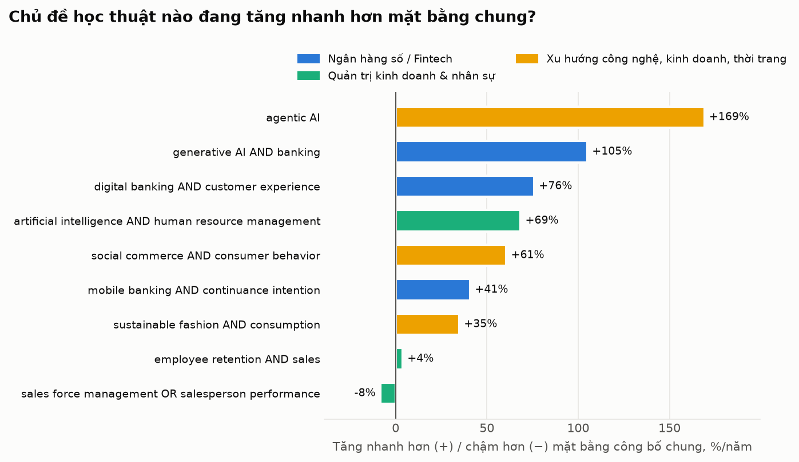
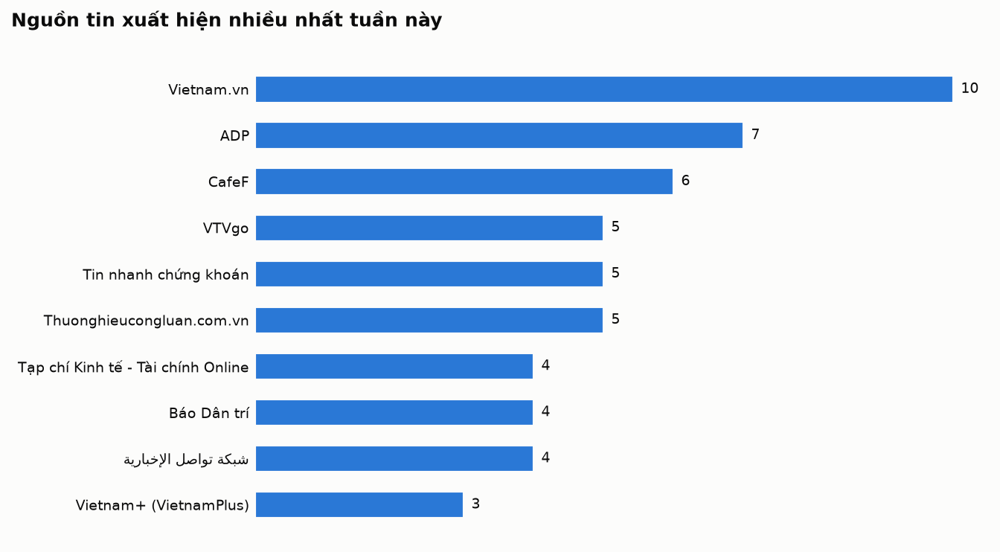
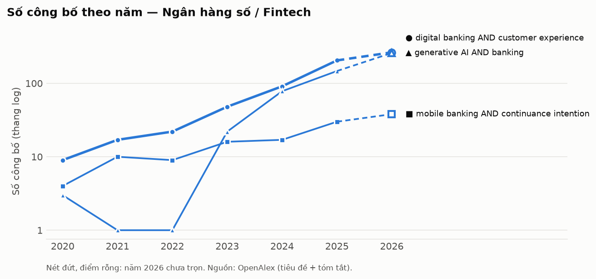
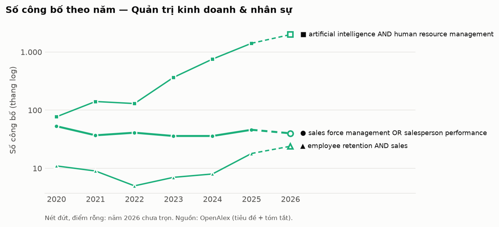
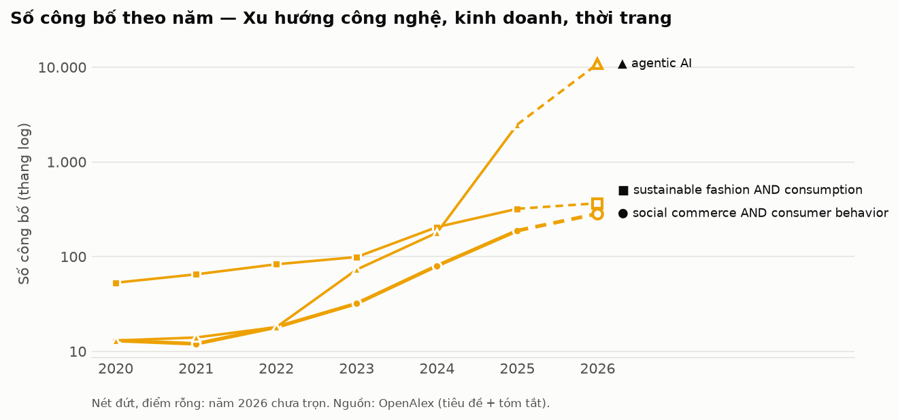

# Research Radar · Tuần 46/2026

> **Ngày chạy:** 09/11/2026 · **Cửa sổ tin:** 30 ngày · **Thị trường:** Việt Nam, đặc biệt Đồng bằng sông Cửu Long; đối chiếu Đông Nam Á và thế giới

**Bản PDF khổ A4:** [tải về](pdf/2026-11-09.pdf)

## Tóm tắt điều hành

**5 điểm đáng chú ý nhất tuần**
1. Ngân hàng số / Fintech — Hơn 668.000 tài khoản thanh toán có dấu hiệu vi phạm pháp luật khiến cơ quan công an siết chặt điều tra các giao dịch chuyển tiền đáng ngờ (Báo Dân trí, CafeF, ngày 07/11).
2. Bảo hiểm nhân thọ / InsurTech — Doanh thu phí bảo hiểm toàn thị trường Việt Nam 10 tháng năm 2026 tiệm cận mốc 200.000 tỷ đồng, duy trì quy mô lớn trước áp lực kinh tế (Thuonghieucongluan.com.vn, VietnamFinance, ngày 08/11/2026).
3. Ngân hàng số / Fintech — Ngân hàng số Ueno Bank phục vụ 3 triệu khách hàng tại Paraguay sụp đổ, gây khủng hoảng niềm tin diện rộng và hệ lụy thể chế nghiêm trọng (nguoiquansat.vn, Vietnam.vn, ngày 07/11 - 08/11).
4. Xu hướng công nghệ, kinh doanh — Chi phí sàn thương mại điện tử vượt ngưỡng 34% giá trị đơn hàng, buộc cơ quan chức năng kiến nghị can thiệp hỗ trợ người bán bảo vệ biên lợi nhuận (Báo Dân trí, Vietnam.vn, ngày 08/11/2026).
5. Xu hướng công nghệ, kinh doanh — Doanh nghiệp đẩy mạnh đầu tư tác tử AI tự trị (Agentic AI) với dự báo gánh 1.800 tỷ USD chi phí vào năm 2030, chuyển trọng tâm sang yêu cầu chứng minh hiệu quả đầu tư thực tế (FourWeekMBA, ngày 08/11/2026).

**3 việc nên làm tuần này**
- Cho luận án: Thiết kế khung mô hình nghiên cứu đánh giá tác động của nhận thức rủi ro an ninh mạng/AI đến xu hướng phân bổ dòng vốn cá nhân giữa các định chế ngân hàng số và các công cụ tích lũy bảo hiểm dài hạn.
- Cho đội kinh doanh: Quán triệt đại lý hướng dẫn 100% khách hàng nộp phí và nhận quyền lợi qua tài khoản ngân hàng chính chủ để tránh tắc nghẽn xác thực giao dịch, đồng thời chuẩn hóa bảng tóm tắt quyền lợi một trang nhằm minh bạch hóa hợp đồng.
- Cần kiểm chứng thêm: Tìm kiếm số liệu phân rã chính thức về doanh thu phí khai thác mới và tỷ lệ duy trì hợp đồng bảo hiểm riêng cho khu vực Đồng bằng sông Cửu Long trong 10 tháng năm 2026, do các báo cáo tài chính tuần qua mới chỉ công bố số liệu gộp toàn quốc.

## Mục lục

1. [Ngân hàng số / Fintech](#digital-banking)
2. [Bảo hiểm nhân thọ / InsurTech](#life-insurance)
3. [Quản trị kinh doanh & nhân sự](#management-hr)
4. [Xu hướng công nghệ, kinh doanh, thời trang](#tech-business-fashion)

## Bản đồ độ nóng học thuật

| Hạng | Chủ đề (từ khoá chính) | So với mặt bằng chung |
|---:|---|---:|
| 1 | [Ngân hàng số / Fintech](#digital-banking) | **+76%/năm** |
| 2 | [Xu hướng công nghệ, kinh doanh, thời trang](#tech-business-fashion) | **+61%/năm** |
| 3 | [Quản trị kinh doanh & nhân sự](#management-hr) | **-8%/năm** |

CAGR chuẩn hoá = tốc độ tăng số công bố của từ khoá chia cho tốc độ tăng tổng công bố OpenAlex, giai đoạn các năm đã trọn vẹn.

## Ai đang đưa tin nhiều nhất

---

## 1. Ngân hàng số / Fintech

| # | Xu hướng | Tín hiệu | Một câu vì sao đáng chú ý |
|---|---|---|---|
| 1 | Siết chặt an ninh và điều tra vi phạm tài khoản thanh toán số | ●●● Mạnh | Hơn 668.000 tài khoản thanh toán có dấu hiệu vi phạm khiến cơ quan công an tăng cường điều tra các giao dịch chuyển tiền [25][29]. |
| 2 | Nguy cơ an ninh mạng và AI tấn công ngân hàng số tại Đông Nam Á | ●●● Mạnh | Ngành ngân hàng đối mặt với 214.000 mối đe dọa bảo mật cùng sự xuất hiện của các công cụ AI hack nhắm vào khu vực [16][17]. |
| 3 | Rủi ro sụp đổ ngân hàng số diện rộng và hệ lụy thể chế quốc tế | ●●● Mạnh | Sự sụp đổ của ngân hàng số Ueno Bank phục vụ 3 triệu khách hàng tại Paraguay kéo theo khủng hoảng chính trị nghiêm trọng [18][36]. |
| 4 | Bắt buộc liên kết định danh điện tử VNeID trên ứng dụng ngân hàng số | ●●○ Trung bình | Người dùng tại các ngân hàng lớn phải hoàn thành tích hợp định danh VNeID trước thời hạn 30/6/2027 [32]. |
| 5 | Số hóa thanh toán dịch vụ công và chi trả ngân sách qua tài khoản | ●●○ Trung bình | Các ngân hàng tăng cường kết nối công nghệ phục vụ chi trả ngân sách và đồng hành cùng cơ quan nhà nước chuyển đổi số [21][39]. |

#### 1. Siết chặt an ninh và điều tra vi phạm tài khoản thanh toán số · ●●● Mạnh
- Diễn biến: Báo Dân trí ngày 07/11 phản ánh thực trạng tài khoản thanh toán có dấu hiệu vi phạm pháp luật; CafeF ngày 07/11 thông tin công an sẽ tiến hành điều tra khi phát hiện các giao dịch chuyển tiền đáng ngờ; Công an phường Nghĩa Lộ ngày 07/11 ký kết quy chế phối hợp bảo đảm an ninh trật tự với các ngân hàng [25][29][31].
- Bằng chứng định lượng: Báo Dân trí (07/11) nêu số liệu hơn 668.000 tài khoản thanh toán có dấu hiệu vi phạm pháp luật [25].
- Insight xã hội/khách hàng: (Diễn giải) Người dùng dịch vụ thanh toán số phải đối mặt với quy trình kiểm soát chặt chẽ hơn, tạo nên mâu thuẫn giữa nhu cầu chuyển tiền nhanh chóng và các rào cản xác thực phòng chống tội phạm tài chính.
- Câu hỏi nghiên cứu tiềm năng: Hoạt động thanh tra, kiểm soát giao dịch thanh toán số (biến độc lập) tác động như thế nào đến mức độ tin tưởng và tần suất sử dụng ví điện tử/ngân hàng số của người tiêu dùng (biến phụ thuộc)?
- Hàm ý kinh doanh: Đội ngũ kinh doanh bảo hiểm cần hướng dẫn khách hàng sử dụng tài khoản ngân hàng chính chủ khi nộp phí và nhận quyền lợi bảo hiểm nhằm tránh phát sinh kiểm tra giao dịch kéo dài.

#### 2. Nguy cơ an ninh mạng và AI tấn công ngân hàng số tại Đông Nam Á · ●●● Mạnh
- Diễn biến: GenK.vn ngày 08/11 đưa tin công cụ AI hack miễn phí đang nhắm mục tiêu vào các ngân hàng ở Đông Nam Á; 24HMoney ngày 08/11 nêu thực trạng các nguy cơ an ninh đe dọa ngành ngân hàng; VTVgo ngày 08/11 nhấn mạnh yêu cầu chuyển đổi số phải gắn liền với an toàn hoạt động [16][17][20].
- Bằng chứng định lượng: 24HMoney (08/11) dẫn số liệu 214.000 mối đe dọa đang bủa vây ngành ngân hàng [17].
- Insight xã hội/khách hàng: (Diễn giải) Khách hàng cá nhân lo ngại về việc mất tiền trong tài khoản trực tuyến do các thủ đoạn ứng dụng AI giả mạo tinh vi, từ đó gia tăng nhu cầu chuyển tài sản vào các kênh tích lũy có tính cam kết bảo đảm cao hơn.
- Câu hỏi nghiên cứu tiềm năng: Nhận thức về các mối đe dọa mạng bằng trí tuệ nhân tạo (biến độc lập) ảnh hưởng như thế nào đến quyết định phân bổ dòng tiền nhàn rỗi giữa tài khoản ngân hàng và các kênh đầu tư dài hạn (biến phụ thuộc)?
- Hàm ý kinh doanh: Tư vấn giải pháp bảo hiểm nhân thọ như một kênh dự phòng tài chính riêng biệt, giúp khách hàng giảm tỷ trọng lưu giữ tiền mặt lớn trên ứng dụng thanh toán trực tuyến trước các rủi ro lừa đảo công nghệ.

#### 3. Rủi ro sụp đổ ngân hàng số diện rộng và hệ lụy thể chế quốc tế · ●●● Mạnh
- Diễn biến: Trong các ngày 07/11 và 08/11, Vietnam.vn, Báo Thanh Niên, Báo Dân trí, nguoiquansat.vn, Báo Hànộimới, Báo Thanh Hóa và TAMDA MEDIA liên tục đưa tin về việc ngân hàng số Ueno Bank tại Paraguay sụp đổ, khiến cựu Tổng thống nước này bị phế truất, luận tội và quản thúc tại gia [18][26][33][34][36][37][38].
- Bằng chứng định lượng: nguoiquansat.vn (07/11) nêu số liệu ngân hàng số sụp đổ phục vụ 3 triệu khách hàng [36].
- Insight xã hội/khách hàng: (Diễn giải) Khách hàng thường đánh giá thấp rủi ro vận hành của các mô hình ngân hàng thuần số (neobank) cho đến khi sự cố hệ thống xảy ra, tạo ra tâm lý rút tiền hàng loạt và hoài nghi về tính pháp lý của định chế tài chính mới.
- Câu hỏi nghiên cứu tiềm năng: Quy mô người dùng của ngân hàng số (biến độc lập) có ảnh hưởng như thế nào đến tốc độ lan truyền rủi ro rút tiền hàng loạt khi xảy ra sự cố sụp đổ vận hành (biến phụ thuộc)?
- Hàm ý kinh doanh: Nhấn mạnh vào tính pháp lý, cơ chế trích lập quỹ dự phòng và quản lý dòng vốn của doanh nghiệp bảo hiểm để tạo sự an tâm tuyệt đối cho khách hàng về mặt giữ vốn an toàn dài hạn.

#### 4. Bắt buộc liên kết định danh điện tử VNeID trên ứng dụng ngân hàng số · ●●○ Trung bình
- Diễn biến: VIETTIMES ngày 07/11 thông báo người dùng các ngân hàng lớn gồm BIDV, Vietcombank, VietinBank phải thực hiện liên kết tài khoản ngân hàng với ứng dụng định danh VNeID [32].
- Bằng chứng định lượng: VIETTIMES (07/11) nêu rõ thời hạn người dùng cần hoàn thành liên kết tài khoản với VNeID là trước ngày 30/6/2027 [32].
- Insight xã hội/khách hàng: (Diễn giải) Khách hàng e ngại về quyền riêng tư dữ liệu cá nhân khi cơ sở dữ liệu công dân đồng bộ với dữ liệu ngân hàng, nhưng đổi lại hạn chế được vấn nạn tài khoản "rác".
- Câu hỏi nghiên cứu tiềm năng: Rào cản định danh điện tử bắt buộc cấp quốc gia (biến độc lập) tác động ra sao đến tỷ lệ chuyển đổi dịch vụ thanh toán không tiền mặt của nhóm khách hàng phổ thông (biến phụ thuộc)?
- Hàm ý kinh doanh: Đội ngũ tư vấn chủ động sử dụng cơ sở dữ liệu định danh VNeID đồng bộ để hỗ trợ khách hàng xác thực hồ sơ hợp đồng bảo hiểm trực tuyến chính xác và nhanh chóng.

#### 5. Số hóa thanh toán dịch vụ công và chi trả ngân sách qua tài khoản · ●●○ Trung bình
- Diễn biến: Báo Quân đội nhân dân ngày 08/11 đưa tin ngành ngân hàng tiên phong chuyển đổi số quốc gia; Quân Khu 7 Online ngày 07/11 thông tin Ngân hàng Quân đội (MB) đẩy mạnh số hóa dịch vụ chi trả cá nhân cho đơn vị ngân sách; Báo Đại biểu Nhân dân ngày 08/11 đưa tin Vietcombank phối hợp Viện Kiểm sát nhân dân TP. Hà Nội đẩy mạnh chuyển đổi số [19][21][39].
- Bằng chứng định lượng: Chưa tìm thấy nguồn xác nhận về số liệu tỷ lệ chi trả cụ thể trong danh sách tin [19][21][39].
- Insight xã hội/khách hàng: (Diễn giải) Khách hàng trong khu vực hành chính công và lực lượng vũ trang chuyển đổi hành vi nhận thu nhập hoàn toàn sang tài khoản số, thúc đẩy việc thanh toán định kỳ không dùng tiền mặt.
- Câu hỏi nghiên cứu tiềm năng: Mức độ số hóa chi trả lương và ngân sách công (biến độc lập) thúc đẩy hành vi thiết lập kế hoạch tài chính cá nhân định kỳ (biến phụ thuộc) ở mức độ nào?
- Hàm ý kinh doanh: Thiết kế và giới thiệu các gói bảo hiểm khấu trừ phí tự động qua tài khoản ngân hàng số cho nhóm cán bộ, công chức và lực lượng nhận lương ngân sách nhà nước.

#### Tín hiệu yếu cần theo dõi
- Kế hoạch xúc tiến thành lập ngân hàng con tại Trung tâm Tài chính Quốc tế (VIFC) của 9 ngân hàng thương mại theo ghi nhận ngày 08/11 của CafeF [10].
- Thách thức nội tại trong việc chuyển hóa công nghệ thành năng lực vận hành tại ABBank theo phản ánh ngày 09/11 của VIETTIMES [2].
- Thị trường khu vực Đồng bằng sông Cửu Long: Chưa tìm thấy nguồn xác nhận thông tin cụ thể liên quan đến địa bàn này trong danh sách tin.

<b>Nguồn tin (40 tin, Google News)</b> — số trong [ ] khớp trích dẫn, ★ = được trích

- [[1] Các ngân hàng thu hàng nghìn tỷ đồng từ hoạt động dịch vụ - Tạp chí Kinh tế - Tài chính Online (2026-11-09)](https://news.google.com/rss/articles/CBMiowFBVV95cUxNLVFVSEZvX0tFWWlDVDJrMDh2c25USUJBUzJBU0JSVHlPOU9xbEFOUUh6SFhVYTRUdXlqaVM0dTdSaWtJYXJkSkxZRVFCcFZIcHF3WlMtUVBLYWlLSnQzNURTWi11RWJjZUdFcjB4OHVaeC1tNHU5ZGUyU1lUd0l3a28xbThVYmg3azlrQUVadko4ZGFpTXdGcEtLQjhqbG9kaXRj?oc=5)
- [★ [2] ABBank và bài toán chuyển hóa công nghệ thành năng lực vận hành - VIETTIMES (2026-11-09)](https://news.google.com/rss/articles/CBMiogFBVV95cUxNcGxyZVNRT00yeC01WEw0MDZfWWJnQXNzdGdCUmhkZ1F3NXl5TWw1Mlc5SGhPMlIxMnZOZjV1YmU1Z09YM0U4NURwRDFmcVR4TnlQRDBoSXI0QXE3ckVUTm1nd1NzU2NaUmJBaVZsRjVlMlFLSThXSXluMjk0azlNZUllU2FFc2Y5amRuRDgzeGFrbFF2MXVZZ1hQQVZiNzRIanc?oc=5)
- [[3] Diễn biến trái chiều tại các nhóm nợ ngân hàng - CafeLand (2026-11-09)](https://news.google.com/rss/articles/CBMijwFBVV95cUxPMkdvNHJoYU5wTDdESWhEMzlKSUo4ZWRuWVJVX2l5U2FqUGZCdThKOUFOZm93SDZsVDBReDBLUjBIdlBVSXJycERSbW9WNWQxLUhULVJjdnhDWHZmZXRmRVljN1dUZVNpelNHN3VNNE9ydVFlWnF3S0M5cVEyRkoxYXRHZnRyckJROTFHUkl2WQ?oc=5)
- [[4] Ngân hàng Việt-Nhật: Kết nối dòng vốn, mở rộng hợp tác đầu tư - Vietnam+ (VietnamPlus) (2026-11-09)](https://news.google.com/rss/articles/CBMipAFBVV95cUxOUkVRMi1yLXQzeDlaSkF6LWhzSTNTUV9NalRlRm5DZl9pazdOVEFqZV9Yc0tVaDhqVHBjdWZ4c1J6VkpKOXZrWnRVZzhpSHF3OVduaEpzVW1pQ0xFcnB5d1RuZGtRVl9neGh6eHJDU0dvV1FMc09GQkVxMUQwRmdSUm9mMzdqN1pZXzFJZldaTTluMTc1UXFsb29XS1FXWDNRdUVxdg?oc=5)
- [[5] Tổng giám đốc TPBank: Muốn hút vốn quốc tế, ngân hàng phải nâng chuẩn quản trị - Báo Tuổi Trẻ (2026-11-09)](https://news.google.com/rss/articles/CBMiugFBVV95cUxOUGhVMEdJS0Yya3hMeTZCYjhwMlNPWExaV1hWalR5TWFaNk9DSEJoNU02RC0wYXlCdF91OUtSSlFZamRIbHZDVEJCR3U5cGNSTFcwVGJKSVZ3ZDl4cHA5QzBKNzYtNG56QVBkeFdQZzNmU0JUN1BWeVFpb3l6ZGVoV3FER0duY19XcTlmU0stRkJSTlBWbVg4YjNENDhFNk4yLTZuaXFueGpuNi1aRXdIbE15Vjl5cGpITXc?oc=5)
- [[6] Nâng cao trách nhiệm bảo vệ người tiêu dùng trên không gian số - Báo Phú Thọ (2026-11-09)](https://news.google.com/rss/articles/CBMimgFBVV95cUxOUnlibS00UVVNMUZTQmNDRktlQ1BSOHlSN0plY0s2WTVqd0I2Mmc5WjRsYk9IZ1lnTjRhNks0TmU2cFZ5a2VwMXVqVkpUajVMSVl1R0ZqUTdXLTNRdm1NbTBGOUZDbXh5MEV4NW1YSUZDU1RYT2g3TnlkWEFYWC1TT1BYLUVLTjRUZFA3aWxZa2N6ZjhTQnVpMENn?oc=5)
- [[7] Ngân hàng số VCB Digibank – Dẫn lối tương lai - VTVgo (2026-11-08)](https://news.google.com/rss/articles/CBMiQEFVX3lxTE9PTjUyVXRsdjUzMFZGcDI1RmkzR3FFRmxIWEZFS0F3THo2RnNKNE92ckhhNWpkbW9rR2Z6aC0wV3Q?oc=5)
- [[8] Tỷ giá USD hôm nay 9/11: Tỷ giá tại các ngân hàng ổn định - VOV.VN (2026-11-08)](https://news.google.com/rss/articles/CBMinAFBVV95cUxPaG1ZOExCemF3VmVqQlNLR0d5czd5OXp5aV9UdjJhb1lYLXJOV0VGRmlQWUJsUEZuTndPYk5XYjhFcU5UeXVCeFpwRVN3ZDFWWmhQN05BRkJiQndqTkNKbFFSNHhlUndZU0FMV2lPMmgzZFE2T0IwaUxJM0N3NVNxeV9EZ1dIbWdDbEFKbXVNLTZISnBqaEVJcjNDOGs?oc=5)
- [[9] Lãi suất ngân hàng hôm nay 8.11: Lãi suất đặc biệt lên đến 10% - Laodong.vn (2026-11-08)](https://news.google.com/rss/articles/CBMiowFBVV95cUxQcGhhRElrUGVnNml2NVBfMVQ3UmJ6ZVFtZkNRTGoxVENEMUh6X3B4NHowQnRBNnY0OHppYmU3djktbENRS1pmNjBGeUFJWUhWSjJFYTZCaHdSUm9jWWhwUlg5SlB3X2JDR2lOckpwTFZkZzk3a2lfWVhlTmdmR2xuU0M1QzhrNDg0eWNZejREb2VMZ0RGLUVBQV96NWlfVnVYcGRj?oc=5)
- [★ [10] 9 ngân hàng xúc tiến kế hoạch lập ngân hàng con tại VIFC - CafeF (2026-11-08)](https://news.google.com/rss/articles/CBMinAFBVV95cUxNejRqQ1gwTV9XWTd6Z2lVa1BoRWc2YzJzeWVQcjU0NnNrM1pNc09wR2xQT2FzSzZleHJXbFJPaVRQNFhWNkp0bE12NU5xRjV0S1I3WFhwRWRNdzBMQmpSN0Q2cFFYZ2U2eGdhVF9oVkxmNmJuZkR4eWV2LUxKTlA1OV9zZkxiTHdnVUVCNWk5NFRBWFJxeWoxYnBPQkE?oc=5)
- [[11] Góc nhìn chuyên gia chứng khoán tuần mới: "Đo" triển vọng nhóm cổ phiếu ngân hàng - Tin nhanh chứng khoán (2026-11-08)](https://news.google.com/rss/articles/CBMixwFBVV95cUxNT0QtT0NPdWZyQXBTeXhFcUwtLUQ4Nmd5MVBNbG9zenVlRG1VX2VPV1czcmFTbGVHQXkxSXFpeURwYlR6R2NZT1hpdjJXa0xPRjZDZ3FxTFBYa2JNOWcwbmJxU25tcUUyaUJkQmdjcy11a0I4M0dveDUyLWdVWTI0YTEwdHF4all4R0lnRGNkbXQ2bm5OMG9INkhfX3VLYTdaZEZ0MG15QVNYRFZjOW9kaDJXLS05aU9XdmVIaEpFWjQ3T3NNT2sw0gHDAUFVX3lxTFBHektXU28tLUpSQkdNSHdjN0FIam5xSkw3VGtWSHNsMWZaQkRnT1VOS1FEZTJlNm54RHNHNEo3VnVRYVA4X3BBeFdxWW42S2d5cm11dWdlTTNtTXJHa3A1ZDloN0RZb2NFclFVYkFXMmxuTjE5YWJvalJ3aDJwOHB4V05NY3VUcFdiMWdqMEFqZnVWSzdUbzZiZ0ZvM0VxV3NiX29CT3lWSXJZRUQ2bnRZRnI3QURBRTkzUmdwejdmVjh1QQ?oc=5)
- [[12] Lãi suất ngân hàng ngày 8/11 tại Agribank, Vietcombank, BIDV, VietinBank, MB, VPBank, Techcombank, Sacombank, HDBank,... - CafeF (2026-11-08)](https://news.google.com/rss/articles/CBMi4gFBVV95cUxQWV9JNlhjMUVZQUd3TG53S3RtSFFvVFd4UEc4Tm9tSzNubWE2R09xY01HN0FacVhadGZkVGRpZjBqN0JJb21xQjBScVhjWUFhb0hFUzVVb1o0WUQwekVYdEhvbDlxR0IyUkU5cVBiT19VSGJEalJhakh6QmdJMWxtOWlIMFhIeEppM3VPTWQwX21KN0NWRkhFUVN2RmNyeTByUlRFT3RlT2tqSmltZ3lfcDBKTy10STJzNm1yNHBTRkRmZ3NXaXg4Z1pxMl9faTN6SjJaZEN3bHpDbGxGeVZLMEFR?oc=5)
- [[13] Lãi suất niêm yết giảm, ngân hàng vẫn tăng ưu đãi hút tiền gửi - Bnews.vn (2026-11-08)](https://news.google.com/rss/articles/CBMilAFBVV95cUxNLWdrZEYtVGw3Vm4taEJzSGlva05xNjZKVTlkeDB1Vi0xR0Uyd2hrZmFqVWplQ1dwXzNsNURKSkhOYlBibm5qR2ZVTElCczVuaERyWTVRVF9PN3RvYXhOWFdxSzN0aXlMMkV6U0J2andna1RVNDNxTk9CY0VTb0VZdTRpajk3NGJrQU5BQ09YRVhlNXdX?oc=5)
- [[14] Ngân hàng quản lý tài sản bảo đảm trái phiếu có phải trả nợ thay doanh nghiệp? - Laodong.vn (2026-11-08)](https://news.google.com/rss/articles/CBMiugFBVV95cUxQaFNFQUNXX3hKNmFJN0luWTFBNEo3djh1SFVaM0VsTDE3LVRfU1h2WFMwRjFlUkt3dnFiQmlXaElKZmJmS0Judk1WbzZnZGlJanktNFdvUW55cG9ka29RR0FESERwRWhaVlJydjZxYjRHSkc0MEZvcktlVlRqYUJRckhXODh5cS1RM3NaT01LeExuQjBOYlhTbnhHMDRtc0ZhUFY0YWNSQ1J0b0Vra1N1aW12aUhZUjhZWGc?oc=5)
- [[15] Gửi bao nhiêu vào ngân hàng để có lãi 20 triệu đồng mỗi tháng? - CafeF (2026-11-08)](https://news.google.com/rss/articles/CBMiowFBVV95cUxQMmVhVHNyOF9Qa2tvY1N0a0pjQXF3TGNvMTJVNHVFVG9seEwyQmNmS1FMUTdqWnZESWlvRUtQYmI2c1U2WDZMMTMwOFhGYkdrQ1ZUVnBoMTV5WmhrUl9iUlcxRnFBbUFUeGh3d3p0c2ZxTWtmZnVtTVZGYTZlX3Y5SnRsUTI2bGR3T0NqeTBNekR0M2ZUczB6Tlo3ZDRCLUNtcXlv?oc=5)
- [★ [16] AI hack miễn phí đang nhắm vào các ngân hàng ở Đông Nam Á - GenK.vn (2026-11-08)](https://news.google.com/rss/articles/CBMinAFBVV95cUxPRF9qeVAwazVhamhucHlJV2JKYzVnY0oyRVhSai1TSmlONmZNa3B5ZTBvTUpEaENROUI3T01tQWtMWU0tVFpPRmQ1MXJORmZkY19JMnhXNU85X1RPbUhRelhUU0FMcW1VT3BtemtpYVZmY1Nod29UX2pnWUExTllwWFM4ZnJrd3dGZ29SSEtXTWN6UXhlanVlZWgwUkQ?oc=5)
- [★ [17] 214.000 mối đe dọa "bủa vây" ngành ngân hàng - 24HMoney (2026-11-08)](https://news.google.com/rss/articles/CBMijAFBVV95cUxOcVZNYjVYSXNCODFBVjNlUkltbEtTVmhzREtSaG1FT1N0YU5fdzJWZkVfTzZ6amZhWlRCLWY3RXFxY1RlZmMxTlpyNVFBZVVwMFZWODJxb1NCZUZCZFZnREZkOGRnOGQwUTBMczU5NFRYTm0yZWVVTExoSm5UUU13N0ZzTnRuZGRMZ3F2cQ?oc=5)
- [★ [18] Ngân hàng Ueno Bank tại Paraguay sụp đổ như thế nào? - Vietnam.vn (2026-11-08)](https://news.google.com/rss/articles/CBMif0FVX3lxTE1PbnZ4NjBVaHdQTFYwTmNNd09WU3k1UlBZSHBoc1p4LVhEOWhfN1BoUlAxbVRfb1RxNUFZeFFIcFRHN1pwYTM5alQ2Nm05VUpkSE51d2tBcUZ3dXVab1hqTWxDR0piNl9KQUlZM09yWVZhMVJYZTZQMTBTdWdfOFk?oc=5)
- [★ [19] Ngành Ngân hàng tiên phong trong tiến trình chuyển đổi số quốc gia - Báo Quân đội nhân dân (2026-11-08)](https://news.google.com/rss/articles/CBMirwFBVV95cUxON0w4T0dEOFAwbEZSSVV5NWRobFh2eHgyQlZydXRyWWRJZGZlbFg0eUVoWVQ4eEJOVF9GdjdOeG92a0JGVjVCZXZObTRuc1d6YjA2ME9tYjB6Q1ZSYWxjWkhXSElKVWJFcXdiYko5Y05ZU3NCNE5XVkRlMmJjb0trY0VWSlZiX2VTZXNVR2wxMjQxdVhUTjQxZ2dVcG92ZnRUNWlERW1wRW1iZGVYbU9r?oc=5)
- [★ [20] Chuyển đổi số ngân hàng gắn với an toàn hoạt động - VTVgo (2026-11-08)](https://news.google.com/rss/articles/CBMiSEFVX3lxTE05NHFjX3d6bDN6ZC1CYjhKQWRlX0l0b1VSVkxiVnRCUnZQSEFmZWZ6UEI5WjdFUnJ2X0lFZTdOZENad0dNalR5TQ?oc=5)
- [★ [21] Vietcombank đồng hành Viện Kiểm sát nhân dân TP. Hà Nội đẩy mạnh chuyển đổi số - Báo Đại biểu Nhân dân (2026-11-08)](https://news.google.com/rss/articles/CBMiuAFBVV95cUxNSU5IQWROX3hNcDJoSzJXSUJXTGcwemxPLURaRENBM0NZY1ZVTlVDbUlVRDNFTlBrQVNzTEVxdGY3SHpQRk5fUlZ0Ykt5ZzFSbG1oRmtLLVFiZkxBWDZuUzlfOFAwaDZ2Vmp4dWwxM0tnTk9MTjN3N2Z6M1FLbFN6Rmg3dlR0RVUxZzNOYVMzWE9OOFVtQm9pRWlLOC1SWGZGeGNDUl9abXFaeURrZU9KcHM4OUxFSlEy?oc=5)
- [[22] Kinh tế số thay đổi yêu cầu tuyển dụng và tìm kiếm việc làm - Tạp chí KH&CN Việt Nam (2026-11-08)](https://news.google.com/rss/articles/CBMikAFBVV95cUxOM3dXRmxhSlNBNlRqd3VibWFSaDRlaHNydWJmckNteS1SelpxZzRwWExERV9kT3Y3Mkdibm1zSG0xZ1FqQVBhMmI0RjJkemZQM0NadEZlNlZ3Qy1WblV0LXlkaEtXSXVRMURXdzEyWVlLdTFZbG9VTUNCaE9FUFhVd2pFZzRIQ3RScTJ1Z2NmaTA?oc=5)
- [[23] Yếu tố nào sẽ quyết định sức hút của thị trường tài sản mã hóa? - Báo Diễn đàn Doanh nghiệp (2026-11-08)](https://news.google.com/rss/articles/CBMiqgFBVV95cUxOTmREblZIMmlLMmNGcTl0OGt2Q3dxV0xWaTYwRU04elZlMmtZU0tJa0Y3N3cyaUFnRHBlSm5yY01ZajRpRUtuTW5PRlNmSmdWT1lvcEp2X3RVQi1lTk5pT3lFa0VrYU96WFYyYllFVUJrUmxXOVgtVlYwNE5tSkx0dS1SZF9tOEp1Rl9uOHA0aWpESmxOa3dlSnJNTmt5cnY1a1JWNUp3cHdOZw?oc=5)
- [[24] Singapore, Malaysia to raise cross-border taxi quota, add two licensed operators - VnExpress International (2026-11-08)](https://news.google.com/rss/articles/CBMi0wFBVV95cUxOUlpYZ2xTUWJQelItMF9HanpZaDQ3QnFQRndRNG1YRGptOTVmekpOS1VYVFdVcWlGSEY5cno4LVFfd21FODNDc2NKUG9mV2NWUTZqczlzYzFsMV9UcG53TUZ1b3lEeXpBZkdrMXVYRjYzeHJhdmtsRi11N2FqR2FvWmFHRVpYRzRJZHNobzVmdFNhUXdrZi1PZ1R4RDJtNkZ2MHVEZ00zTmdIWHJhVzNreTczelVxVjV3TXE0blk1OW5RUzBkVklwOEFVTndKVEhzOEg4?oc=5)
- [★ [25] Hơn 668.000 tài khoản thanh toán có dấu hiệu vi phạm pháp luật: Cần làm gì? - Báo Dân trí (2026-11-07)](https://news.google.com/rss/articles/CBMixgFBVV95cUxOMWQ0aGFwYk5FNzltdGVmVVpSRVZqZi15VWxZSExRS2FmTnp3aUkxWFpzUTFIb0c3dXRLcHNvV1Yzc0kzNGV3RVB4Y1BnLWxRSlNkZm50MERqMEpvMGlUd054QzRuN0pqVmNndjRNVURfbDR0VDl3SkhQelgzYm03dHhabnZlOEtEZ1d2RHE2NHlVZ3B0NC1NQWc3RzM2Wlo3XzdKbldyVnFId1VYNjNQVlFJektSdWJDRWJ3V1k4a1ZIZWVpZGc?oc=5)
- [★ [26] Paraguay biến động lớn sau vụ ngân hàng số sụp đổ - Báo Thanh Niên (2026-11-07)](https://news.google.com/rss/articles/CBMimAFBVV95cUxOWEViaEg4WVN0NGdseTNaZ0VDMmtkd1pzcWxUWXBvdk02Mmo4R2YtbFh5a0NsZjloTjItamhGSU5lWmc5eWx0V1daZFQ5R3UyS1VubzBxdmVqR3dILWNrUjZ4Zk16U2ZWMXEwcGRGaU8zaW80cjdKZlZRZ3hhNWZRSTlhSW5aNzR3a1BFTUlZazBQcTdTcWZqbw?oc=5)
- [[27] Quy mô tài sản các ngân hàng Việt tăng nhanh: Ai đang dẫn đầu? - Báo Dân trí (2026-11-07)](https://news.google.com/rss/articles/CBMitgFBVV95cUxQN1dyVmxHVVpxdUdIbmZhcjNCYmhJRUVPMmF1QVdBZDFhbGcxUDJ5dURaQ1VYZmtRYTZQZ3ZnTnBLQUYwZWRyeERYX3BpVUdOWW5SNWliVEdpYWhTT2NZWmd4MXExUllSMFRNUlF4Uy14SXQtTjdBYjc2a2E1eVM4X25zQzBoTURuWlMweTEtOFE4V2JvSE5PZ2RWRjdKWWR0MWQ4UDY0WWw3SkpvcFRabTRVUGhyUQ?oc=5)
- [[28] Lãi suất ngân hàng hôm nay 7.11: Gửi từ 5 triệu đồng, nhận lãi suất đến 9,1% - Laodong.vn (2026-11-07)](https://news.google.com/rss/articles/CBMiswFBVV95cUxNYkcxTFJNYzV3S1lwaFppcV9jYkQ2azRmaEttSVJlaEFmNGVTV1dWN2RlazdYZVY4NVgxdmxUOEhhU3B3YzhSYkJKakRSUWpvSlhqU1pzRkVYRUNzTGdBSlhEcnJNRFQ1elhERFRqMVA0UmtnQ0NjT3NjVU1lZmE1eEduYW1feUZpWXVOYmJXYkpaYktFM1NNN0tZMldGSFdkNndDQkZacVlYdXlCcjZySlRqaw?oc=5)
- [★ [29] Công an sẽ điều tra khi phát hiện tài khoản ngân hàng các giao dịch chuyển tiền như sau - CafeF (2026-11-07)](https://news.google.com/rss/articles/CBMixgFBVV95cUxQQjNXVkZiOFAybWtzUFdqQTktWWJTX1dWN2RUQndvOFRDcU1DWUpFYm80UEZPWi1ZUHZGNUxIbWF1TXZLMGlkeGtwWF9KZUU0am9vR1FYYXBXZkZ1VGhDSzVhWGhVUHU2elFJR0pZMmVVS1ExeWdScldmaWM0ZEJ5bXpFVFg3dlFnSmRyTkVFOWVfUkZRRzJjZWIwT1FkTzJmYnBzQnZQaG1TaVJLMDF2ZW1qOWNFRnJmeXA5TF9Ca0tsYVNjZFE?oc=5)
- [[30] Ngân hàng NCB tăng tốc trong chu kỳ tăng trưởng mới - Tạp chí Công Thương (2026-11-07)](https://news.google.com/rss/articles/CBMilAFBVV95cUxPajNKWERxY3BDRVd1TVFCeTJEUXllMTlUMVVWeE1jblVmNE1yRGFQM0ZEN1NQR1k3WmFqeDZUTkV2ZGdBanJiakpqYkdWZ1BvdjdhaFBFY1V3d25uMW9oUGpIdU1sVFN6WHhrLWFKSjU4LUJKWkhraXlNYlFOcW5BOFZQNHp6STlCcFFZYkU2ZC0zZ2Js?oc=5)
- [★ [31] Công an phường Nghĩa Lộ ký kết Quy chế phối hợp bảo đảm an ninh, trật tự với các ngân hàng, cơ sở ... - congan.quangngai.gov.vn (2026-11-07)](https://news.google.com/rss/articles/CBMinAJBVV95cUxNLVZEMU5xLWQtcUxJdHZQX3doSmhBeVpndUZqc1FCYV9MUHlPQlBHYklyRWxrVFF6Z1I0WkJMZmdKY25NUTQ4OXdyZUlvV2d2SlJublctaXZvaXlXaFBOVjh4U1ZMWS1rRHdVNnpOcFpLb08tUExkcFhYQlE5aWNZNFhEU3hmZTJSTE5GRW5Kc1JMUVhncks1al9keXl5T2JsaWphcXV2dy1MUlcwM2pKRkd3TFBNZzlrZTU0NlZuZlFRM0JXSTJrTllLREFNcWtzVFNTYXhieFJNQk9yMEo2QlA0Smk2WjJRN2p0RHpPY3dHSlh5RjIwMDlvQ1hLS0EyQWxJNS12Mnp0NmFkbmdHVUtuRGtvbm5ub1NTNw?oc=5)
- [★ [32] Người dùng BIDV, Vietcombank, VietinBank... cần liên kết tài khoản với VNeID trước 30/6/2027 - VIETTIMES (2026-11-07)](https://news.google.com/rss/articles/CBMivwFBVV95cUxNUFR1Zy1mY2pLTGdNeENvS045UFFEQV8tSHQ3Qm1BOHdmY2RsZHlsVVR0bWpGZ29JNUp2VHNkTFRYM3RuazZkY1hWaGdSMFp2Wm0tZXlhY1RsLUF2VVZxdW9HU2lLVzlBeFp1UlA5a3pMcGROeFpBV3VYcUJERDJlM25nTnhQUUh0cS1JTURCZjdEWm84UVVRM0I1emRYTmNULVd4Q2RENFVvR09PX09ZZnM2YTVGbHZhTUZ4b1ZTTQ?oc=5)
- [★ [33] Paraguay có Tổng thống mới, cựu Tổng thống bị quản thúc tại gia - Báo Thanh Hóa (2026-11-07)](https://news.google.com/rss/articles/CBMinAFBVV95cUxQdlJWVFdQY0UwSGdnelNsUWFaUVI1MlczdklEZGIwV2kwM0Z0TVB0eTBmNktLVTQ3Zi0xTUZCV0ROYXRwdVJ0TnF5NnFmNmwtOENLU2haRnpGMElfSUdnWjkwRWU0RW9taTY2MTZncmJTbXlGa2xUTmRNZUJrRXV5NENpczk2SnNiTTYtazgxM2lZRnJ4dEdUYUY5X1E?oc=5)
- [★ [34] Cựu Tổng thống Paraguay bị luận tội, quản thúc vì vụ ngân hàng sụp đổ - Báo Dân trí (2026-11-07)](https://news.google.com/rss/articles/CBMivgFBVV95cUxPX192cVZfZ1lFVVUzYUVCRkE0OVBrQUV1Sk5teHkwWkhCdW03dERuMUZOTHA0a1BGSlFHWWV6b2RiX2E0QzhUVFA3TlFUQ3ZxSXFhT2tqNXUxYXFzT3k1Y0F1LUwySjk1NTlvR2RHMlEzRHF3ZFdHZmxpNWpVMjQ5aWZXd05sak1YNXVCUHRaWnJVRVFHOEFaMm8tOTJDam1YbldFblE0YkUySEVhRks4aUtOdGFSTTZVemxlMGt3?oc=5)
- [[35] Lãi suất ngân hàng ngày 7/11 tại Agribank, Vietcombank, BIDV, VietinBank, MB, VPBank, Techcombank, Sacombank, HDBank,... - CafeF (2026-11-07)](https://news.google.com/rss/articles/CBMi4gFBVV95cUxQZXlwbE05WXRNYXowOVN2Z0lxWS1jZFhTd2ppZGctdUlkc3FkUkNzWEI5WWRQSnFNd040cGZDSjFtdGUyZkFOVURnTHExcTJma0hSVDYxU05EN1h3UHBOY243dThJeXBXZGRWdHJLTndoeUVTLW9GUlh0MHhYcXV6RklqT19DTDZVRk85T0pQcmpyMm1GOGhKdGJBWmh0S3N6WlNIcV9QZVRnVEVSREJ3NTFZNHRUWGtfdTlSMG9XSDh3dFBsTGZjTTZ4WlNqSnA3UHpNbFF6ZEdJTHpMYXBtNHZR?oc=5)
- [★ [36] Chấn động: Ngân hàng phục vụ 3 triệu khách sụp đổ, Tổng thống Paraguay 'bay ghế', bị quản thúc tại nhà - nguoiquansat.vn (2026-11-07)](https://news.google.com/rss/articles/CBMizgFBVV95cUxNZ1F1NHlOazdxdVpiZUM0TGo0MkxxVjh5RkdmQ2ZyNUY0NTFLRU9SQjJpS1JSTVlhSmNrNXVvWjBRLTdFb1E5elNxVVo4QjZ1alZBQlk3OVBtSWU2bm9fT2Y0ZnpKSWNIR0pHVnFLQ0daQ1ZuR19RWDNLQkR4NTNIbzY5OWJMN0VtVTd3ZU4zTGs4UWs3VnZkYWJqcjZodnF2blRGOTBGVXZsMHh1X1JQdHgwVnRNSFRhQjB6SFhqQ3pGZVdMVTRSYnIzdGR2QQ?oc=5)
- [★ [37] Tổng thống Paraguay bị phế truất trước cáo buộc liên quan ngân hàng sụp đổ - Báo Hànộimới (2026-11-07)](https://news.google.com/rss/articles/CBMiqwFBVV95cUxPcW42dTJjSUtRVW9nQ01yREd4b0ktQ3Y2S3FzeDRTdk4zUWdaRkdNZkUtdkVwNkJrbTZyNERfelE5TXFMZjViOGhOZWQxc0hzeExOSjRWNlN6NTUta1B1TGh2Yi1NeEFvRGZHUG9VWW9VWnhXbzIwV2s2R1p0UGcxX0xETS1EMld2QmM4dEJvTG13alU1QXJ4V3JwX1pOSVFaek40MEVvcHhISFE?oc=5)
- [★ [38] Tổng thống Paraguay bị phế truất, quản thúc tại gia - TAMDA MEDIA (2026-11-07)](https://news.google.com/rss/articles/CBMifEFVX3lxTE5VSVZLbmVaLTF3X3JTRUhkaVV0bER4TG01NlBaUmJmajFMQ0VIaDFpeVRpWW1nUVJHQWpELVF6c0lhRmR3aVdDb0pUTGh2N0MxWkk4R0RhOEkzZzVCYmswNTh0Y1NtV19HQ0tFM1FBMWQwbnRvY0pCbC00aTQ?oc=5)
- [★ [39] MB đẩy mạnh chuyển đổi số dịch vụ chi trả cá nhân qua tài khoản cho các đơn vị sử dụng ngân sách - Quân Khu 7 Online (2026-11-07)](https://news.google.com/rss/articles/CBMi3gFBVV95cUxQM3hteHZROHdTUHhDcG1sRUFGTVpjV2YtRENaWWpZX3psZkRZRkVyQnU4ZklUQ1YtQXdKLV9zZmE5NGY5ak1rZXprQkQwcHFtU1JOS3E3STZaYXEyUVFnd0FqUG9DdGFzVGtDc1BhUzkyM0JvMDZDd0JENG1ZMC1jRnUwVDZxeVBRR28tWWIwU2ctSVA0dEY2cXVNQnNnY0VQSFd5alZTdGVVdjg1V3FXNTA4SW1RNjdQUFgyc0FpYUh5RjBnRlhEUklqdGtCTDE4ZEd6T0pXbU9lMHAxQUE?oc=5)
- [[40] Chuyển đổi số trong thi hành án dân sự: Từ đổi mới phương thức quản lý đến nâng cao hiệu quả thực thi pháp luật - chinhsachcuocsong.vnanet.vn (2026-11-07)](https://news.google.com/rss/articles/CBMi7wFBVV95cUxQYU5kZkdkZ2ZYMDFjSG5KZVRBZlRtaDNqWElPUkE1YzhjNEV2aExKYlZsa3o4MmFaLTAxQk5MY2N0Vi1EQ1pmOUp6Q2NJRGNOZGE4OFEtVUhodE83elJDMm1pRnJVSThZa2VxVGlGSUZMMllwRjZOSEF1X1QzNnhJTGVnX1NabFB3azllYU9vS3ZUdTAzUkVmTHRKN2tCUFhDTmlKbWxXdzFnb2RJOXJtOU1YN3djNmVPc2dPdlNrdUdMQzZzMGtUQktjcTJtRWpYZDh1b3VkSUNTSWFRb0d0RjZaUUdabWd4c3dHRDByYw?oc=5)

Mô hình: gemini-3.8-flash · Truy vấn: ngân hàng số; chuyển đổi số ngân hàng; fintech Việt Nam; digital banking Southeast Asia; generative AI banking

### Học thuật đang nói gì

| Từ khoá | Công bố năm gần nhất trọn vẹn | CAGR thô | So với mặt bằng chung |
|---|---:|---:|---:|
| `"digital banking" AND "customer experience"` | 205 (2025) | 87% | **+76%** |
| `"mobile banking" AND "continuance intention"` | 30 (2025) | 50% | **+41%** |
| `"generative AI" AND banking` | 147 (2025) | 118% | **+105%** |

OpenAlex, tìm trong tiêu đề + tóm tắt; chỉ là tín hiệu trắc lượng, không dùng làm cơ sở nội dung lược khảo.

<b>Bài được trích dẫn nhiều nhất 3 năm gần đây</b> (cần kiểm tra toàn văn, hạng tạp chí, tình trạng rút bài)

- Impacts of digitization on operational efficiency in the banking sector: Thematic analysis and research agenda proposal (2024) — *International Journal of Information Management Data Insights* — 191 trích dẫn — https://doi.org/10.1016/j.jjimei.2024.100230
- Continuous intention usage of artificial intelligence enabled digital banks: a review of expectation confirmation model (2024) — *Journal of Enterprise Information Management* — 75 trích dẫn — https://doi.org/10.1108/jeim-11-2023-0617
- Green Finance and Fintech Adoption Services among Croatian Online Users: How Digital Transformation and Digital Awareness Increase Banking Sustainability (2024) — *Economies* — 67 trích dẫn — https://doi.org/10.3390/economies12030054
- The impact of digital banking service quality on customer loyalty: An interplay between customer experience and customer satisfaction (2024) — *Asian Economic and Financial Review* — 49 trích dẫn — https://doi.org/10.55493/5002.v14i9.5199
- Augmented reality is the new digital banking – AR brand experience impact on brand loyalty (2024) — *International Journal of Bank Marketing* — 42 trích dẫn — https://doi.org/10.1108/ijbm-11-2022-0522

[↑ Về đầu trang](#top)

## 2. Bảo hiểm nhân thọ / InsurTech

| # | Xu hướng | Tín hiệu | Một câu vì sao đáng chú ý |
|---|---|---|---|
| 1 | Doanh thu phí bảo hiểm Việt Nam 10 tháng năm 2026 tiệm cận mốc 200.000 tỷ đồng | ●●● Mạnh | Thị trường duy trì quy mô doanh thu lớn dù bối cảnh kinh tế còn nhiều thách thức [2][3][7]. |
| 2 | Chuyển dịch trọng tâm sang chất lượng hợp đồng và tính minh bạch sản phẩm | ●●○ Trung bình | Định hướng quản trị và hành vi người tiêu dùng thay đổi rõ rệt sau giai đoạn thanh lọc thị trường [6][22]. |
| 3 | Xuất hiện các mô hình phân phối độc lập (IFA) và môi giới bảo hiểm | ●●○ Trung bình | Kênh phân phối truyền thống đối mặt với yêu cầu tái cấu trúc khi xuất hiện các lựa chọn thay thế [20][38]. |
| 4 | Tích hợp Trí tuệ nhân tạo (AI) vào chuỗi phân phối và thẩm định bảo hiểm | ●●○ Trung bình | Các doanh nghiệp bảo hiểm quốc tế bắt tay với đối tác công nghệ lớn để số hóa hoạt động đại lý và bảo lãnh [30][32][34][35][37]. |
| 5 | Áp lực siết trần hoa hồng và quy định phân phối Bancassurance tại châu Á | ●●○ Trung bình | Sự điều chỉnh chính sách tại các thị trường lớn như Trung Quốc và Ấn Độ trực tiếp đè nặng lên triển vọng lợi nhuận [1][24][27]. |

#### 1. Doanh thu phí bảo hiểm Việt Nam 10 tháng năm 2026 tiệm cận mốc 200.000 tỷ đồng · ●●● Mạnh
- Diễn biến: Thuonghieucongluan.com.vn và VietnamFinance ngày 08/11/2026 ghi nhận tổng doanh thu phí bảo hiểm 10 tháng đạt gần 200.000 tỷ đồng [2][3]; trước đó Tạp chí Kinh tế - Tài chính Online ngày 07/11/2026 công bố số liệu đạt gần 196.000 tỷ đồng [7].
- Bằng chứng định lượng: Doanh thu phí bảo hiểm 10 tháng năm 2026 đạt gần 200.000 tỷ đồng theo Thuonghieucongluan.com.vn (ngày 08/11/2026) và VietnamFinance (ngày 08/11/2026) [2][3]; đạt gần 196.000 tỷ đồng theo Infographic của Tạp chí Kinh tế - Tài chính Online (ngày 07/11/2026) [7]; số liệu phân rã cho khu vực Đồng bằng sông Cửu Long chưa tìm thấy nguồn xác nhận trong dữ liệu công bố [2][3][7].
- Insight xã hội/khách hàng: (Diễn giải) Khách hàng vẫn duy trì việc trích lập ngân sách cho các giải pháp bảo vệ tài chính dài hạn, cho thấy nhu cầu tích lũy và dự phòng rủi ro đời sống vẫn là ưu tiên cơ bản [2][3][7].
- Câu hỏi nghiên cứu tiềm năng: Tốc độ tăng trưởng doanh thu phí bảo hiểm khai thác mới (biến độc lập) tác động như thế nào đến tỷ lệ duy trì hợp đồng bảo hiểm nhân thọ (biến phụ thuộc) trong các chu kỳ biến động kinh tế? [2][3][7]
- Hàm ý kinh doanh: Quản lý kinh doanh cần rà soát lại tiến độ thực hiện chỉ tiêu quý 4/2026 của từng khu vực để bám sát tốc độ tạo doanh thu chung của thị trường [2][3][7].

#### 2. Chuyển dịch trọng tâm sang chất lượng hợp đồng và tính minh bạch sản phẩm · ●●○ Trung bình
- Diễn biến: Báo Tin nhanh chứng khoán ngày 05/11/2026 nhấn mạnh yêu cầu tập trung vào chất lượng hợp đồng trong bối cảnh thị phần bảo hiểm nhân thọ tăng [22]; tiếp đó ngày 07/11/2026 báo này ghi nhận xu hướng người mua bảo hiểm chủ động chọn những sản phẩm mà bản thân họ thực sự hiểu rõ [6].
- Bằng chứng định lượng: Chưa tìm thấy nguồn xác nhận về tỷ lệ duy trì hợp đồng hay tỷ lệ tăng trưởng thị phần cụ thể trong tiêu đề bài viết [6][22].
- Insight xã hội/khách hàng: (Diễn giải) Khách hàng chuyển từ trạng thái mua vì quan hệ hoặc bị thúc ép sang trạng thái phòng thủ, chỉ sẵn sàng chi trả cho các điều khoản và quyền lợi mà họ nắm bắt rõ ràng [6][22].
- Câu hỏi nghiên cứu tiềm năng: Mức độ hiểu biết tài chính của khách hàng (biến độc lập) ảnh hưởng như thế nào đến tỷ lệ khiếu nại hợp đồng bảo hiểm nhân thọ (biến phụ thuộc)? [6][22]
- Hàm ý kinh doanh: Yêu cầu đội ngũ đại lý chuẩn hóa tài liệu tóm tắt sản phẩm một trang, thực hiện kiểm tra mức độ hiểu quyền lợi của khách hàng trước khi nộp hồ sơ yêu cầu bảo hiểm [6][22].

#### 3. Xuất hiện các mô hình phân phối độc lập (IFA) và môi giới bảo hiểm · ●●○ Trung bình
- Diễn biến: VietnamFinance ngày 04/11/2026 phản ánh mô hình cố vấn tài chính độc lập (IFA) tại thị trường Việt Nam [38]; đồng thời Asia Insurance Review ngày 06/11/2026 cho biết Hong Kong Life triển khai kênh phân phối thông qua môi giới bảo hiểm [20].
- Bằng chứng định lượng: Chưa tìm thấy nguồn xác nhận số liệu định lượng về thị phần hay doanh thu của kênh IFA và môi giới trong tiêu đề bài viết [20][38].
- Insight xã hội/khách hàng: (Diễn giải) Người tham gia bảo hiểm có xu hướng tìm kiếm lời khuyên từ các chuyên gia trung lập thay vì chỉ tiếp nhận tư vấn từ đại lý độc quyền của một công ty [20][38].
- Câu hỏi nghiên cứu tiềm năng: Sự xuất hiện của mô hình IFA (biến độc lập) tác động như thế nào đến năng suất bán hàng của kênh đại lý độc quyền truyền thống (biến phụ thuộc)? [20][38]
- Hàm ý kinh doanh: Quản lý kinh doanh cần đào tạo đội ngũ tư vấn viên theo hướng nâng cao kỹ năng hoạch định tài chính độc lập để cạnh tranh với các kênh tư vấn tài chính mới [20][38].

#### 4. Tích hợp Trí tuệ nhân tạo (AI) vào chuỗi phân phối và thẩm định bảo hiểm · ●●○ Trung bình
- Diễn biến: Hãng AmeriLife công bố thỏa thuận hợp tác cùng Palantir triển khai chuyển đổi hoạt động phân phối bảo hiểm và hưu trí bằng AI, được đưa tin bởi Yahoo Finance, TBBW, InsuranceNewsNet và Traders Union ngày 05/11/2026 [32][34][35][37]; cùng ngày, Insurance Business trích dẫn báo cáo chỉ ra AI đang thu hẹp khoảng cách dữ liệu trong thẩm định [30].
- Bằng chứng định lượng: Chưa tìm thấy nguồn xác nhận số liệu cụ thể về giá trị hợp tác hoặc mức độ cắt giảm chi phí vận hành trong tiêu đề bài viết [30][32][34][35][37].
- Insight xã hội/khách hàng: (Diễn giải) Nhu cầu cá nhân hóa kế hoạch tài chính và rút ngắn thời gian phản hồi thúc đẩy kỳ vọng của khách hàng vào quy trình xét duyệt hợp đồng tự động [30][32].
- Câu hỏi nghiên cứu tiềm năng: Mức độ ứng dụng công cụ AI trong phân tích nhu cầu khách hàng (biến độc lập) có mối quan hệ ra sao với tỷ lệ chuyển đổi khách hàng tiềm năng thành hợp đồng chính thức (biến phụ thuộc)? [30][32][37]
- Hàm ý kinh doanh: Áp dụng các ứng dụng số hóa nội bộ để rút ngắn thời gian tạo bảng minh họa và hỗ trợ đại lý sàng lọc thông tin khách hàng trước cuộc hẹn [30][32].

#### 5. Áp lực siết trần hoa hồng và quy định phân phối Bancassurance tại châu Á · ●●○ Trung bình
- Diễn biến: Insurance Business và Sharecast.com ngày 05/11/2026 đưa tin các quy định mới về hoa hồng ngân hàng tại Trung Quốc làm suy giảm triển vọng lợi nhuận và doanh số của Prudential [24][27]; The Economic Times ngày 09/11/2026 nêu việc các NBFC tại Ấn Độ có thể tăng lãi suất vay và phí để bù đắp mức trần thu nhập bảo hiểm bị giới hạn [1].
- Bằng chứng định lượng: Chưa tìm thấy nguồn xác nhận tỷ lệ cắt giảm hoa hồng cụ thể hay mức giảm lợi nhuận bằng số trong tiêu đề bài viết [1][24][27].
- Insight xã hội/khách hàng: (Diễn giải) Cơ quan quản lý thắt chặt giám sát nhằm hạn chế tình trạng ép buộc khách hàng vay vốn phải mua chéo bảo hiểm, dẫn đến sự thanh lọc mạnh mẽ đối với dòng sản phẩm liên kết tín dụng [1][24].
- Câu hỏi nghiên cứu tiềm năng: Khung pháp lý siết chặt hoa hồng bán chéo qua ngân hàng (biến độc lập) tác động như thế nào đến tỷ suất sinh lời của doanh nghiệp bảo hiểm nhân thọ (biến phụ thuộc)? [1][24][27]
- Hàm ý kinh doanh: Chủ động cơ cấu lại danh mục sản phẩm của đội ngũ kinh doanh, chuyển trọng tâm từ các gói sản phẩm ngắn hạn liên kết khoản vay sang các hợp đồng bảo vệ thuần túy [1][24].

#### Tín hiệu yếu cần theo dõi
- Hoạt động kiến tạo nền tảng dữ liệu bảo hiểm số tại Việt Nam thông qua việc Pegas Next tiếp quản NDH.vn (Báo Thanh Hóa ngày 06/11/2026 và Báo Cao Bằng ngày 07/11/2026) [10][14].
- Xu hướng sụt giảm vốn đầu tư InsurTech toàn cầu trong quý 3/2026, đối lập với việc các doanh nghiệp bảo hiểm Nhật Bản vẫn duy trì rót vốn công nghệ ((Re)in Asia ngày 06/11/2026) [18].
- Chiến lược tinh gọn kênh phân phối thông qua việc ưu tiên tập trung vào số lượng nhỏ đơn vị bán sỉ thay vì mở rộng mạng lưới hàng trăm nghìn đại lý cá nhân (Insurance Business ngày 05/11/2026) [33].

<b>Nguồn tin (40 tin, Google News)</b> — số trong [ ] khớp trích dẫn, ★ = được trích

- [★ [1] NBFCs may raise loan rates, fees to offset insurance income cap - The Economic Times (2026-11-09)](https://news.google.com/rss/articles/CBMi0gFBVV95cUxOeW1KUXZvNF9pT1E3LTNreG93dlhJTmdvWC1yTjJkNm41cDYyWWliZ0VZNFdERHhjMm1YOERHUVpNUmw2MEZzdmRINUp5R21oc0tvaEhtcWppeDVPUmdOcmg2LXE2V2VvcGxReklVdFZfaWRqZUVKZERxSkYyQ2VyNzZkYm0xeElKaW40SkFkLWR1VXlhdDMwemY0NWlPZktGalFlOFNCQmthUWw4U0JXTldBbkdrcVZNNlEtckp0TU42MFQ0Y1NoQVJEOUU0Q3FTeXfSAdcBQVVfeXFMTWNSV0tXSldnaDc1LWl6MFRpWmlGTnhYSElSamNTWTJvZEpwSkhESl9jRGg0Ym42ZGVUU1ZLUjl1Z0FpREtnRXUyYWlCZC15bFV3aGlUUDd1S2d4Skk1OEZxXzhCVU5zZ3VPNTZfOXNEZ3ZFSmFaLW5KYWlpaTBGSkxMSHVwS2VnVWlsR0lsVzFIZFNsQTROTnQ0UkxZTXFUSDc4X2dQRFhoLWZNaXhOMVN1bTVtem1WSWVISHpJbDdNNFkxcDFQQzd2SXB2MEVWeGQ1SXlhV00?oc=5)
- [★ [2] 10 tháng: Tổng doanh thu phí bảo hiểm đạt gần 200.000 tỷ đồng - Thuonghieucongluan.com.vn (2026-11-08)](https://news.google.com/rss/articles/CBMiqwFBVV95cUxQaDV1NF9MTjFJcHZoTDh6aFhzYmJNVzVjaUVmQS1UVmlRSjFMOGhBdnR0VEJGY2k3U0hnVWo2NkZuUkZ5cUdnMUk1Z2RUbmxlUlF2VFJlR0ljU3VaSWFtS0M4d1hNNldfeUF0VFFhdVhjSjBYQVdoV1VVNjNOQjhscDZSYzFGZkJiZ2R6MFpVXzF5d0VpZmpBUGRZdDhJQjE5ZnlKNk5oWnVuSlU?oc=5)
- [★ [3] Tổng doanh thu phí bảo hiểm 10 tháng đạt gần 200.000 tỷ đồng - VietnamFinance (2026-11-08)](https://news.google.com/rss/articles/CBMinwFBVV95cUxOdk8wMWxIeXI3b0pJcjBubjVsYWdINlhpTHhWMlBpNVYxU3lRMXFmdHBJcmpvVW9FS3hwSU9hOTBGVWhPNERxdGhYVHI3V1BiVk02UlZiNzRUcElUUXJSNExYMFYzMzAzbzZHSjFPclpQWVJqSnNTVFA2d0djN0tZVWZSSUVKSkdYNXBiUGdGUUJndndmQTJqaGJxZ2N5U0k?oc=5)
- [[4] LIC delivers strong Q2 performance, IDBI Bank disinvestment unlikely to hit bancassurance: CEO - Investment Guru India (2026-11-08)](https://news.google.com/rss/articles/CBMi2AFBVV95cUxQd2NsbTV0SjVFUVlWS1NoazU0VlpSQXFIdjN5TkJXaU16eXpNTVlPMHdJTUprM1JSeW9WLWRBR2ZKdUtYdk0wRGJOTGxQUHpLTFdtVzltMzNHZ1hwWlVnYk9iVk43NVJaWHhwTEo2OXFpZzdINER5SVFxNEUzS3E0QXVjbUNhLUZYMjZVRElwM0ozQUdid1VBOEZuNTNBYmp6ZG9VQ0NTSU5tR09OYnhSbmJVN3dlWlhnRGpEMnNGWlltTzlPeEMza3AxRWNVdUtXRFlYdzBGdVg?oc=5)
- [[5] DBBL partners with Pragati Insurance for non-life cover - The Daily Star (2026-11-08)](https://news.google.com/rss/articles/CBMitgFBVV95cUxOdDA2c2t3XzA2QUtTXzdDSnZJTWwwd253YXZ2OGlSSzB0elYyRFZldkx0MlNoYkdGR1M5NUZHVkRoaFptQTNwLVFUdlpZMnBRTXA2MmFaVVlNMDVNbkEtUEl2UTBxRkRfdlFRTTdMaDJiUFE0aUpQb191c3ZUSnZCeVhrQldmZG0yS0NDaUo3dm13a2hkUlduenNJcXRILXdJN09SV3NtbFl6bmJNT2ZVc0ZaUzU3QQ?oc=5)
- [★ [6] Khi người mua bảo hiểm chọn thứ mình hiểu - Tin nhanh chứng khoán (2026-11-07)](https://news.google.com/rss/articles/CBMilgFBVV95cUxPaFdXMExjZkpDMlZFQ2doaFpjdjNGWVcwcU9ITzNMM1ZiN2F0XzgyMjZCaUxwOU90TlJlNkxELTZmb08wSVFiRXN5MWNrbVdEbGpnYlNsaVdkRG5GZWplNlZ1ZnVuWlhtSW1CRVdWck5peFE3d1BFbUljN01JS3ZmVjl4UHpkT1NYVXE1WlltZzZoVkw5WkHSAZIBQVVfeXFMTmxuS1VWaWFIN2VTRlRJUlp4REJoRS1CLW1rdWowN1p4cXY1eUlGYWhUQWpobjg4Q3lQeWhPYVgtN3ptOWdYYnNDam1nbTFURll1a0hScHJiRi03ZWI3NFhMUXlhQjhRTmdIU2pNNF93MXZYZ3pwa0ZKOUtoOG9kUEhrczc1R0lyeGIyMkNlbFI5MFE?oc=5)
- [★ [7] INFOGRAPHIC: Doanh thu phí bảo hiểm 10 tháng đạt gần 196.000 tỷ đồng - Tạp chí Kinh tế - Tài chính Online (2026-11-07)](https://news.google.com/rss/articles/CBMisAFBVV95cUxOZGVjYV8xQXBYUkVhSkg4RFA3STBXdkZ3VUl0LS1BT000OXBjVGwzUjhzaUloRE1heUZtdnkxUkFiYVp1UFRxMjNQd1YxQ0VfcG9Jcm9EZTdpSEhkLXdmYllpSXpBOHo0cExiNnFRQnVwY3U1TVUtb3oyQzBKWWFrdHRGTllQeVB6X2xTSHUtWVVKLXhTdXJyd2k5YUJkYThxRkJ3c3I5cU9mcE9MTUNCYQ?oc=5)
- [[8] Thực trạng và giải pháp phát triển thị trường tài chính Việt Nam - Tạp chí Kinh tế - Tài chính Online (2026-11-07)](https://news.google.com/rss/articles/CBMitgFBVV95cUxPdGRESnczTnRlRk1vOHFjcElrUGJRVmVMNkNSTDh1WGFtNnc3LTE4M1JvOFV4SElKd1BTcHA2ejFwZ2ZjaXRFamRXdklXSmZDS05uWEpFTVI5bVpOOV9HLS0wQXNrUDlMM2RkNjFiWURKeFNwTTAtWnRhbGJHVS1JWmNTSWxHRE14emhpNDNOM0xyajlEbDJlZ0doOFY1WVVsS0ZFSjgwTlRLOU1ubnVrTU53WlBjUQ?oc=5)
- [[9] Vượt kế hoạch doanh thu năm 2026, Bảo Minh sẵn sàng cho chặng đường tăng trưởng mới - Tạp chí Kinh tế - Tài chính Online (2026-11-07)](https://news.google.com/rss/articles/CBMixAFBVV95cUxPaHprZ2JIVHBEbEJDTlEyLXFqYlQ3S0Ytd1VNQ2d6U3ZFNGJCVHBZTnBueGs3XzBjalM2b2RvRHRObHdjUll2dXhrMnBaMkNFUXJpS29nb3lsUmZxMzRMelUzNzdHTm1oOElDUnE0dU0yRkpwbWdpSUlJVkZzbVZUdXFkTFltSFUtZXF4bmVNcVJiX1VmZkRnQXVLdjNBdVZXYjRBRGF2VnB2NUZ1YU9CS2VCU0hqQ1g2cmxCM3FlbHVpVHNj?oc=5)
- [★ [10] NDH mở rộng trọng tâm vào bất động sản và bảo hiểm do Pegas Next định hướng - Báo Cao Bằng (2026-11-07)](https://news.google.com/rss/articles/CBMirwFBVV95cUxNMTM3UndtWjMxZVA5cHNWTkkyUk9PV2E0WU51RG93VzFYbDF6dy1yWEtILUplRV93UWVMNGhvOGRabkV1TzhTY2NTbkhvMnIyXzdkNkpvQThyblN4RzgwR3Z6TjRGQVRDa3l2MWZFbFFIQTZvbXBCU3V4WHhDV1BKaG56STdESmRkaEJ0c2huZ2pKRU8yTW5lQ2xzalUwTnRIdkUwRmk2VXYxS296ZE04?oc=5)
- [[11] Bharti AXA Life Insurance ropes in Amreesh Kher as CPO – New Bancassurance & Alliances - IMPACT Magazine (2026-11-07)](https://news.google.com/rss/articles/CBMi1AFBVV95cUxOcWd0UElQdzNjYTd5S2VjTjZzOUJ1UWJpMEVFZV9qWTdVdC12RTM4Nk5idG43TEdSdVNJM1NIZ1BZWWVoRVFwS1JERVBJVk44S1RlaFM4QUNwRkZyc2FJSzg3ZTZ4NTE0bU1DOHBBWnMwOG5aT1E5bF9DLVpTdjJVTVlfTl83M3h1MG52bmMwRFEydHUtczlHM0NqeGh2eGNfc3dYZTMtU3RmbmlJTGgtME8weFdraml2S0xZUVNsWXUyTjNPbUliM3l4MjJhOFY4QkNkUQ?oc=5)
- [[12] Amreesh Kher joins Bharti AXA Life Insurance - Exchange4Media (2026-11-07)](https://news.google.com/rss/articles/CBMirAFBVV95cUxPUzJTVl9rVnVXX2lBekdXSzRiZi1HaTYwZDJXbTlhY1B2Vkk4dWJCZEEzUzFpeHN0YjBMVUNFdnNnZmJrLWN2NEl4VVc4SmpFS2NlN1ZTZGVLdDVSbWc3S1lQUktBeHZXSnp3YkVQRklLR1IzaThNWG1ha0hfY2FzU2hjREprc2Zad2k2bS04T2FIZU40NXhVd2s4MmJaeDZKNVJIUDJKR1BiTm00?oc=5)
- [[13] Bảo hiểm phi nhân thọ nước rút cuối năm: Nhiều doanh nghiệp đã cán đích sớm - Tin nhanh chứng khoán (2026-11-06)](https://news.google.com/rss/articles/CBMiwgFBVV95cUxQTnV1akpBaEZhMy0yZ3p5djAyVGtuNENGSDZXZ3U1TVpWMlVPd3ZoS3FiSE5KQ2FpOGQ1NWtKTEhaMEJiS01MZzgtOXlKMkxjUmd5MkxJbkVwRVZONUZoZDZhWWVzTHE0dXo0eGNfS3BGSDhGNGtqQjdVUzNKQnY4RVdCN2l1d3dlZnRWQmd1eDFPQ2NTWUJkanN4WXRqXzJKdnVjekdNbGZrb1A1RzJ4MnpEZ1A1MUpfekdjSXpuZXhFQdIBvgFBVV95cUxPbndsSlVhNkVENzd6aXhwWU1zY0dKckF5dEZXdDdUY3ZGaHRyMHVmeHlTczkzRktCbkFwNnZjVFgtc0M5VVRjcEIyR1lJUHlKRzc2SFVMUE56MGdrRkNaeHZTNnVYT3pGNGtlejNULU9Qb2JzQ09IdVgwLTZoa0ZsWkZOR3hyTHlWZ1FleUpmTnlmcE5Gck1ILVFNb2Y0ZnczMTZac1hDSUFLNm9mbHlSUnJsYXNPNlBudGh5WXlB?oc=5)
- [★ [14] PEGAS NEXT tiếp quản NDH.vn: Kiến tạo nền tảng dữ liệu bảo hiểm số - Báo Thanh Hóa (2026-11-06)](https://news.google.com/rss/articles/CBMioAFBVV95cUxONmtMOWlpZzgzMGxVWTIwdFJBRGdiMjN0blBfUDVhbTVTQUMzWThBYnV0Y2RrN0loQm5XNmU3Zi1XV1c1SnNac0x0MGlDeV9xSFVDcmhIbTRmUklTNFZ4WU1xVE9UOW5qUk9mUEkwcVN5U3ZheDBEazBIWGkza0dZYXJmaWF6MFZfeDJxbjV4ckVRSHo5eFEzMjRqM0JQYURz?oc=5)
- [[15] Hơn 1.411 tỷ đồng chậm đóng bảo hiểm xã hội tại Thanh Hóa - Tạp chí Tài chính Doanh nghiệp (2026-11-06)](https://news.google.com/rss/articles/CBMipgFBVV95cUxQLURkdU9uS2lqUm9YY0JjNzBSYTMtQkJwUEhxcXR2T3JEWGgwWklrU2ZCaVYtNFhqTno2cE5iVU01YzJfeEk3dFR3YUZTWHFzaFQyYkZOd2JsM2M1YnBGRGEtMEZieXJpYXViUFd5cVVsUy1nQWdmSlVtNGNKY1g5aXMyY0hwYU1TVU9EcDYwSGU5dnVsVFNfek0tRFFHenhXS0NSMWRR?oc=5)
- [[16] Amreesh Kher Joins Bharti AXA Life as Partnership Chief - Elets BFSI (2026-11-06)](https://news.google.com/rss/articles/CBMiakFVX3lxTE95Tmllay1KZDNab3p5dXZ0UC1hUFFXTWcxYjRwMzc5RERWUFZqMzZfd0RVZDhDX2RvMGpGRVA0Wk1ERDBhTlhndEZhYlQ0Qk5pZkV1bzBkUTNzVUY0bUhqUGVWQU9VSi1LS1E?oc=5)
- [[17] Young insurance professionals prize technical skills, but executives say leadership will set them apart – (Re)in Asia - Slipcase (2026-11-06)](https://news.google.com/rss/articles/CBMi2AFBVV95cUxNaDF2cUx0Q1BqWF9qTDNmNHY1NlJNMm96VUItUGU2TUo4bld5Z3dKRmtqaC0yRzlYeGVXWVZ5T3UzZTRid09aZURhRmJMbnROT19nblVtN2s3UU1rVjBTdTlzWkppZkFOdnR0dW5pd2NXS0htTzlMdVhhdmR4Sk1HeC1GQnJJY25PR3diYV9Zc09UdV9GbWZsd1FnUk15S3lvN19xYU9tc0ZkT3RBLXJ5TE9iSExVTFBHeW5WcllrWHJvZHgzQ25kbXpUYUx5VXp1Wm02YktvS2s?oc=5)
- [★ [18] Japanese insurers maintain tech investments as global insurtech funding falls in Q3 - (Re)in Asia (2026-11-06)](https://news.google.com/rss/articles/CBMiqAFBVV95cUxOUW83MU1VOEZiaHpTb1RYb3lvX0JMcmxWVHFQZ2hXQXFqOUYzWDJwRFpRS1NzQjFiUFAxalVmUkhFSUh6Q282WXFOLUMzT3VGUmFGTXF6TXVlNUtBX1N1NWl5MG83SmVhNS11Q3VyTlRCOEdVTE5IazJTemFhMmdYd2JIUnpaU3V1QjJDeEdVenhBeVV5UzlRa05KYVZKRVFrLTJ3bkNGVVU?oc=5)
- [[19] FTSE 100 today falls as global tech sell-off spreads from Wall Street to Asia and Europe - Beinsure (2026-11-06)](https://news.google.com/rss/articles/CBMickFVX3lxTFBvSzFWVXhMbm5MTEpBNUo3dG9DbmFVRGpvZVVqQTlCeTFFRFR6VzVCOTE3TklZd0g4bl85cUI4bm1wbXAzWWxGZ0pFNFlqWTQ4LU5QQTZ3am5GZHZIcGdlSTVwQmtiVzhjRm5TLW9ERDdoQQ?oc=5)
- [★ [20] Hong Kong Life launches insurance brokerage distribution channel - Asia Insurance Review (2026-11-06)](https://news.google.com/rss/articles/CBMi4gFBVV95cUxQUEpEcnZjbDdOb0MzbUI2RzA1VEpjUFhwWUt1bk95U0NvLVJfZlpWaFM5NFRVbExiZWhYRU41RHlkZ0w2U0xRakxreVRDZkdLRGZwb19YT2JlYXczLU5WRU54XzhUM2VXN1pBekxpdzNuNGkwOGxRbk8tQ3R3NWhsa2cydGw1Nm9TaElFQzNNSk5rTVdrVkhDYkRQc2xHalo4clZVbUNVbDNyVFB6a0hBTHFhZGhHcHp5Nk9rb3F6WG03RTF5TVZDajFZWndaWGhITDVOaV9Hdm5rM0JyTkRvbURB?oc=5)
- [[21] Telangana welfare schemes: Revanth Reddy govt to launch saree distribution, free life insurance - BusinessLine (2026-11-06)](https://news.google.com/rss/articles/CBMi6wFBVV95cUxNQUdTYWlvOGVOVlJHQnhjSFBIaFhBMEl6VFp1Y0xOQVBYc2FEY0M3XzBCRGlFQWFjMnVfX1k5QWNLemVhd2xZS1RycFNVTldFQXI1eFlUQ1RIcEJiamJyM3FCWUtjRldhRUNHaWZnZFBiSDE2UGU4aDVPcEt1UFBOWmZyQnpCZ1VleGExMEh2U0c4dkpPNWJiQ3Q1cG5mN1pEeHowMTgweGhQTFlqMThTZEJFTi1SQ1FRcVg2U0h0NWxWTU5JMHpNdW56cTFVM01YSU01WUpvUHJ5T0tsenhoWVpXVldWWW1LbmtR0gHyAUFVX3lxTFBJNk90TnMyeVRaRzhXWmRQTjJkTEZSNW90THEwRm95Zy15TGxVTE4tblhUOVpEVWlVdzR5ZU5iZmQ5RWVGTjZuaEdOX3d4NDRjLVl5R2dJYmdEdUlGOGxiQllBYVlzUUJxZEJWaXZiOEpGcm93VldiWGczRjJVY1ZqWGNwTGpyNkRrZE1FS1lwZ2piYmw5X3lwZXdHei14RHF1V25tb2wtX29Qa1dBMlBlR1I4ZHlVczZDSk05bF9GRkxLQ0xOLVhRRjkyYUwxcDJ1X2xCR3hNN2xxZEplU08yYjVPS2xnWHdoVGJyTDdTSGtB?oc=5)
- [★ [22] Bảo hiểm nhân thọ: Thị phần tăng, nhưng quan trọng là chất lượng hợp đồng - Tin nhanh chứng khoán (2026-11-05)](https://news.google.com/rss/articles/CBMivgFBVV95cUxNUkJ3NnR1UDN6bnBOeTJZRmNTdk91SFJKeXp4MVpoYlotWDgyY1E3NWVWWU1hdFZsTHdHcGt1SjJ4YjVTNkFQRE94ekhpMjBrRDJMZ21jN1otZGJiYmxPNzctckdmSWlUOEdjaEM3ZF9sOFUtY09WV09xR3FDTzVIWWZpdlNKZ09Ma2x2NmQ2VTRNOEhVTk5FQ21DVG9ScFV1YzFPeHdwbzNLQ2xfU3lSQVotN0tCNl9JTkFfNGhR0gG6AUFVX3lxTE9uLW83X01SaFQyMTFMNmVJVTdaRzdfY2dNblZoTTFlRHZRSkI4cjlrZkFMX1ZtV2Yya3pPTnlmaUhDOFIxZlNuWm5qMW80M1FreUpaWVllbVlMUEQxa0c4bTFIc1ZET0wzS3AzaVFQaFZ0cjJDMmpaQVNIWHR4S3B4cmRhRnhOVW5LQ0NyNFpVdERQOW1rd1dNdkxVSWJkSWJyQWVtWkI2RHJXWjE1c3RGVi12MHpNd0oxdw?oc=5)
- [[23] Bảo hiểm thất nghiệp - điểm tựa an sinh trước biến động thị trường - Báo Đại biểu Nhân dân (2026-11-05)](https://news.google.com/rss/articles/CBMipwFBVV95cUxNQmZwbDVRYVRPYnFOWmNOMzNRRmhGSUFFMmc0aGdfVGc5TmJaQ0M5aVFQTllkNHE4ek9QNW5rUE4yQTlfbXBBcU1IbXl1WGlycjAtVERZQWc5MmNEVGE2S1k2eFg1eFd1NldEaktaMjNod0lBdjNrOUNRblFqbHJxXzZ4SW53OFpaT0JkVTdKTGhFcVUwN3N1QVpjdUtHRUp6NUt0STJmaw?oc=5)
- [★ [24] China’s bank commission rules cut Prudential’s mainland profit outlook - Insurance Business (2026-11-05)](https://news.google.com/rss/articles/CBMi2AFBVV95cUxOYldWbnNTNW5DMGxDQnp1LVByUHdNMkNMeHNkQXkyVjY5VmtmYmVBY0FmcWpPZXUwNlEtckRORkJsemxVSVBpN0hTdFA1WlNSUDNuNThKaE9uamZhZkdfN19lTTlCMUd6WXBWXzNZLXZJbU5DM1lvbTVZQXRkaXhUWFk0Vzh4aDU2eXYtZzNWQU4zZTRIRlJZV2tJQ0dMbi05aUNzMDkyWTBPZXpJZDQxbnBiTXd2YzIxSFo5ZTBMTU0zcHpPVUhZWFZqd09NVzViLVNEQlAtcjc?oc=5)
- [[25] Last month, bancassurance sold at five major commercial banks (KB Kookmin, Shinhan, Hana, Woori, and.. - 매일경제 (2026-11-05)](https://news.google.com/rss/articles/CBMiUkFVX3lxTE5yaDhPNXBvcHlkN2luRzJ1WDhIT20wWUFPaGJZWW5GYXFYb0lCY2MzSUtWOE12VjNHNEJfczJEOUhiQkMtRjlNVUlMT3JVdFdya1E?oc=5)
- [[26] LIC sees limited impact on bancassurance from IDBI sale, plans to expand bank partnerships: MD & CEO... - Moneycontrol.com (2026-11-05)](https://news.google.com/rss/articles/CBMi-gFBVV95cUxPTkJuVE1tQ0pjRGhvd0JIR2Z4OUhXVVlVTTBmSzZVVjFWOXRNSlozZ19QbmNhNFdwdlBlYk5sSjkzMlBiYWlnWVQtdW93dm9mdzNEUEtsOVlXWmlISEhDRnJma0oyZGx2U2ZIZHNXdEVpMkpvczJCUWZILVJheVB5czBVVS1oUDBYejM3OXpJWTNtY3RvY2RxcU9JbjMwTDA4SXU1YnlVcGJaNWYyWEEtRml5djBFM25TTldzYVhfSHdmRlVIcHhINExDTlNLdUxlNlR4WElaUHctMHZpaWlQYXplakota0NPTUp1Z05wSUIwZ0R5NU9WSmtR0gH_AUFVX3lxTFByZU1pTlBsa2pfNlFYZEVNdnE1QTNlYm5aZWdNR2ZmN3AxU29mcDNDUF9MRFlPS0l4bDM3SG54YnRmTGJTclgxUjNueGdOVG1nRXE3T3oxMmVlNWdsUnpaNGw5djVHYlRIenVBVFlmb2Rtdmx5WmdyanI2ajBpTnVJZGVRc0lxcFVoa2N0cHJPWTd6bWVOZWdHd0tiazRiOTRQczRnczh6OTQxd012SFJDUkxvTHg3aV83U0tXcmpKT09QWV9jdmt2QWJPYWJVdVdUVzNobS1Ra2hNY1d4UlowSlBqQXI1ZDVsVDI5X3lTSHVScHgwWUhMbVppYVlmMA?oc=5)
- [★ [27] Prudential says profit target more challenging as China weighs on sales - Sharecast.com (2026-11-05)](https://news.google.com/rss/articles/CBMipAJBVV95cUxOTHBjLWJ5MDlOZnVJQ01oeTJ0UElfNXBxY09VRkxZLU5QbmN6bUc5YS0tamVUNXdySjR1WmNucVZpOGtOSFI1YjdfNDg0VWVxUHB3TTYySkdsRVZyOXhSNkE5dXhqNmZJQzFwU05hNTJadjdiOGxJbVFaZ3hobWZPejBacG05NzRNNHdUc2pKZGtWbmVQQUxOd043d3pfYzZUMndXUERneXY3T0Y5bjdNMHljdEV4Uk1MeUhWOTlhOEFoek9Yc1hrcFg0d0tfVDZqWVlRR0prb0Y1ZWl1bFRJNmRrZXA0U3hMbllCV19Ib2ZaTm9MMnhrYWQ2Qi1LVE5XbjNwX1ZScnN0T21NNXpvYnJXXzM5WHl6R3BsTVctYXNuX0xf?oc=5)
- [[28] REG - Prudential PLC Prudential Fdg(Asia) - Prudential plc - Q3 Performance Update - TradingView (2026-11-05)](https://news.google.com/rss/articles/CBMi5gFBVV95cUxPQ1EtS0VCV2toekc2WmxJSXdLM0ZkMnBwTDdwNGxrRndjdGxhcl9vZ2hoZ1QzN205QmtNbU0zM2ZUOXM2WGFseFhsakhZekItdUJSUFlycUV5dmJncF9rVWktZlZnNXpiVEFvaHFLdVJBVXp6NXgtTDlMZDlfcHluMUtxZjh1M1Y2QnM0SFVPRWhtZW92c0YxMVpzQy1HOXc2aG9jWE42ZUJkVHJ4SVlzTk5YTWN2bkdkMGU0dmxEcGpRdHdXX3RFNl9nLUhkZnNUdENwSkIzNHFBSlkwc0tveWxJWU8tdw?oc=5)
- [[29] Capital Small Finance Bank says 1.6% ROA plan rests on NIM - Multibagg AI (2026-11-05)](https://news.google.com/rss/articles/CBMitwFBVV95cUxQTFJYVkoxTlpOUlhQQS1JbHE5clVtQ2ZIUDlnbmltT2xHN19DLWE1YmEzU2J2bHJLSzJTelIxWTVqVXJDUkU5eVVRZ21MaERwMnljRDlfeUFIYmxpajk4SEtudW5BWjQtU1VFQms1Zk9GLUlJTHJLTlY2OXA4aDJhWGVkZjZlYms4UHdXRk5MSjc1aXMwLUR5ODAxYUtENW5fc0lVcmRTLXI0VTNwZWRyanBFTlVWeVE?oc=5)
- [★ [30] AI is closing the data gap in credit and trade finance underwriting, report finds - Insurance Business (2026-11-05)](https://news.google.com/rss/articles/CBMi5AFBVV95cUxNWHZmNmtfUTdpWEtZMTV4N3NrRC1jYjh5ZDVTVGZMVjF4V1JMUHNmWXNGZnVINERDTEpZamFQYkVYSXo0MGduNloxaFRwRzJJR0E2c0VXOXJJVVBGd01MMHVvbDdVM09zT0duOERyRkpZV1UxXzRzTXR3amVoTkVNY2ZQSmtneFdpSVFkVVNibDNpaTVtUHl2VnRES2Z3dUxrVXhCdHpUeDM1aUlpejRrcWp5Nk1wZmZjOHpRcnhGaml3dGh1Yk5pY2lxNlY3aE50WWhyQVI5ejlsVG1NVlozQ1Y0Wk4?oc=5)
- [[31] Digit Insurance MD & CEO Jasleen Kohli Wins Woman Leader of the Year for Second Consecutive Time at Asia’s Prestigious AIIA Awards - TheWire.in (2026-11-05)](https://news.google.com/rss/articles/CBMimgJBVV95cUxNaU1VblNxM2QtM0xISjVJR2hTdjlKXzhid1NMSU9kZ2F4alNDR0ttRFdLNDctT2M3cnJGM21uMFB5WE9lLUtoWjBCZWZEUlY1SFNLZGRGN2k5Z0dkdXVuLTVfUWppREJaMFJCWjRnUjNiV3RIUEJkT19nRXp1RndMLUxOd3JjWGNTLUpPLU5sUHQ4MW50YmwzVTlULXRxcjRxNXIzdkg5RGplSUtvTTN6MUlsRTd3OFZoc1loX2N3WWttSTdtdzVWUHh4eVhwcS1UUkZlcW9XNDhRSVd6djg5UEthb0lMbEtkeUNfUXZabTFMZWdMOVhJZkdkMDhBMFJuSnp6M1J3M1o2aXFiWnRZclpkM0RQdmltS0HSAZoCQVVfeXFMTWlNVW5TcTNkLTNMSEo1SUdoU3Y5Sl84YndTTElPZGdheGpTQ0dLbURXSzQ3LU9jN3JyRjNtbjBQeVhPZS1LaFowQmVmRFJWNUhTS2RkRjdpOWdHZHV1bi01X1FqaURCWjBSQlo0Z1IzYld0SFBCZE9fZ0V6dUZ3TC1MTndyY1hjUy1KTy1ObFB0ODFudGJsM1U5VC10cXI0cTVyM3ZIOURqZUlLb00zejFJbEU3dzhWaHNZaF9jd1lrbUk3bXc1VlB4eHlYcHEtVFJGZXFvVzQ4UUlXenY4OVBLYW9JTGxLZHlDX1F2Wm0xTGVnTDlYSWZHZDA4QTBSbkp6ejNSdzNaNmlxYlp0WXJaZDNEUHZpbUtB?oc=5)
- [★ [32] AmeriLife and Palantir Announce Enterprise Partnership to Bring AI-Driven Transformation to Insurance and Retirement Distribution - Yahoo Finance (2026-11-05)](https://news.google.com/rss/articles/CBMitAFBVV95cUxPQ1FibkkxWjF4S0YtbTRyVjZRU0p1N0hZZVZMYlJ4bTlKRjVqSzh3M2JLVmdabERsOHFaaFRzWjBSU2ozOEx5YnUxM0V3SHJIY1l0eV9MR3IzcUhmWHRQSTFMMjVvM3VpUUZxaTF3d293M2dGNHl3NVUzTDJXd2Y0Q2pQM0RUZ1lvZ1pyS3Z4WkJkbjI1NVBGMUVuTUswSms1OGcxUERHMW4zRHVJXzFZODFsR08?oc=5)
- [★ [33] Corgi’s new distribution chief would rather court 50 wholesalers than 100,000 agents - Insurance Business (2026-11-05)](https://news.google.com/rss/articles/CBMi6gFBVV95cUxOWWt6MTYtMVl4dVlMWm9vdmI0dkNZQVlvZGUxc3U5ajB1R0hJbVhiMjlfZDVCRy03ZGRHTWF6ZW5TVHRKMGpZNG1jYlNNU1FaSmZlQ1hTZ3pFQXNwVGl6NVpGTUpYQmtwaDR1Q2VZcDEyaEx0Z0xFZThHZEFrbkd0elpxSGJvaXQ5aHVlWDk3UDBGR0lsMzdydEVLSlVvWXV2Wk5oR1hFUkU2d1B1UmF0TlpWeHVEVmlIR2JkYzQxYWEyQTJMTFQ1emRZR0JMWlVha1lNLWVWZEttcjJVTE5Rck9hbnZsbjc4X1E?oc=5)
- [★ [34] Palantir secures sweeping AI deal with Clearwater insurance giant - TBBW (2026-11-05)](https://news.google.com/rss/articles/CBMiakFVX3lxTE91aHJ6T0JRZlZycFpoRTM2a2NWV0xHYkVaNnhhajF1d3c3S3QwNjhVOGQ1VlMwY1hJSkVDVEdueDZtanZsRWxFVXR3Y0hMWE5pTGRSMTltSmdGUDdWd0I0VVZNSUhZY1dOc1E?oc=5)
- [★ [35] AmeriLife partners with Palantir on AI rollout across insurance distribution - InsuranceNewsNet (2026-11-05)](https://news.google.com/rss/articles/CBMitwFBVV95cUxPcERqblUyS3hob2ZJdlhibGZ1OEo1cEduN19CYlRnY2hqRGlsM0cybTRlWlVCeDJvb3hqTkJpaHZqamZTS2czRXRmVDh6dzlSc2pyM0QwYXZpbzFoOE5pdXh5SFY5VlJpVGx2elBGU01BbUZaeHRwTmlqcGpQVzk5NzB1U0szVGozSUNSNjBpR2VyZUJHUkxwcmFEc1FhUW8tRzNPTFRfVWpMejdvRnJFRzNGU0pwYmc?oc=5)
- [[36] Ethos Technologies (LIFE) Expands Digital Life Insurance Reach Through A Wider Distribution Deal - Simply Wall St (2026-11-05)](https://news.google.com/rss/articles/CBMi1AFBVV95cUxQQ1FpZzU5OHZtdjZ1Sy13MmlyZUFlaXpEaGJXVng1ZUNCWG5xLXM3OUpXVlJYOUJkcld1ZUZhT3B2MDZYbVkzOUEzZzFEeERIcVUwRlRSMU5oR2hXYWNOY09UcXlvSzhKYWNMOUJrNzhfR01idlNLNDZDLTBPclZoaVJpTWRpQzVRTjBmOWJvVHZTNVNEWjVSdTQyNlhUMkNzd3h3azZmYkhHY1I1VXd0SEtJcEZiUU5BS0lsa1JtUHlXMkNIWVlQRE1hR2todWFkMmdzR9IB2gFBVV95cUxPbnpMbFR2Q21VeDh4VDdFMElVQ21zMnF6c291S2l3cjBWNFJNeW1NMXNKQ2tQSVhLeURCMnBIY24yNTRJem9STUJmblkzVWUwY2FxYnZyX1c4OV9pQ1ZxYjdINW45UEJKbVMxN3dxTDVNMnNDT0FXa1A2WjBLSHRBVWo3elpoMjRUQ1NrN1lzU3R4MTZEaXA1VFk5UG0tQzNvZ0RHNmkyUkpUMk9MTVh4OEQzTkFIUzAtelE2N0pvSXhWZXVVOVZDU3I2dzllbThIUzlQNUVwWUhiUQ?oc=5)
- [★ [37] AmeriLife expands AI operations partnership with Palantir across insurance distribution - Traders Union (2026-11-05)](https://news.google.com/rss/articles/CBMimwFBVV95cUxNeDFpWDByRk9jeVBoZDRGX00zRWJWWXI0U2p5dEJLa25zWEQ3bFhtbmdfSzRxNGdqNFQybS05X2kxQms4ckplYURQS0JmSlBQVU1CblEwdkg0d2NQWl9TYVdFb3NQU19CV2hub1lHZWdEVEJ2VjBicF9mYm02YmNvNkwzak5IdERXWnF3bTlEU1NJb2tlMzA3Rm55cw?oc=5)
- [★ [38] Thị trường bảo hiểm nhân thọ Việt Nam: Hướng đi mới mô hình IFA - VietnamFinance (2026-11-04)](https://news.google.com/rss/articles/CBMiqAFBVV95cUxQSHM1ZGpKenktd0EtNXJuc3pOXzl4WFJ5SzNzN0stUGRYc2tXTldoNjhReGo0ZTB3VjA0S3RzZVNnREZEd01oZWY4U0Q1bnFpdmVwbl85VEREb05DWWtuVWUzSGJIZ0FDekhqQUZYOEFyNWtFMlIzeXlKVFhoSDJyZDhmeVZYaEFzTURMdDU2a21YTTN0VC1JNHB3bFlySGpORmx0OENkd0Q?oc=5)
- [[39] Công ty bảo hiểm nhân thọ YF Life giành 2 vị trí trong nhóm 3 đơn vị dẫn đầu tại lễ trao Giải thưởng Bảo hiểm Hồng Kông 2026 - Vietnam+ (VietnamPlus) (2026-11-04)](https://news.google.com/rss/articles/CBMi-wFBVV95cUxQb2lNSnBibUFlZTZTcGM0NzZKWC1HcnVSaGlaSU1BczdIVUZrcHBUX1M4aE9BSXM0VzBhLUV4Smk2ZmY1T19MU1dqZXFOdWRXNHRHenFwbWtPWkNVY0lxQzR1SUp1aEdXVEg2UXd1VENhcjliZ2JTSGg5aWl4dmRqWG9rSUlKLWJEcURLR19jeXdyclhDQmJGMmhXOHhyRW13TlhGNmhEODNSY2diWlNzLWlHd1B2TEN4cWlrbTQ0R2dMSXhRRG9lVXRFYmhTalJ5ZkwwcUV4UjJLc29xSU40cVlKNVcxSzY3cDJNelJOTUxwWDNWZEdkNjh1aw?oc=5)
- [[40] “Cuộc chơi” mới của bảo hiểm xe cơ giới - Tin nhanh chứng khoán (2026-11-04)](https://news.google.com/rss/articles/CBMikAFBVV95cUxQTEEwY01SUTBXVE9HeGFCU1p3M0lBOG1UX21DQlhGWlZpVHZ1VFdMRnNRZ201X2R0TjFYbVJxNlBCV3dZM1AwUDB0YWREUVpGT01ZOGN0VHI3QnVTRWgyZ0ZoRHZTanZCSzdKN2RhU2NNZE9heVhGRmpJeHFzWjgzelFieXpETlREUThoVEx0R2TSAYwBQVVfeXFMTmdnX0hpZkFiZ0ZLb3FaZXFLNVI2QjcyMms2RHFwVGk2X05OUTJkX0E1cThjWldlMTF1SmhsX0dfTG9CRFBmVkg4ZHNRaUV3Q3NfbkxDSEdkNDdEenJBMERWYWpfQzYtQ2VkRFNxdjYtdjFLamhVRldwMmRMdENVYVR4dUpoT0dGMjFIOXo?oc=5)

Mô hình: gemini-3.8-flash · Truy vấn: bảo hiểm nhân thọ; thị trường bảo hiểm; bancassurance; insurtech Asia; life insurance distribution

### Học thuật đang nói gì

> ⚠️ OpenAlex lỗi: 429 Client Error: Too Many Requests for url: https://api.openalex.org/works?filter=title_and_abstract.search%3A%22life+insurance%22+AND+%22purchase+intention%22%2Cpublication_year%3A2020-2026&group_by=publication_year

[↑ Về đầu trang](#top)

## 3. Quản trị kinh doanh & nhân sự

| # | Xu hướng | Tín hiệu | Một câu vì sao đáng chú ý |
|---|---|---|---|
| 1 | Chuẩn hóa hệ thống vị trí việc làm và hoàn thiện khung pháp lý nhân sự | ●●○ Trung bình | Cơ quan quản lý và các địa phương, bao gồm khu vực Tây Nam Bộ, đồng loạt siết chặt cấu trúc định biên để tối ưu hóa tổ chức [11][12][14][38]. |
| 2 | Nâng cấp kỹ năng bán hàng và đào tạo nhân lực trong kỷ nguyên AI | ●●○ Trung bình | Sinh viên và nhân lực trẻ đang chủ động thích ứng với kỹ năng bán hàng công nghệ cao trước yêu cầu mới của thị trường [35][39]. |
| 3 | Tích hợp AI/AI Agent vào quy trình HR song song với kiểm soát rủi ro gian lận | ●●○ Trung bình | Các bộ phận nhân sự đẩy mạnh chuyển giao việc hành chính cho AI nhưng lập tức đối mặt với gian lận ứng viên và áp lực tâm lý của nhân viên [9][15][21][23][28]. |
| 4 | Tinh giản quy mô nhân sự công nghệ và gia tăng nhu cầu an sinh | ●●○ Trung bình | Doanh nghiệp phần mềm thực hiện sa thải diện rộng khiến vai trò của các giải pháp bảo hiểm thu nhập và an sinh trở nên cấp thiết [8][10][20]. |
| 5 | Nâng chuẩn tuyển dụng khắt khe cho các vị trí quản trị bộ máy trọng yếu | ●●○ Trung bình | Doanh nghiệp lớn tái cấu trúc theo hướng siết chặt kinh nghiệm thực chiến và ngoại ngữ đối với nhân sự quản lý [4][7][31]. |

#### 1. Chuẩn hóa hệ thống vị trí việc làm và hoàn thiện khung pháp lý nhân sự · ●●○ Trung bình
- Diễn biến: Báo Cần Thơ (2026-11-07) phản ánh yêu cầu đổi mới quản trị nhân lực tại Đồng bằng sông Cửu Long [11]. Báo Sài Gòn Giải Phóng, VOH, Báo Văn Hóa, Báo Đại Đoàn Kết và Vietnam.vn (2026-11-06, 2026-11-07) đồng loạt đưa tin về hội thảo quốc gia bàn thảo giải pháp quản trị nhân lực gắn liền chính sách pháp luật [12][13][32][33][36]. Báo Đầu tư và Chinhsachcuocsong (2026-11-06, 2026-11-07) đưa tin Bộ Nội vụ chỉ đạo rà soát, tính đúng, tính đủ nhu cầu nhân lực theo từng vị trí việc làm [14][38].
- Bằng chứng định lượng: Chưa tìm thấy nguồn xác nhận số liệu đo lường cụ thể trong danh mục tin.
- Insight xã hội/khách hàng: (Diễn giải) Tổ chức và người lao động đang đối mặt với sự thiếu đồng nhất giữa mô tả công việc và kết quả thực tế, thúc đẩy các nhà quản trị xóa bỏ cơ chế tuyển dụng cào bằng để cắt giảm chi phí vận hành dư thừa.
- Câu hỏi nghiên cứu tiềm năng: Mức độ chuẩn hóa hệ thống vị trí việc làm (biến độc lập) tác động như thế nào đến năng suất lao động và sự gắn kết tổ chức (biến phụ thuộc) tại các doanh nghiệp dịch vụ?
- Hàm ý kinh doanh: Rà soát lại bảng mô tả công việc (JD) của lực lượng tư vấn viên và trưởng ban kinh doanh bảo hiểm, chuẩn hóa chỉ tiêu doanh số và tỷ lệ duy trì hợp đồng (K2) cụ thể cho từng cấp bậc thay vì tuyển dụng số lượng lớn không chọn lọc.

#### 2. Nâng cấp kỹ năng bán hàng và đào tạo nhân lực trong kỷ nguyên AI · ●●○ Trung bình
- Diễn biến: Thời Báo Ngân Hàng (2026-11-06) đưa tin về cuộc tranh tài kỹ năng bán hàng trong kỷ nguyên AI dành cho sinh viên [39]. CafeBiz (2026-11-06) công bố các định hướng nghề nghiệp và tham khảo mức lương cho sinh viên quản trị kinh doanh năm 2026 [35]. ADP (2026-11-07) công bố phân tích về mô hình lãnh đạo lấy con người làm trung tâm nhằm thu hẹp khoảng cách ảnh hưởng tại nơi làm việc [22].
- Bằng chứng định lượng: Hơn 2.300 sinh viên tham gia tranh tài kỹ năng bán hàng trong kỷ nguyên AI (Thời Báo Ngân Hàng, 2026-11-06) [39]; 6 hướng nghề phổ biến ngành Quản trị Kinh doanh năm 2026 (CafeBiz, 2026-11-06) [35].
- Insight xã hội/khách hàng: (Diễn giải) Lực lượng bán hàng trẻ nhận thấy các kịch bản tư vấn truyền thống dần mất tác dụng trước khách hàng số hóa, dẫn đến nhu cầu cấp thiết phải ứng dụng AI để tối ưu hóa quy trình tiếp cận và thuyết phục.
- Câu hỏi nghiên cứu tiềm năng: Năng lực ứng dụng công nghệ AI trong bán hàng (biến độc lập) tác động ra sao đến hiệu suất chốt hợp đồng cá nhân (biến phụ thuộc) của đại lý kinh doanh bảo hiểm nhân thọ?
- Hàm ý kinh doanh: Đưa học phần hướng dẫn sử dụng công cụ AI vào chương trình đào tạo đại lý mới nhằm giúp đội ngũ xây dựng nội dung tương tác và kịch bản tư vấn tài chính cá nhân hóa cho từng nhóm khách hàng.

#### 3. Tích hợp AI/AI Agent vào quy trình HR song song với kiểm soát rủi ro gian lận · ●●○ Trung bình
- Diễn biến: ADP (2026-11-07) công bố chuỗi hướng dẫn thực hành về cách bộ phận HR dùng AI [21], vai trò của AI Agent trong giảm tải tác vụ hành chính [23], AI định hình nghiệp vụ tiền lương và dịch vụ HR [24], cùng các bước thử nghiệm thực tế [25][26][27]. Memeburn (2026-11-07) giới thiệu các công cụ AI cho HR [28]. Ngược lại, Brian Heger (2026-11-08) đưa ra cảnh báo về kiểm tra quy trình tuyển dụng trước tình trạng ứng viên gian lận bằng AI [9], trong khi Báo Thanh Niên và VOH (2026-11-06, 2026-11-07) ghi nhận áp lực vô hình và thách thức của lao động trong xã hội số [15][37].
- Bằng chứng định lượng: 9 công cụ AI được đánh giá phục vụ thực tế cho công việc HR (Memeburn, 2026-11-07) [28]; 8 câu hỏi kiểm tra độ chịu lực của quy trình tuyển dụng trước gian lận từ AI (Brian Heger, 2026-11-08) [9].
- Insight xã hội/khách hàng: (Diễn giải) Doanh nghiệp muốn tự động hóa để giảm chi phí nhưng đối diện nguy cơ ứng viên sử dụng AI giả mạo năng lực; đồng thời, nhân viên cảm thấy bị giám sát và áp lực thay thế bởi thuật toán.
- Câu hỏi nghiên cứu tiềm năng: Mức độ ứng dụng AI Agent trong quản trị nhân sự (biến độc lập) ảnh hưởng như thế nào đến mức độ căng thẳng nghề nghiệp và tỷ lệ nghỉ việc (biến phụ thuộc) của nhân sự khối văn phòng?
- Hàm ý kinh doanh: Xây dựng quy trình phỏng vấn tuyển dụng đại lý bảo hiểm qua các bài tập tình huống thực tế và phỏng vấn trực tiếp nhằm kiểm chứng trung thực năng lực giao tiếp, hạn chế rủi ro hồ sơ ứng viên do AI tạo lập.

#### 4. Tinh giản quy mô nhân sự công nghệ và gia tăng nhu cầu an sinh · ●●○ Trung bình
- Diễn biến: HR Leader (2026-11-08) đưa tin công ty phần mềm Heidi cắt giảm nhân sự trên phạm vi toàn cầu [10]. Tại Việt Nam, TTXVN (2026-11-08), Báo Đại biểu Nhân dân (2026-11-09) và Baolangson.vn (2026-11-07) liên tục ghi nhận hoạt động hỗ trợ lao động thất nghiệp, nhấn mạnh vai trò bảo hiểm thất nghiệp và hỗ trợ tái hòa nhập thị trường [2][8][20].
- Bằng chứng định lượng: Heidi Software cắt giảm 18% lực lượng lao động toàn cầu (HR Leader, 2026-11-08) [10].
- Insight xã hội/khách hàng: (Diễn giải) Nỗi lo mất việc do tự động hóa và tái cấu trúc công nghệ khiến người lao động chuyển từ tâm lý đầu tư mạo hiểm sang tích lũy phòng vệ, ưu tiên bảo vệ nguồn thu nhập ổn định.
- Câu hỏi nghiên cứu tiềm năng: Nỗi bất an về nguy cơ mất việc làm do công nghệ (biến độc lập) tác động như thế nào đến quyết định mua bảo hiểm thu nhập và bảo hiểm nhân thọ bổ trợ (biến phụ thuộc)?
- Hàm ý kinh doanh: Chỉ đạo đại lý bảo hiểm tiếp cận nhóm khách hàng làm việc trong ngành công nghệ và văn phòng với các gói giải pháp bảo vệ tài chính dự phòng cho trường hợp đứt gãy thu nhập đột ngột.

#### 5. Nâng chuẩn tuyển dụng khắt khe cho các vị trí quản trị bộ máy trọng yếu · ●●○ Trung bình
- Diễn biến: Doanh Nhân Trẻ (2026-11-08) đưa tin thị trường lao động dịch chuyển mạnh với yêu cầu tuyển dụng khắt khe hơn [7]. Kenh14.vn (2026-11-08) đưa tin VinFast tuyển gấp nhân sự quản lý cấp cao liên quan trực tiếp đến bộ máy công ty [4]. PetroTimes (2026-11-06) phản ánh hoạt động Vietsovpetro và Hóa dầu Long Sơn trao đổi chuyên sâu về năng lực quản trị nhân sự [31].
- Bằng chứng định lượng: Vị trí quản lý trực tiếp bộ máy tại VinFast yêu cầu kinh nghiệm tới 10 năm và tiếng Anh xuất sắc (Kenh14.vn, 2026-11-08) [4].
- Insight xã hội/khách hàng: (Diễn giải) Trong bối cảnh áp lực tối ưu hóa chi phí tăng cao, lãnh đạo doanh nghiệp thắt chặt việc phân quyền và yêu cầu năng lực thực chứng thay vì chấp nhận thời gian đào tạo dài hạn cho cấp quản lý.
- Câu hỏi nghiên cứu tiềm năng: Tiêu chuẩn năng lực quản trị đầu vào (biến độc lập) tác động như thế nào đến tỷ lệ duy trì đội ngũ bán hàng (biến phụ thuộc) tại các mạng lưới kinh doanh phân tán?
- Hàm ý kinh doanh: Nâng cao tiêu chí tuyển dụng vị trí quản lý kinh doanh (Trưởng ban/Trưởng nhóm kinh doanh bảo hiểm), ưu tiên ứng viên có kinh nghiệm quản lý thực tế trên 3 năm thay vì thăng tiến nội bộ ồ ạt dựa trên doanh số cá nhân ngắn hạn.

#### Tín hiệu yếu cần theo dõi
- Nguy cơ Cục Dự trữ Liên bang Mỹ (Fed) tiếp tục tăng lãi suất khi thị trường lao động Mỹ phục hồi mạnh (VOV.VN, 2026-11-06) [40], có thể tác động đến thanh khoản thị trường tài chính và dòng tiền tham gia bảo hiểm liên kết đầu tư.
- Việc áp dụng kỳ thi đánh giá năng lực hành nghề bác sĩ lần đầu tại Việt Nam (Báo VietNamNet, 2026-11-07) [17], là tín hiệu chuẩn hóa chứng chỉ hành nghề độc lập, có khả năng tạo tiền lệ pháp lý cho các ngành tư vấn tài chính - bảo hiểm trong tương lai.
- Hợp tác đào tạo nhân lực ngành công nghệ cao và bán dẫn tại Việt Nam và Nhật Bản (Vietnam+, Báo Hải Phòng, Đài PT-TH Đà Nẵng, Vietnam.vn) [3][5][6][18], tạo làn sóng thu hút lao động trẻ kỹ thuật, gia tăng áp lực cạnh tranh nguồn nhân lực cho khối ngành dịch vụ bán hàng.

<b>Nguồn tin (40 tin, Google News)</b> — số trong [ ] khớp trích dẫn, ★ = được trích

- [[1] Tín hiệu tích cực thị trường lao động 2026 - VTVgo (2026-11-09)](https://news.google.com/rss/articles/CBMiQEFVX3lxTE9QTlBZNFh3Vkd4SUFkRE9CemtwdVl2MDBqODUza2pPUFdSc0tUZks3SVpUQ0NaV1Y5SFh4OVdiUVU?oc=5)
- [★ [2] Sơn La giúp lao động thất nghiệp sớm trở lại thị trường lao động - Báo Đại biểu Nhân dân (2026-11-09)](https://news.google.com/rss/articles/CBMipwFBVV95cUxQN2JOdVZCMFZVcUJFTFRxYmJySFFaN1Q3ZW1RMjhBNzlhTVBqNnI5MHNhUW1ENGxNMFdOc3BZeXhaZjl2TWpJd3BOaXQ5NkJHMEF0SG9MbE5NbF9yMFlBa2I1VFB5U1hEN0RDS0xjS2hkVmJ4ZGtraU1vazdTUjNRT21mejR5WGgzdWRZdTdLTGMtaEpiMURrbTlFY2N0cDFWSkxqM1pjTQ?oc=5)
- [★ [3] Nâng cao năng lực quản trị, mở rộng hợp tác với doanh nghiệp Nhật Bản - Báo Hải Phòng (2026-11-08)](https://news.google.com/rss/articles/CBMipgFBVV95cUxPeWVVdkJQMzhUMHBkVDhleEZHazJNdGVXbTZrNktXSDdxSVgwcE1weWNWS0lsckh0YWJ0aDlsMUl0V0c3THIySXloZk54d2xXbEFudlhLQU9EOHFrUk5oWVpaN2szOGNCeURJdEU4U0NzSnMzYkYzS3NrcEI2RlFvd2ZWUG95VFRyMHU5dHlqTU1EbnFjbno2amdzUjBvc1M0Y18zcW13?oc=5)
- [★ [4] Con trai tỷ phú Phạm Nhật Vượng đang tuyển gấp 1 vị trí đặc biệt cho VinFast: Yêu cầu kinh nghiệm tới 10 năm, tiếng Anh xuất sắc, công việc liên quan trực tiếp tới bộ máy công ty - Kenh14.vn (2026-11-08)](https://news.google.com/rss/articles/CBMivAJBVV95cUxOemVCTDFSa1cxT3FjQW1vWGFKejJ0SUxZWExEcHFYUzlwV0FPV2U0ck42Y3NzUmtmcVBGNURTOVh2emFHVE9EM2tMSjlTcEw2aDhVREJyR3BBbms0akNNU3JLUDVyNGNBVkRVa1NJZ0V0VzJKT0pUYVRqaHlFTFFaWkVlZFhwLUZEMjRmaVVqN2tLZXBsZGJIUDhfaU9ZWU5ZY2JPb1ZYazNvT3pUMHdWa0wxdTVTQUJTcFJmUC1ybHp2ME5lYWdPU25sdEZtTGc3YVZINGhiQVlDZGxlUDlUOWM0TXg2bWxBdkhhOXlEbUs3WkhPQzJxVXdnX1M5M29sYmY2b19jR2RBX3JXM2p2ektjcm9KSTFDUDZRVmtpTUhGLTNaVmlWNzBPbkh4VWJSdGdKX0UxWXcxdXN4?oc=5)
- [★ [5] Hợp tác bán dẫn Việt-Nhật mở đường cho đầu tư công nghệ cao - Vietnam+ (VietnamPlus) (2026-11-08)](https://news.google.com/rss/articles/CBMipAFBVV95cUxQY0hXYzk5elhtcXdnVXhiSlNMUjVQaGd1NEVEc2E4MmhZQkFyMjFKdGJUaWI3Qmhoc1dlNThrSWhHVl9JbEhDM0VTWUpuLWJhaXo1emlVX19zdGx0c2RnNkZSS0Q2X0ZYLUpWdDBJMWREMFlIcm4xRC1QVi0yMWFhTkh1cTdjMHRna1BPY0V0VUc1WURPZERTaFBnaUEwcEFJeXRUNA?oc=5)
- [★ [6] Y tế - Giáo dục - Tăng sức hút đào tạo ngành bán dẫn - Đài Phát thanh - Truyền hình Đà Nẵng (2026-11-08)](https://news.google.com/rss/articles/CBMiUEFVX3lxTE81cDNIR3Y2cm1Vem5RSUEyMkswcTduX2hpdHVQWm9Vc2pHVFZ1b1ZPMWZMRFRMZmhTSnFGamM5SU5nR09oa013Ulh1UVQyMDNN?oc=5)
- [★ [7] Thị trường lao động dịch chuyển mạnh mẽ, yêu cầu tuyển dụng trở nên khắt khe hơn - Doanh Nhân Trẻ (2026-11-08)](https://news.google.com/rss/articles/CBMivwFBVV95cUxONTlESGtROVUzcndVaXZENFZtLTV5enRELTNBdDczREstc2JGMHVaNEtyMk1iamlWQncyTFF1Wk1sa2w2RlFQa09wLXVqSHJ3bVd5NFM3cjhMeEZDVmxwbzcxZmdIMURSODFkUk9ranZ2ZkVScEJ5U0RHbzlHR0xtUm1pZjBOb2pURzJjMjZtbnJhT0VuMEVxQnoxWXJ0dGJtS1J6a3hHVWVBbExGdUdEMGtTTFMwUkVpcnUzWXFKZw?oc=5)
- [★ [8] Bảo hiểm thất nghiệp – điểm tựa an sinh khi người lao động mất việc - Báo Tin tức và Dân tộc - TTXVN (2026-11-08)](https://news.google.com/rss/articles/CBMipgFBVV95cUxOOWFZSjdZUDBPSnhwZDdWNW5RbnhSVHVHLTNSQkJXS3Z4dktEN19yb2NDOW5wUGwyNEZKRUFnX05fMWJmczkzd3FXdXRXMlFEYTFITVUwSFVhaV9CR2xHQ1VBN0dpX2EwNlVlMGFyQVcwdC10QU8tbDFEMldFdjR3bmRNUXVWOFNSdnVqa01pd193NXZ4c3lhaGVIR0dFeEc3ODJFZG5R?oc=5)
- [★ [9] 8 Questions to Pressure-Test Your Hiring Process for AI-Enabled Candidate Misrepresentation and Fraud | Brian Heger - BRIAN HEGER (2026-11-08)](https://news.google.com/rss/articles/CBMi2AFBVV95cUxOS01zQ2hWM0N6c3BNUUhJNWdUNldUN2t6ZWtjX0o3b2ZHckhjYjdVdUg0YmZlUG1LLVhuZDdSMDlBdmIzN0hBSHh6cTMwN3VhM2VacnVfLVhub1RXSHRyZWR1cTltR0UzeFJ3RlJOeTdMU0VPU1ZYLVI3SldNU1IwVDdkaTlkUThqdHN0djFJa09ycVJlQ054cmNDbGQ0ay1yeFJJNl80TC1SNldCQnVhSUlsUTRVRFFTU0Z6OWZ2S2hJOU9JRVNrbm9NMnN3UllHR2F6Y3MtY2Q?oc=5)
- [★ [10] Heidi software to reduce global workforce by 18% - HR Leader (2026-11-08)](https://news.google.com/rss/articles/CBMilAFBVV95cUxPeFQycWVnSlZXMkZpYmxEWVhQR1pabHl5VjlGQ1hzbzgyV1V6aXdBU3IwdnRRZWZPZWNUXzNXTlVjd2h6cnFpbUlZUHowRGRvWWZZb2ZNZENfajJGWVJLNHFPVHZBRTMtSmIzaXZfWWNKOHVHcTB1bDgtTzJsUEktT2QzQWRsZVNJdmdDU1k5T1BzMVhI?oc=5)
- [★ [11] Cuộc cách mạng về quản trị nhân lực - Báo Cần Thơ (2026-11-07)](https://news.google.com/rss/articles/CBMifkFVX3lxTE84SXU4SGlIaEJRMDdiaEtfZjBMeUJVSEt2elA0b2FVTXhoaS00V1ZQamVNSnZZOE5CM2JOOEhRc25hQ21EZ19SMUE2YlBTZThfNFhNajdRd2NHelBvcnY1TDhuSDVEanh1YW9XNFV4XzMteUFzbmNNaGxjekdzZw?oc=5)
- [★ [12] Đổi mới quản trị nhân lực, hoàn thiện chính sách pháp luật cho phát triển bền vững - BÁO SÀI GÒN GIẢI PHÓNG (2026-11-07)](https://news.google.com/rss/articles/CBMivgFBVV95cUxPa3hBY1h2Y2g0QW5JNVhXR3Z6aHdyLW1oYXN4bXE0UlFwb0dnOVJnRi1aS29BZkY3ajZHWGxnZmlWODByUVM5aGg3S1hYTTBuTTlkNmJfZm9VTEUwWnRwN2ZPQWxhaVFIbklUVTJHTXRyVi1XZXo5NW51QmZ5SlI4WFlYOE52Q2lQeXJoX0w0TXQwTmNjOS1hVTJiWjV1Q0pmTkNEbV9LT1Vsalk3Slc3clN4NlhwNXJ1UF9kdDZR?oc=5)
- [★ [13] Hoàn thiện pháp luật và nhân lực cho phát triển bền vững tại Việt Nam - VOH (2026-11-07)](https://news.google.com/rss/articles/CBMiuwFBVV95cUxQNFQtdUg1UVhwVG4zYzVBbHNCR2FSZlpLVmpaVkNLaGNrVzVkUm9xd1lpZldHQnQ2Nk5pZjlSV3czSXFSWERoRGZZS2VkbXF4N0FTejFWcUhBMzlVcWpvZlJZdDNpenpRUlRSZGxfamFWUkxWRnpKMXRVcmFaRVBISnRKMDRfVkNiQzdZUnNocU0zLVdKM2V2MWl2TlF2YlBtTHBxeTRhcmFpWGI1NnczZzNHSWYyb0Y3eWRv?oc=5)
- [★ [14] Rà soát, hoàn thiện vị trí việc làm: Đổi mới quản trị tổ chức bộ máy và sử dụng đội ngũ - chinhsachcuocsong.vnanet.vn (2026-11-07)](https://news.google.com/rss/articles/CBMizgFBVV95cUxQNkNVU0xDWVZKX1VxSjJLSExselBDcDludGR0S3hNbGpiVWlwV0xSMDd0dkZpQnRVbGJkVzJ1SWZLRmtWTGlSUDg1aUtOa3IweUxSUUJKTmpYWnl6dTdKU3FoWVRNcEdrcHhHVnBMLWYwSTFRcF9mX2FCZnJ4X055LUw0Rjc2OEJuUUN4QUZyQWVVbmt3NGRaRjViRDRTdkVCZVdJaVctTWRfYVcyRkFFVnBEbElpS3VwOVB6cjVYLVRuNGFEQTRsdFgtV2pEQQ?oc=5)
- [★ [15] AI phát triển, người lao động đối mặt với nhiều áp lực vô hình - Báo Thanh Niên (2026-11-07)](https://news.google.com/rss/articles/CBMiqAFBVV95cUxPTTRMVzF0RlNZQWtUU1BLeVpOUjBicDAxWTlpMzFlTWtBdXlya1EtZHhMVXFTZjJYTTNUVE5MYy16dGxiWDNHTXpRblpTb0RXNnpQMTM1MjFWN01zY2JIUDhweUl4WldLekgtRzVVbklOVXNDVkhMQ2xCRGdQUDAtNlZLWGw0NjQ1S0JPTkxIaHJoYnVYaXU2emxxbzVqcVEySzF4cjJ4WUU?oc=5)
- [[16] Dự thảo quy định rõ nhân sự hỗ trợ giáo dục giúp trường học thực hiện chế độ ưu đãi thuận lợi hơn - Giáo dục Việt Nam (2026-11-07)](https://news.google.com/rss/articles/CBMizwFBVV95cUxQRERCbDR0dFR0T24yQnlGVFJUNHRDT3hwdjZTUlZUQkZaYWJNMkRkVHdzQmE5OVNDSzlENlhydGVvaFlqajBQRTVmdWV2WXF0TXBZYllTX2tvY3J5X2JKaHlxS21PSmN5eV95VXNHeU1xMFdSMVdFVW1TcEg2T2RJbW9VdmhoLXJwSl9XaFUzOVlSRHVpLVJpRGZoX3JmbkExUW5NeXM2WUd6R3ZSY3Z2X1lWY3o3eWNiTTRfZV9EV3lidGkxa0dvUmQ2M0cyc0U?oc=5)
- [★ [17] Lần đầu thi đánh giá năng lực hành nghề bác sĩ, các trường đổi mới đào tạo ra sao? - Báo VietNamNet (2026-11-07)](https://news.google.com/rss/articles/CBMisgFBVV95cUxPWm03V3JVcnR5Y1h4ZllZNUVRaFUtMGFHemlFeko4SzJPWGE4SktnWGlITHNHY2x4cmZudi1fVDdSd0FUWHZidnppeDByNmxoTm1PVkpUZ0RjWEVxWkZaWEh6dDlYSFY5TUYyLXdRc3Y5d0FpVTQ0REl3Yi1FQ0w4ZGlzSzg5ZWhFTFlZYmFDNzFiYjVkVTdBczR2ZUZyTzRFelIxQ2pqMUlPQjdWSVY4dTd3?oc=5)
- [★ [18] Đào tạo nhân lực bán dẫn để làm chủ công nghệ - Vietnam.vn (2026-11-07)](https://news.google.com/rss/articles/CBMid0FVX3lxTFB0QzVlRGhhN1RFUW9MQkRibmtVazFCaHdVRlB3Y2ZZdFBSSS1Tc2poem43VE00WFVESkFBYjRYaVZqQVZuTk55QXZtLXpsanE0b2JsbHRiR3kzQ1RtUHV0ZkpmUFp2SnJSS2NZQzhTVEhRLUY1MTBR?oc=5)
- [[19] Sôi động thị trường việc làm | Việt Nam hôm nay - VTVgo (2026-11-07)](https://news.google.com/rss/articles/CBMiQEFVX3lxTE5JYVRBd3VxUlNYaXp3RmI4dHpSOHFPWklhdjU3Smg4SUg3US0yWjJkbFE1U1E2dEhYc0VkbUU3SkI?oc=5)
- [★ [20] Hỗ trợ tái hoà nhập thị trường lao động - Báo và Phát thanh, Truyền hình Lạng Sơn - Baolangson.vn (2026-11-07)](https://news.google.com/rss/articles/CBMiekFVX3lxTE01cXRyNVhDbmJ0WnUtNG5QNWpRZ1BJQ0hlVFpEUFVmaGNlRGN6a0pEdUpfekxUT3pMdkxqZzU5ZXcxV2tYa1dSNS0tMjJIUEdqLVpCNmZOaF9wLVR1NXBjWUZvT3Y3cTRPLUxsX1lveWRHZGVPcDN4N0ln?oc=5)
- [★ [21] AI in HR: How Departments Are Using It Right Now - ADP (2026-11-07)](https://news.google.com/rss/articles/CBMilAFBVV95cUxNbEo5SUpOQTBkNUJ5Y3NJc2ZBajdVc1VjRUFacGRlVmE3Z3RfdnBia2w0M0NXT3BiQUpoSU1nQmxMc0pfYWZ6VE9pdGRPRldmU05nS283TkRIY205NFRDNzZoNTZNWjhZSmhlLVM5UjZELTdHdWNTbGZsdVBGdVg4YnRhU3JyRjJxaXlMbHhpVjJxT0Vi?oc=5)
- [★ [22] AI in HR: How Human-Centered Leadership Can Close the Influence Gap at Work - ADP (2026-11-07)](https://news.google.com/rss/articles/CBMiuAFBVV95cUxOZ1oyX3VmY1h2X0UzS0tUalhxb1ZnalNwVGhHd19ZVi1tdjJkcnhKUXVSZTZQazF6cFIwbkxoTTBwSm45cVNBakNRU1FfSEFlcmwwVGotSVBwTzJxOXNHOVdJV0FFUF8zcW0xUjEzc0hVb2dIeXQwZTl5d3BRREtXTjhXaDd2YXR1c1lZT2VuMGI3WGVsQ0VRV3VKTG4way1lMEM5Q0pxNUNBN2lVbVY0cFRKYTJCaWo0?oc=5)
- [★ [23] How AI Agents in HR Can Help Reduce Administrative Work and Enable More Strategic Impact - ADP (2026-11-07)](https://news.google.com/rss/articles/CBMiywFBVV95cUxOT1RBZmxFZFdUeVZaUmtPdGFjbHpXUUdNdTB3NUEwLUxDd0dfaTBZYWx6T211M243NHVhNEJPaHNmTE5DODI1S0ZTc2J4OTBITlYzaDVmY2pwZjV1S1lNN3BxUjlETVl3dGd1ZlpnMUtrc2o5TTJOSXltV29pd1RCMTAxRWVDTll5eGJJaHRJbVdTam5TZjhsWnRnbEFIdW9Xdkt2QXNsOTNXelV5clRYWW16T1dYQ1FOd29iWjBMaE5URUdrcktpYVYyNA?oc=5)
- [★ [24] How AI Is Reshaping Payroll and HR: The Shift to Intelligent Service Delivery - ADP (2026-11-07)](https://news.google.com/rss/articles/CBMiuwFBVV95cUxNRXVybUNpZlloWUphR2hiQmhXMHJMblU4SF95Ym9zMkpKSmNhLXh0OVNkMEtjVE5nZTg3a2pLbXVMS3JSVk43ZGZuS3pzM2QycjRQdnRfc1Q5OWVTUVFrbjd4enhmaVJ3b3BwZ2RlbjZ2R1g4OG9lQ05ZZEdfSkM5aWJTMkplWkxSOEV5OGFzU2ZhOEZEaEVjdVFyMWstSDZMbWQzUjlmVWtfSzVDZGJiWmhwWHdXaFhONUNN?oc=5)
- [★ [25] How to Work with Your AI: What to Consider Before Adding AI to Your Toolset - ADP (2026-11-07)](https://news.google.com/rss/articles/CBMiuAFBVV95cUxQcnJWNm1NcDM3REExWDhOZDNPampHLVdvN0ZrdjhpSEYyQ0QzNnBMZnJFcDdsVng3VzB1ODNmalZFYjZoa255SGphVDFJY1lpcEZFdEdZbGpVSzRBRFBDQWJsZ0xwV3AtWktjQXJycEs2SG5QWVk1ZExRT3k1RnVoQTFqS2J3UW4wYVg5U1M3Y2duZUZORE5Za3VXNWhOOTRUbk0tZE82NTRsa2hTWmZ6aXFXTkFLTjdQ?oc=5)
- [★ [26] How to Work with Your AI: What AI Is and What It Does - ADP (2026-11-07)](https://news.google.com/rss/articles/CBMimwFBVV95cUxNNGk5b2FxM2IxVWJaSXFZUmxkTG1ET2xZWC1wUllqZU1Wc3ZkVmJnbW1aUExIdi1QS3liUlNSdTZ6X2l4Yzd0end1UlBtRFRJWHlnOEdEMFFTb0JITlNFX01WWVlGcm5QNW8tM1FfVDdoVy1DR1lwXzRIVTFOVng0eUR1UmY3NHlpblBmem9xN0xxMDkxZEdLUWJnVQ?oc=5)
- [★ [27] From AI Pilots to Proof: Explore What Comes Next for Your Workforce at Insights in Action - ADP (2026-11-07)](https://news.google.com/rss/articles/CBMiywFBVV95cUxPYlVleTIyVkVoQVhMeDJUQ0F2VzVvNGVWcFBKSXRyMjdydWFmS0plaVg3X0QyQUE2SkZrN0dOVXloN05KYUppUXJPOGhETFluUkpkQlhzMVAzZF9PeGFZWmh5VmlBQnk2cDNVdFpXQUpsQzc2cnRQdVNYU2ZmODN0X24wYzU2MklpWVBTLXZoVlMxci1WdGZ0c3dpUlZUYWtvaFg5bFFOT01YUmRUT0lWdEh1aWJvdTdvS19KbWlpeU9SLVRFVmIzWFhnZw?oc=5)
- [★ [28] Best AI Tools for HR in 2026: 9 Picks for Real HR Work - Memeburn (2026-11-07)](https://news.google.com/rss/articles/CBMiVEFVX3lxTE9MbkdWSEtZczlQRHN6ZTAtMGhnNl9HWVhzaFg2NGJLeXBkR0lEZVRCSDRvamVhcUpBSUxpU05VcFpDUnVtM1FmY1Q3S01lUjUweU9feg?oc=5)
- [[29] Building sovereign AI: Human resources are a particularly important factor. - Vietnam.vn (2026-11-07)](https://news.google.com/rss/articles/CBMilwFBVV95cUxQejI2M1FfeTRaM0Z4YXFCWWtQQXNxZEJ4Z0pPbWdEVXdCSE93T3dqeXo4ekJMQjV0YnR5YXJTMmZtOGFDclVaTXBidk0wZ3NvZkE0ekczRG5xQ3VicTl1VTJpSVBJcFdPUnVoc3R5bUdBajR4NzlEeWNJVWJQWjBLY0ZlcDh0UXkyeUM1LWNUSkRsYllFVkhN?oc=5)
- [[30] Training human resources in new technologies in line with practical needs. - Vietnam.vn (2026-11-07)](https://news.google.com/rss/articles/CBMiigFBVV95cUxOQzhqd00yZ2Q5VmktelhiUkltak1sUnRXbjlMazd4cHRCM1Z1VzJHRnhwUk5qZzd0cUJkcUhwYm5OUVFIRTFhV3d4R05rXy1yUTlxNHNGOTVLOU16cjEtUng1dHdhQ1lyVDRPdncxUlkyQ3F4a19SWlBqTnNENWZOUkxwSVlWd0xPb1E?oc=5)
- [★ [31] Vietsovpetro và Hóa dầu Long Sơn trao đổi kinh nghiệm quản trị nhân sự và công tác HSE - PetroTimes (2026-11-06)](https://news.google.com/rss/articles/CBMizgFBVV95cUxOLWR2RkE5cXRFUEZPOGZINzhHRVR2eDFleTBEaWhpR0pnOUhpZDBScl9SVllvU2ROYXFTWEdNMmNOUU1XQ2R6UWNfYWlWclYtY0hSVVc2RXdiaXhENldWZjU2ZjRqWVE4NXpwY0dZRDdoYnpqM0NOYU5ySzkzSnBsMXF1SDJ1em5zX0JFeVdMT0RIM3NTcDR6TGVBa0ZPeFhjZGp6RmEyUUVmLUVTRFJBS3N0aWl6Y1FnRWI1c05VeHloUGdtdTRsV1FkSzNEQQ?oc=5)
- [★ [32] Bàn giải pháp quản trị nhân lực và hoàn thiện chính sách pháp luật - Báo Văn Hóa (2026-11-06)](https://news.google.com/rss/articles/CBMilwFBVV95cUxPNmxhTHgwRWlHZnRKR0JUQWdYZHdyS2YzRGVpVnhEVjhCazBWalBpajJJaXNnclo4clNlV0k3b2NFZGdFU3d1YVdYdG1tSWt5c0Q4UlZZNHJRQno5WjNSMHVmcEE2LS1yenEzTEgwV213ZlN1bHdxWnZGWDdOTEx5enRLMVZLcm01YVVBMlVWR005a3FndUpz?oc=5)
- [★ [33] Hội thảo quốc gia về quản trị nguồn nhân lực và chính sách pháp luật - Báo Đại Đoàn Kết (2026-11-06)](https://news.google.com/rss/articles/CBMimwFBVV95cUxOcm12ZmZNQl9MRll3bFc4UkdMcFBhS1c3NWZ4S3BCOWFtZ0xQNUM2X3JtNVphT2ZVLXdlV1dzQTR5UHdjUk5RbzFqa1VaUDZNYl85U3JqdU1XS0huaVZTT2pOR2ZpZGFBTTVweGF1bkJMSjZwN0JJVFl2anBLellVM3hLVkR1YUdpV1RuUnJLbkUwTmZfVjdiVUM3Zw?oc=5)
- [[34] Đại học Kinh tế Quốc dân: Phát triển đội ngũ nhân lực, đổi mới quản trị đại học trong giai đoạn mới - NEU (2026-11-06)](https://news.google.com/rss/articles/CBMiuAFBVV95cUxOcFozcXZobXVxaERmeUg4djdoX1NIQUFfVTlXSjNRQV9ybjAxN0F3cG1LQUVrTnE2azc4TnJVTUdDTkRHNmdXQTlZMDBXeFljbENQVDNjTXRxaU1QRXc3eUFPbHprRm9JQWxFS21ja3hPbW1Yc2dpaF9UWW5MaUVyNl9rLTJGV1hlcGlNb0hZOVlZcnVWSUdvdWJjbGxGclJ4aDhuUHB0dnNNbXlkTFpXTmk3SGVLYmoz?oc=5)
- [★ [35] Quản trị Kinh doanh học xong làm gì? 6 hướng nghề phổ biến và mức lương tham khảo 2026 - CafeBiz (2026-11-06)](https://news.google.com/rss/articles/CBMixAFBVV95cUxPRFU4TzlMMjdGNlBfN1Y4RDlLX2RiR0Fram8yM1ZCWWtOOTlnUkk0Z0pnYi1TZzdSSXJxMnVnN0JIdzRaVUhaQXI5SWdGQWdIdFlCUEU1VUZ3blVPRFdhQ3Iza0pyTUFpZk1sZEx5THdpbDYyVHk0WEJRQzcybmlvcnd5czhPM3o2SEV3ZjdUZWhZX1l0SnNOelQ1dV9jVXFkMWxtX0Zlc3MzUmoyVHdZZ1RxMjAyWk1QLXNVQ00yRWhHY3Rz?oc=5)
- [★ [36] Bàn giải pháp quản trị nhân lực và hoàn thiện chính sách pháp luật - Vietnam.vn (2026-11-06)](https://news.google.com/rss/articles/CBMikwFBVV95cUxOdVB2S25LeXJHMndaM3dPXzhreGxTeHdhTmlZUVBrZmNxY3UzUmFqN1NNdm9pZkF4eU8wbl9JWVBWR3hEa2NjUDNDU0R0VFNQNVktMTZlem9RUjZzbXdEcXJmXzVrRzNVVzFHTGtkTjhKZ0hqWF9TTV9hNDhkM0FvUW1uOTluS2hSUEp5QW9jOGdYWDQ?oc=5)
- [★ [37] Nhận diện những thách thức về quản trị nhân lực trong xã hội số - VOH (2026-11-06)](https://news.google.com/rss/articles/CBMipwFBVV95cUxNSWJteXpMNmZhQXlfLXBUbXBrQkFIc1FOMUpJVmdWT2JSTHBydS02eGFURnBRS1NvWVBkNnhyYy1LR3JnY2ZQUDREZEpTWFAzMkVkdkRNeVBnTENVYnJ4QlZpZ3NmUXVlYlVkb1FLQlA0T0ZqVVMxS005dnpsdUlteS1wNUtXUlltYUJpa2p3bzM5UHNhRjU1MFdrNkRqdHNza2VyYjZ3TQ?oc=5)
- [★ [38] Bộ Nội vụ yêu cầu tính đúng, tính đủ nhu cầu nhân lực theo từng vị trí việc làm - baodautu (2026-11-06)](https://news.google.com/rss/articles/CBMisAFBVV95cUxOTWRhVVJKUUxsSFplaHBTblBEUm95WEVQeEd0bC1mRUpubUktUlMtMkF1UWdYalVQbE5yMFRDdS1fYXhPRjdKVHkwakVhT3ktRnFXMzFLWXpteEVmVGdHa202MkJ3MGVrb2k0UV9ZeGlfb0NzVS1kNTMtVjgzMDVtLTBrdXhzTm1CZ1RPckpONkxBZmtaTE1zc2N3bWdhcmZFSTJuZC1ybWtIaUExcVhuZQ?oc=5)
- [★ [39] Hơn 2.300 sinh viên tranh tài kỹ năng bán hàng trong kỷ nguyên AI - Thời Báo Ngân Hàng (2026-11-06)](https://news.google.com/rss/articles/CBMipgFBVV95cUxOYVBMbFVudExZV1BxSVR4bWJQemE2MnRQbUVmd0p4QURkTXA1RWJCN3drUUZLUmxGdEp6bGlaZWEwUEVYQUpRMDJTMnNRUVNBTkpMZUZvdmZmNWlrLXA4NVIyNXlBWmF3cUl4RXp0UnFQV3EzR1B6Y0xXUDhKeW1NWUJUaFNiUEl0aTd0RmM4WGVYQjFWZ0pGWGFCV3ZDMFBGaWlqS1Rn?oc=5)
- [★ [40] Thị trường lao động Mỹ phục hồi mạnh, Fed có thể tiếp tục tăng lãi suất - VOV.VN (2026-11-06)](https://news.google.com/rss/articles/CBMirwFBVV95cUxQZjdOR2JCM0RfRy1UNlFBMTgtakprdm5EejRzQVM3NWtaaV9GYUI3YkJHcXJiT0UzbG1HQVE2SkgzcEV4bUR2bW5WZnhBNjZKUWRBSlpNa0RKQWdjbzNsd1VVM1RpMmxPRzctekNIVVczOS1ES2E0ekRsVEF3MHJhS0Jrdno3b1BTM09fbmlOY3BDc1lPei1yaXRNcW9CZ0lUVk93S0RkemFLeEczUWtZ?oc=5)

Mô hình: gemini-3.8-flash · Truy vấn: quản trị nhân sự; đào tạo đội ngũ bán hàng; thị trường lao động Việt Nam; AI in HR; sales leadership

### Học thuật đang nói gì

| Từ khoá | Công bố năm gần nhất trọn vẹn | CAGR thô | So với mặt bằng chung |
|---|---:|---:|---:|
| `"sales force management" OR "salesperson performance"` | 46 (2025) | -3% | **-8%** |
| `"artificial intelligence" AND "human resource management"` | 1413 (2025) | 79% | **+69%** |
| `"employee retention" AND sales` | 18 (2025) | 10% | **+4%** |

OpenAlex, tìm trong tiêu đề + tóm tắt; chỉ là tín hiệu trắc lượng, không dùng làm cơ sở nội dung lược khảo.

<b>Bài được trích dẫn nhiều nhất 3 năm gần đây</b> (cần kiểm tra toàn văn, hạng tạp chí, tình trạng rút bài)

- SALES MANAGEMENT ANALYSIS AND DECISION MAKING (2023) — *PROCURATIO Jurnal Manajemen & Bisnis* — 130 trích dẫn — https://doi.org/10.62394/projmb.v2i1.57
- A desire for success: Exploring the roles of personal and job resources in determining the outcomes of salesperson social media use (2023) — *Industrial Marketing Management* — 37 trích dẫn — https://doi.org/10.1016/j.indmarman.2023.06.005
- Alleviating the negative effects of salesperson depression on performance during a crisis: Examining the role of job resources (2023) — *Industrial Marketing Management* — 33 trích dẫn — https://doi.org/10.1016/j.indmarman.2023.02.009
- How social media use enhances salesperson performance (2023) — *Journal of Business and Industrial Marketing* — 28 trích dẫn — https://doi.org/10.1108/jbim-02-2022-0082
- Sales Force Management (2025) — *Routledge eBooks* — 23 trích dẫn — https://doi.org/10.4324/9781032692807

[↑ Về đầu trang](#top)

## 4. Xu hướng công nghệ, kinh doanh, thời trang

| # | Xu hướng | Tín hiệu | Một câu vì sao đáng chú ý |
|---|---|---|---|
| 1 | Phí nền tảng gia tăng gây áp lực biên lợi nhuận thương mại điện tử | ●●● Mạnh | Chi phí sàn vượt ngưỡng 34% buộc cơ quan quản lý và hiệp hội phải kiến nghị can thiệp giảm tải cho người bán [18][20]. |
| 2 | Doanh nghiệp đầu tư mạnh vào tác tử AI tự trị (Agentic AI) | ●●● Mạnh | Quy mô chi tiêu AI doanh nghiệp dự báo chạm 1.800 tỷ USD vào 2030 gắn liền với yêu cầu chứng minh hiệu quả đầu tư thực tế [34][39]. |
| 3 | Tăng tốc xuất khẩu qua thương mại điện tử xuyên biên giới | ●●● Mạnh | Cột mốc quy mô 49 tỷ USD cùng sự hỗ trợ của các tập đoàn quốc tế mở rộng cửa ra thị trường toàn cầu cho doanh nghiệp nội địa [4][23]. |
| 4 | Chuyển đổi xanh hóa chuỗi cung ứng và tiêu dùng bền vững | ●●○ Trung bình | Người tiêu dùng chuyển hướng sang hàng xanh, sạch tạo sức ép chuyển đổi trực tiếp lên chuỗi vận hành thương mại điện tử [1][9][10]. |
| 5 | Thị hiếu thẩm mỹ hoài niệm và tiêu dùng công nghệ thực dụng của Gen Z | ●●○ Trung bình | Giới trẻ tái định hình phong cách thẩm mỹ đồng thời ưu tiên các sản phẩm công nghệ có chi phí tối ưu [5][6]. |

#### 1. Phí nền tảng gia tăng gây áp lực biên lợi nhuận thương mại điện tử · ●●● Mạnh
- Diễn biến: Báo Dân trí phản ánh tình trạng chi phí sàn tăng cao ngày 08/11/2026 [18]; Vietnam.vn và شبكة تواصل الإخبارية đồng loạt đưa tin Liên đoàn Thương mại và Công nghiệp Việt Nam (VCCI) kiến nghị giảm gánh nặng chi phí cho người bán trên sàn thương mại điện tử ngày 08/11/2026 [20][27].
- Bằng chứng định lượng: Phí sàn thương mại điện tử đã vượt mức 34% giá trị đơn hàng (Báo Dân trí công bố ngày 08/11/2026) [18].
- Insight xã hội/khách hàng: (Diễn giải) Người bán hàng trực tuyến chịu áp lực kép từ chi phí vận hành tăng vọt và sự phụ thuộc vào thuật toán của các sàn lớn, dẫn đến tâm lý phản kháng và nhu cầu cấp thiết tìm kiếm các kênh bán hàng thay thế để bảo vệ biên lợi nhuận.
- Câu hỏi nghiên cứu tiềm năng: Tỷ lệ phí sàn thương mại điện tử (biến độc lập) tác động như thế nào đến xu hướng đa dạng hóa kênh phân phối D2C (biến phụ thuộc) của các doanh nghiệp bán lẻ nhỏ và vừa?
- Hàm ý kinh doanh: Rà soát lại tỷ trọng chi phí tiếp cận khách hàng qua các kênh trung gian số, chuyển dịch ngân sách sang xây dựng mạng lưới khách hàng trung thành thông qua đại lý trực tiếp để kiểm soát chi phí khai thác hợp đồng.

#### 2. Doanh nghiệp đầu tư mạnh vào tác tử AI tự trị (Agentic AI) · ●●● Mạnh
- Diễn biến: Doanh nghiệp chuẩn bị cho sự gia nhập của các tác tử AI cá nhân (Constellation Research, 08/11/2026) [31]; Business Wheel tại UAE triển khai tác tử AI do nhân viên xây dựng vào hoạt động (Zawya, 08/11/2026) [37]; Apple phát triển Agentic Siri (FourWeekMBA, 08/11/2026) [35]; Meta chuẩn bị ra mắt trợ lý Muse AI tại Anh (The Times, 08/11/2026) [36].
- Bằng chứng định lượng: Doanh nghiệp dự kiến phải gánh 1.800 tỷ USD trong tổng số 2.600 tỷ USD hóa đơn AI vào năm 2030 (FourWeekMBA công bố ngày 08/11/2026) [39]; việc triển khai hệ điều hành mới kéo dài thêm 50% thời gian viết mã (FourWeekMBA công bố ngày 08/11/2026) [35].
- Insight xã hội/khách hàng: (Diễn giải) Lãnh đạo doanh nghiệp chuyển dịch từ tâm lý thử nghiệm công nghệ sang áp lực bắt buộc phải chứng minh tỷ suất hoàn vốn (ROI) thực tế, trong khi nhân viên bắt đầu chủ động tự xây dựng tác tử AI phục vụ công việc hàng ngày.
- Câu hỏi nghiên cứu tiềm năng: Mức độ ủy quyền tác vụ cho tác tử AI tự trị (biến độc lập) có ảnh hưởng như thế nào đến năng suất lao động và mức độ gắn kết của nhân viên kinh doanh (biến phụ thuộc)?
- Hàm ý kinh doanh: Thử nghiệm trang bị cho mỗi quản lý kinh doanh một tác tử AI cá nhân hóa để tự động phân tích nhu cầu tài chính của khách hàng tiềm năng và lập kế hoạch tiếp cận trước mỗi cuộc gặp tư vấn.

#### 3. Tăng tốc xuất khẩu qua thương mại điện tử xuyên biên giới · ●●● Mạnh
- Diễn biến: Amazon Global Selling Việt Nam công bố ba ưu tiên chiến lược thúc đẩy xuất khẩu thương mại điện tử cho năm 2027 (Báo Pháp Luật Việt Nam, 08/11/2026) [21]; Hải Phòng đẩy mạnh xuất khẩu xuyên biên giới (VOV.VN, 08/11/2026) [16]; hàng Việt tham gia Hội chợ CIIE 2026 (moit.gov.vn, 09/11/2026) [2]. Về khu vực Đồng bằng sông Cửu Long: chưa tìm thấy nguồn xác nhận số liệu riêng trong danh sách tin.
- Bằng chứng định lượng: Việt Nam đạt cột mốc 49 tỷ USD, vươn lên dẫn đầu khu vực Đông Nam Á ngang hàng với Malaysia (CafeF công bố ngày 09/11/2026) [4]; một tập đoàn Mỹ trị giá 2.800 tỷ USD tuyên bố hỗ trợ 30 doanh nghiệp Việt Nam vươn ra thị trường quốc tế (nguoiquansat.vn công bố ngày 08/11/2026) [23].
- Insight xã hội/khách hàng: (Diễn giải) Các chủ doanh nghiệp sản xuất trong nước có nhu cầu cấp bách thoát khỏi thị trường nội địa cạnh tranh gay gắt bằng cách bắt tay với các nền tảng công nghệ toàn cầu để bán hàng trực tiếp tới người tiêu dùng quốc tế.
- Câu hỏi nghiên cứu tiềm năng: Năng lực thích ứng nền tảng số xuyên biên giới (biến độc lập) tác động như thế nào đến hiệu quả mở rộng thị trường quốc tế (biến phụ thuộc) của các doanh nghiệp sản xuất địa phương?
- Hàm ý kinh doanh: Xây dựng các gói bảo hiểm tích hợp bảo vệ tài sản, hàng hóa lưu kho và bảo hiểm rủi ro gián đoạn kinh doanh nhằm tiếp cận nhóm khách hàng là chủ doanh nghiệp đang tham gia xuất khẩu thương mại điện tử.

#### 4. Chuyển đổi xanh hóa chuỗi cung ứng và tiêu dùng bền vững · ●●○ Trung bình
- Diễn biến: VTVgo ghi nhận người tiêu dùng ưu tiên sản phẩm xanh, sạch (08/11/2026) [9]; Vietnam.vn thông tin doanh nghiệp chịu áp lực chuyển đổi lớn do thị hiếu này (08/11/2026) [10]; Tạp chí Công Thương kêu gọi sớm có công cụ kỹ thuật xanh hóa chuỗi hoạt động thương mại điện tử (09/11/2026) [1].
- Bằng chứng định lượng: Chưa tìm thấy nguồn xác nhận số liệu cụ thể trong tiêu đề các bài báo được cung cấp [1][9][10].
- Insight xã hội/khách hàng: (Diễn giải) Người tiêu dùng coi tiêu chí "xanh" là thước đo trách nhiệm đạo đức của thương hiệu, tạo nên sức ép chuyển đổi bắt buộc từ bao bì đóng gói đến quy trình giao hàng của doanh nghiệp.
- Câu hỏi nghiên cứu tiềm năng: Nhận thức về tính bền vững trong chuỗi cung ứng (biến độc lập) ảnh hưởng ra sao đến mức độ sẵn sàng chi trả thêm (biến phụ thuộc) của người mua sắm trực tuyến?
- Hàm ý kinh doanh: Thiết kế chiến dịch truyền thông của đội ngũ kinh doanh bảo hiểm hướng tới "văn phòng không giấy tờ" (paperless), tư vấn giải pháp hợp đồng điện tử như một cam kết bảo vệ môi trường để tạo thiện cảm với khách hàng.

#### 5. Thị hiếu thẩm mỹ hoài niệm và tiêu dùng công nghệ thực dụng của Gen Z · ●●○ Trung bình
- Diễn biến: L'Officiel VIETNAM phân tích hiện tượng Gen Z hồi sinh thẩm mỹ "sến" (09/11/2026) [5]; GenZ Việt đưa tin về sản phẩm công nghệ giá tốt HUAWEI FreeBuds SE 5 Max (09/11/2026) [6]; SkyDoor News ghi nhận phong trào lan tỏa văn hóa đọc của giới trẻ Đà Nẵng (08/11/2026) [30].
- Bằng chứng định lượng: Thiết bị tai nghe nhắm đến phân khúc người dùng trẻ với mức giá 700.000 đồng (GenZ Việt công bố ngày 09/11/2026) [6].
- Insight xã hội/khách hàng: (Diễn giải) Gen Z thể hiện phản ứng chống lại các quy chuẩn thẩm mỹ tối giản công nghiệp bằng cách tái khám phá sự màu sắc, hoài niệm, đồng thời duy trì hành vi tiêu dùng thắt chặt, ưu tiên tỷ lệ hiệu năng trên giá thành.
- Câu hỏi nghiên cứu tiềm năng: Sự kết hợp giữa xu hướng thẩm mỹ hoài niệm và tính thực dụng tài chính (biến độc lập) điều chỉnh hành vi lựa chọn sản phẩm tiêu dùng cá nhân của Gen Z (biến phụ thuộc) như thế nào?
- Hàm ý kinh doanh: Phát triển các gói bảo hiểm tai nạn và sức khỏe kỳ hạn ngắn với mức phí siêu nhỏ (micro-insurance) dưới 1 triệu đồng/năm để thu hút tệp khách hàng Gen Z lần đầu tham gia bảo hiểm.

#### Tín hiệu yếu cần theo dõi
- Nhóm tội phạm mạng bắt đầu sử dụng công cụ ARTEX AI nhắm vào các định chế tài chính, báo hiệu sự gia tăng của các hình thức tấn công bảo mật sử dụng AI (FourWeekMBA, 08/11/2026) [32].
- Chiến lược đưa thương mại điện tử về tận cấp xã nhằm tạo động lực tăng trưởng từ cơ sở, phản ánh định hướng mở rộng thị trường số hóa sâu vào khu vực nông thôn (moit.gov.vn, 08/11/2026) [15].
- Biến động nhân sự cấp cao tại các thương hiệu thời trang xa xỉ quốc tế với sự kiện Martine Rose đảm nhiệm vị trí giám đốc sáng tạo tại Balenciaga (L'Officiel VIETNAM, 08/11/2026) [29].

<b>Nguồn tin (40 tin, Google News)</b> — số trong [ ] khớp trích dẫn, ★ = được trích

- [★ [1] Xanh hóa chuỗi hoạt động thương mại điện tử: Cần sớm có các công cụ kỹ thuật trong bảo vệ môi trường - Tạp chí Công Thương (2026-11-09)](https://news.google.com/rss/articles/CBMi4gFBVV95cUxOWmEtYjRuN0d6c1hwX1lYalFaTldrWFBqaG9QLWJoRE9FSWdfYnZiOVZkRDZma3lXZF9oSm5tWlliSW9uMUlIX2hpMno1ekpTd0M2bEtmN1ZVbDhxeDQyRUh2UG5rVlQ5VDh6c3AtejZwZHZsODZSYnZFTXZMeGhBNjc1UUVwQVQ3LW0xWE1xR09WVVFIdDZRU21lSnkwc2tYeVp3WmxZQVB3OUUyZ181QmE2cjhLRWdlVmsyZk1KTEIzbEl3SWRTVlBfX3NUVVl2TEZ6SHQydXBHcDNabF8yQWpB?oc=5)
- [★ [2] Hàng Việt khẳng định vị thế, ghi nhận nhiều tín hiệu tích cực tại Hội chợ CIIE 2026 - moit.gov.vn (2026-11-09)](https://news.google.com/rss/articles/CBMi0AFBVV95cUxPaFhacU1LaFJfODhDQ0ROeEU2MVlkdjRBamFVbkF2VlowLXJ5cVJ6d0MtcENFQ05ZU0pUclc3bFRnTzBEa01lQU0tdjJPNFJ3M2tBb1FTdlRoeFBWQXdNOEFBVzJsVklUOE56WjdJdGw5WXdsQzRLZjZsenZHdldZQlBpd2dzNWtqaU5Tb3NuLVkxQ0ViWUJRSDJFMVR2V2NsN1VqNzVFRXhUUl8xcXRKWE5rVFRMc0JvM0Z0cGE2UDR6WGQtcWJqN3ZNaTVHRHdZ?oc=5)
- [[3] Làn sóng hàng giả và phép thử với thương hiệu Việt - Thuonghieucongluan.com.vn (2026-11-09)](https://news.google.com/rss/articles/CBMingFBVV95cUxQbWp1Q0VCQW9aeW1MVTZyYWV4ZmNIeWpSUTdPUzlzUDB4ZGI1SGJGRl9jVnBpWnRGMXg3VTEtRFk1bnZlUUZvNEgzMS1uRkpmRVJWQTFNSFFJaTdOMFJrVUpuUUxVdmRWWGxJV2M1emktNDh4T25LOFI2SENDWGNLWUtFV0I3VV9taGo1LW4wbGlnSEVjRzNKb0tqNl92Zw?oc=5)
- [★ [4] Việt Nam bất ngờ "đảo lộn vị thế" ở Đông Nam Á với cột mốc 49 tỷ USD: Vươn lên dẫn đầu khu vực, ngang hàng Malaysia - CafeF (2026-11-09)](https://news.google.com/rss/articles/CBMi4wFBVV95cUxNakNWQ0k1RHFnVmxQXzM1elpETmN0V3VueDlLTEpveWx6YmVnLVllWHZSeHA3MUgxZWxIUkhNcGZ3RFMtT2ZObWM4ZERMY2dOeVF6TXVZOXJyV1k0MnE3M1Y3ZGZDZWlDWVFqek1kYnNuMkZCUElzVWNMVkVEUGtoVHV2UmVTbFk3dTlqRnlVRHBuNzlCYm9XalgzMzU5RDhlUkFWajZyVXBwVWhUaXlwZ1J2Yjd5aVMwTng5dDN1VThsZlA5YXh4Slo5RHpQVE4wSEs0c3FsQzJxUVhUSVZ2VXd5MA?oc=5)
- [★ [5] "Too Cool": Gen Z đang hồi sinh thẩm mỹ "sến"? - L'Officiel VIETNAM (2026-11-09)](https://news.google.com/rss/articles/CBMihwFBVV95cUxQRGQyQUNVa3FLQ0hRcXp0XzF6UEZ5di1tLU5MMElFZl9JdXQ0eUtvcVFXZUI5WGIxVlpfbHJrd2xQWlVOd2FKN3Y1OW5zS2tMTDJORjFHakZQcTc4NklLYXE4Y0wyT1I4Y1h4c3paRU5ybENZc0kyUUw5d3Jmai1VNzM1TVJhTjA?oc=5)
- [★ [6] HUAWEI FreeBuds SE 5 Max: "Món hời" trong tầm giá 700k! - GenZ Việt (2026-11-09)](https://news.google.com/rss/articles/CBMifEFVX3lxTE53ZnViUC13TW5EWmI5MkpRRmg5bTdvLVF3N0tOblBSdDVjQWp5UVVJRTk4THlraGpLaU1DZnlyaVVNMHhFMnhWNjFyeF9zSVpuTjJkZVM0M05qZzlmUlNtbzZEQjlrM0JhSDVySm5XSFI0NVI1a2V0S180TlM?oc=5)
- [[7] Consumer goods at 9th CIIE reflect global trends - People's Daily Online (2026-11-09)](https://news.google.com/rss/articles/CBMiZEFVX3lxTE4wVDQ3LUU1WmJOS0J3V0N4dEFPTHBRemlkZzVCS1A3UGtPaURPRm55Zl9mMk1KSlBzbEVoUEU0RHF0aTczQkdiZjlfWGVWQTMyRGlPNGRGZFVwaGl2cU9LM3F1ZTg?oc=5)
- [[8] Predictions 2027: Why the future of work is 'AI and human' adjacent - IT Brief Australia (2026-11-09)](https://news.google.com/rss/articles/CBMimAFBVV95cUxNaGdVQkcweFNuZjFJMzM1Ti15U1NHel9mak55N3owSC1xV0lwZGdqU0FfQVMtUG5PWVFmSXdSRk1tdFJ3M2F3WE9keWZJOEVNQVBJdzU0S2RuMUExUjVVRHBmVFlpdTg1eV9BRmRnbU9RQnY0cW5pM3BLRjUyM3hBX2tLd0RjVU95QVBSc3FWcG5TcE82NXNLWQ?oc=5)
- [★ [9] Người tiêu dùng ưu tiên sản phẩm xanh, sạch - VTVgo (2026-11-08)](https://news.google.com/rss/articles/CBMiQEFVX3lxTE1SSGtfbENOdE1zX2VsVGJ5UUltUDNRUExmc1VMbVhCS2YtMU1MNW5Nc2dYS3RGTG9qZE9nSlNDM2o?oc=5)
- [★ [10] Người tiêu dùng ngày càng quan tâm sản phẩm xanh, doanh nghiệp chịu áp lực chuyển đổi - Vietnam.vn (2026-11-08)](https://news.google.com/rss/articles/CBMiqwFBVV95cUxQTFBhTEJVOVQwdVVHbnp3X1RWajVTZGZtQXlUTzJYenNJWXRSWExJYTJMNnZKWDhNWFhZMFNfcFZ4WXhoZUcwdDc5UGVaZTR0X1NqbUMtZS0wbXQ1c3pidFJDTmN2cnJwWTJBZ0dUSkxOV2hNSVRUTzRURmtjbVo1TTZzbXV1YkZUaEhyUzVIMTJCOVV4R2dTeTZRYmxYRjhBNUxIcDNyR0VZVHc?oc=5)
- [[11] Thành phố Hồ Chí Minh tổ chức sự kiện kích cầu tiêu dùng trong những tháng cuối năm - Báo Nhân Dân điện tử (2026-11-08)](https://news.google.com/rss/articles/CBMiuwFBVV95cUxNZ3pvN2piYWNTaXZzM2ZGTzIzSTloMWI0by01TTcyZDhtMzNNdW12RHZIOTMzbUQ0Nm9LdHVVYkZ4VzZWa2l0QXNPMzQtM3I3U2ctdDhMVHRiVGVuYnk2NlpoRlBIUGp0RGwwTVlZd085NlhuRDFWSzM5NGNQclpWdGRYZDhvSW05ZDVYYWhMT204SHNBX0lWWS04eGFqcHZCUDZyTDNPMk1RWWhuSEdwQUJncjZzZ0x0N0Vr?oc=5)
- [[12] Mây tre đan Hà Nội tìm cơ hội mở rộng thị trường xuất khẩu - شبكة تواصل الإخبارية (2026-11-08)](https://news.google.com/rss/articles/CBMiU0FVX3lxTE9mRXo1Y1pWeWJCV1liMzdDb2c0cHhNTlVzM2xpMjBZaDNzeFBYYzc1SEhRVlBjU2o0dkhZOV9rWFgtR05DaUltc3FxclJMUVU0Q3kw?oc=5)
- [[13] Đưa thương mại điện tử đến gần hơn với doanh nghiệp và người dân - Thuonghieucongluan.com.vn (2026-11-08)](https://news.google.com/rss/articles/CBMisAFBVV95cUxQVU9oZU9iZDhGajB1NzlvdHc3S0FFZjh4SFVtMHJtYVhBVWg5Z2NmNDVMQUdHNGl3dldmdFVxNzFYWk9Xa0JrVVJ4MzJhZE1Ca3d6V1ZERHl4bzZubW0zbFJ4ZGRpTmItdy1WaURrMno3TzlUc1k1c3RNTklmM1JZNll1VWN3TnZIRUFQNzFQQ25LMlE3SEh2YXE1SWxmdXhkQlAtaUVaUTVnZlRUNkYtaw?oc=5)
- [[14] Thương mại điện tử tăng tốc, áp lực tái định hình cuộc chơi - Thuonghieucongluan.com.vn (2026-11-08)](https://news.google.com/rss/articles/CBMiqAFBVV95cUxOVWFudjB5bS1XaXNSNmdPV0tLVmxzd0lzcUNQRXdsaFdWbjUzeHlKNmxtUEFnbzc4aE1ZWHhqYnRvZXFRZGFxWWhxSHFSZGItNTNVQk8wemszX0t0OHdBU2J1YXctZDBTMWpOVXdBbkhoeWlCYTBGSml5LVhCeHVTSThxdE9xR2ZSTkd3UEs0M0tXSjd5Vi1hYWhEMGhEV3JMNDc5LUdXRWU?oc=5)
- [★ [15] Đưa thương mại điện tử về xã, tạo động lực tăng trưởng từ cơ sở - moit.gov.vn (2026-11-08)](https://news.google.com/rss/articles/CBMimwFBVV95cUxQV1diZ1FQSTVwZDJ6ck1OY3NKd25kd0lRcmJkNTNicnU3dTU3c19ULVNBc1hTeTB4VGNWNkhxTm91d1BsNnl5Vl9aWFdhZ2hUc21md2JBYzA0X0YxeDctZkgzdWswa1ZLSkdZV2tkMkxvblR2MDRhS0U4MjFLeUJPZC1OZ0k3S29HaUptUnc1VnU5WjNIREhzYlVQMA?oc=5)
- [★ [16] Hải Phòng mở rộng thị trường xuất khẩu qua thương mại điện tử xuyên biên giới - VOV.VN (2026-11-08)](https://news.google.com/rss/articles/CBMitwFBVV95cUxQYWlzNXAxXzYyRkZzaDc3ZmhsenEwcEsyaGhhWmZYUHpKTktqZ0ZmV2NyeDU5S0gyZ3RoSlpGRXVfSWFkdjFCTjZPUlMtRUNLMmpabGt2XzBGcU15TEYxVWlWOG43eWZtemNaQkJXVS1LMkRWcDFERUdwcENYY1RRV3VFOW5SQ3JSTU10dFNTUVRtZHhuOGNENUZGRklYbG9BS1pqZTZIWEkyM1ZQc3BveWVJUWxLUDg?oc=5)
- [[17] Giảm chi phí, tạo dư địa cho thương mại điện tử Việt Nam - Vietnam.vn (2026-11-08)](https://news.google.com/rss/articles/CBMihAFBVV95cUxPTkU0cWZaTWhPc0xXTE1XWWQyWm0ySlREVTFZZkZ5bzdrYmJLcmNGWERoWmtxLVgwbDJoc2RYekltN2xBRFZtbHBFTEFSc0ViT1FwUDFweFF0Q0tVUVVpalJRbDZ1OTFOdHF4VUwtSlliRTFBdVBOd1NIOGxPZVVhTjBEcU8?oc=5)
- [★ [18] Phí sàn vượt 34% giá trị đơn hàng, cách nào giảm gánh nặng cho người bán? - Báo Dân trí (2026-11-08)](https://news.google.com/rss/articles/CBMiwwFBVV95cUxNVkxvN3BmWlBfY29vUkxFZ2I1TXBkVzFEZFl5YUpMYkdISV9ocWlOYjJ6ZllPTHZrdWFEeTlDSlZtdGpNSzZqcklkbjRBbHU5MUZjaEQtekxhenRnTmdqWnB3T0RPcHNyY1JFR2xHa2h3UlJrbTJIYWdvTk1oaEs2YXF3Yy05ZzB5aVJQNlE2T2swUTZqODh5cjJ2SGpPSXBRWXBobFM5cGlEZnVEb191eTBtRnZKNlNkUHIwbWFDZG9iX2c?oc=5)
- [[19] Mua hàng trên sàn thương mại điện tử: Làm gì để tránh rủi ro? - Báo Hànộimới (2026-11-08)](https://news.google.com/rss/articles/CBMilwFBVV95cUxNSEREbU9veXZDaEVFNmEzRGlzTGhxNzRQS1MtazkyS0lzQlBEcDZ2bjBDMnhXdkpXZ21nU2tGT0FnQU5TaDZRYkp5T3RBWmRkSE5na1JOV1NPMXVVdFFHMG9ESURaVUF4SS0yamJETDZhd2lCQk5xWHhOS0pXVnJ5STNTa1RuSWllcHNOZE1PQ19NRU9kbDBB?oc=5)
- [★ [20] VCCI kiến nghị giảm gánh nặng chi phí cho người bán trên sàn thương mại điện tử - Vietnam.vn (2026-11-08)](https://news.google.com/rss/articles/CBMipAFBVV95cUxOY1hpdDRpZGE5aFpTcXlGaVRVMmVkN2x1QnVLUWtqUTZsYi1fRVF2S1R5WV9zWmFRMks2QUI4ZGFnYi1BTC1neWZaRVp2VnR1enVGZW1YYVcwU3Y0WWFCODFEbFNvazhXT3hPM2dLQUxEMTZxM2pjYXg1RzdpRmJ5Y2gxa1NYaTJrU0lwRThvcENLMlF0MmJreEtYODMwcHE0TnNiZQ?oc=5)
- [★ [21] Amazon Global Selling Việt Nam công bố ba ưu tiên chiến lược nhằm thúc đẩy tăng trưởng xuất khẩu thương mại điện tử của Việt Nam trong năm 2027 - Báo Pháp Luật Việt Nam (2026-11-08)](https://news.google.com/rss/articles/CBMigAJBVV95cUxOclI4M0lrTnpWNll2blFWd0VyOUxNZ3o5MmxqNUNUaW1ZQlZlR0VsQUI1VElSUVF3ZjBtWmQ2LXUxbmJWaldIczJiMk10NjJvbUhjVnVWVGo5Y2g1LUJQMGVkNGE2NXA4WHRucloyNzFvTjFlZmw0R0l0ZGJCSHhLNGtuUF9SWVZFdl9HeThlLUhfeW5XWHg4Rjc1VU5tTTJQT0lOd2ZhalcycFJ1bEtnd3libUVNZUoyOWJrbWhwVTJYM0lhSEM2SXZfMmVDQXg0QmhhWDZIX0NWb182T0wyLXpTVk8xbWIzVzJNYWFMQ1B6Tzk3UmFaOF9QSFd2SDBu?oc=5)
- [[22] Hàng Việt tại chợ truyền thống: Từ hiện diện đến chinh phục người mua - Thuonghieucongluan.com.vn (2026-11-08)](https://news.google.com/rss/articles/CBMitgFBVV95cUxPZ0pqNFJPdVlCekZRWmNuSjJVN0N1ejdkUndYVExYSlZXQ3Y4NEFYMFRPektRMnkxVkdLcEUxX2ZPVk00eU5FckFUcWRhMnk2Z1dYaTNHTGViSWtBSng0OVozc3czVFZuSXdZaXRxdW5MQlNCNEMxX1BvYVN6RFZ5WWdEdFNXSGxoM3owelpqd0hVaEdHcjJ1a2pUblIyamQxbWJIeTEzcDhRX25relFoblFrWmR4Zw?oc=5)
- [★ [23] Tập đoàn 2.800 tỷ USD của Mỹ tuyên bố sẽ hỗ trợ 30 doanh nghiệp Việt Nam vươn ra quốc tế - nguoiquansat.vn (2026-11-08)](https://news.google.com/rss/articles/CBMiwgFBVV95cUxQRF8wY0xpT1poa1gxb1FjZExkbUlVSjNIVDc4eUk5YW44c1F5NmVkTmo5WDhjU2w3V2ZpUXNIbTBPY2xNd054aThOVTBaZm9MMmlMenNoSnUtS0ZEeHJGM0o4S3dTdGNTTXNSUTM0SmR3QU5DTGRkTHlFN3ZILUo5c1VGZ2hfNURMdHEwSldIYlZTRmtkQmJET1B5ZHdzX09hcHl3a1ZwVVBKajIzVnNYaWg3NTh6S0dvZlNCQkZKeGczZw?oc=5)
- [[24] Giảm chi phí, tạo dư địa cho thương mại điện tử Việt Nam - شبكة تواصل الإخبارية (2026-11-08)](https://news.google.com/rss/articles/CBMiU0FVX3lxTE1MblJTYWV2QlBDR2JIbk5nRW5wUVNvN2ozcmZtT3ZrUDc2Zmlhd2x5X1RGMWY5Yk5xVXpZNk9HaGVaMWFCSlVBR05Oa2dDMnFWLWc0?oc=5)
- [[25] VCCI نے ای کامرس پلیٹ فارمز پر فروخت کنندگان کے لیے لاگت کے بوجھ کو کم کرنے کی تجویز پیش کی۔ - Vietnam.vn (2026-11-08)](https://news.google.com/rss/articles/CBMiqAFBVV95cUxOX2tQVTZ5WWRENENUeURYVVpXMGMzVzNlQkR2MzhzLUhjeFJ2RHZjZzlpM2dMQTNWTG8xSl9BOGZaREd5LVpiQTdoY3VSNDREN1VHMnIxLTJGeUVhbkV3RldpcE9na2xIX2xUdHRCdDlsTU9YZTd1Y0syYUh6Y0RVMDZUT1pJSl9RSFJDNG5PTVpROVdDbW01VEtDYXBTR3JoVTU5NjN6TE4?oc=5)
- [[26] Propuesta para reducir las comisiones de cambio y simplificar los procedimientos de exportación en línea. - Vietnam.vn (2026-11-08)](https://news.google.com/rss/articles/CBMilAFBVV95cUxQdG9JYWNhdHhQajZZTkRiYi1XU0JkR0trY0JNelZBY253WjNpUW9mUXQyOEVxOVFWMjhaY2kzY3VnVmRVMUpuVEVEZnZBMDJJdHllXzIyVHdQTkFEMG1yRmhLeWlORGhrckdSRGpXTlA1UV9QWGhHNkRSanQzVldWLTZVcGRDMVdHdWRUTkszMG13X0hu?oc=5)
- [★ [27] VCCI kiến nghị giảm gánh nặng chi phí cho người bán trên sàn thương mại điện tử - شبكة تواصل الإخبارية (2026-11-08)](https://news.google.com/rss/articles/CBMiU0FVX3lxTE90dF9HTXBOOEJ1Y0M3bC1sWHlESGlELWtPNVZRRjVwUV9pMHMtdkxmVEFlTWxrQmVrelo0bkloQzZsUC1DZU9JS2t6NVlHeElWT2RR?oc=5)
- [[28] Mua hàng trên sàn thương mại điện tử: Làm gì để tránh rủi ro? - شبكة تواصل الإخبارية (2026-11-08)](https://news.google.com/rss/articles/CBMiU0FVX3lxTFBPMnFLX25xVjFnTkNROTlUclg0UHhnVERvMkFPLVdzclBpTW1Ja0lnNEZLb3IzY05HcTgtN2tUY1dWbHpWaFg2RDk2WENUMDNndEFn?oc=5)
- [★ [29] Kỷ nguyên mới đang đến với Martine Rose trên cương vị giám đốc sáng tạo của Balenciaga - L'Officiel VIETNAM (2026-11-08)](https://news.google.com/rss/articles/CBMiwAFBVV95cUxNT1VwbzhvYTBqY0FIeEFZcWhXOWFMT0hCYW84ZzhzLXc5TjdrRklXdUZmalVhTzhnaGlIWUxSY3YtV1pIcUMyNnFLX2hfRDh3cldpU3dkQjQ1VDJvMkd6X2tGZ01HeXhQTjA0WFhRZXlDYk0zampoZ2RUbEd6MlFhNDlPYVpmc3NiYl9oaVBLYnB5MWROOXVMVHVEVWlUeEFBVGJEQTdGcHJTa2J5LU93ajRXdVRWUjR1cTFRWUFNU0Q?oc=5)
- [★ [30] Gen Z Đà Nẵng lan tỏa văn hóa đọc - SkyDoor News (2026-11-08)](https://news.google.com/rss/articles/CBMihgFBVV95cUxNcXROOFJoVjhueXJtMzR6MFJ5WmlXWUJZV01RclJsdGZybVdXMTVCV2ZjVjRKaVBTby0xbWwtd25DbTRrS3IyN2ozdUVWcUVVcVJMcWR2SkZ0NEpCTDVsMWZTTTJHbHZSY0VuNE9TVlZqZV83cXRaVkpib1J4aDhwbksyVXJ3QQ?oc=5)
- [★ [31] Enterprises prep for influx of personal AI agents - Constellation Research (2026-11-08)](https://news.google.com/rss/articles/CBMikAFBVV95cUxOdVNuNEd0aWJtTFZPR1BwQXA5aUVLLWhsdFNRWnpONzNmdnZKdE5UeWxudU1JRGExNG93a0Y5eE5tMEEtbVM1dVhYd1VtcEkyblJMT0lNY3RuMld2MUZodGNPMGI0d3YzcThaY0hFb2M1cm5BVXVDRjdDVWs1X0VXVzBOZlhLbHJfNWZhY1MxZFA?oc=5)
- [★ [32] Microsoft: Crime Group Now Aims ARTEX AI at Financial Firms - FourWeekMBA (2026-11-08)](https://news.google.com/rss/articles/CBMijwFBVV95cUxPM0N3MG5UUnBQT2RVcXZxVi1FczlNbmRFeUV5d0NWVlB3RXRNSTdZcFZHa0ZMRDlpcVI1T19LUDhCWEt3b25qTjZYYlNTVEFTQnUwLXpxTjNHOWRFUk5kclRMYllZQ2ZGbG5yN3VjSm5IeThoYjJTSzBWWTR6SmgySkZUdk1tSVN5LXlJYVVVcw?oc=5)
- [[33] AI cyber resilience and the trust gap - SiliconANGLE (2026-11-08)](https://news.google.com/rss/articles/CBMif0FVX3lxTE5uOWQ0V3BBSG11WHI3bFhzMWU3bl9ZdjJiZmp5RHlGVmJienVlT2JYU3U1dGFjRzFiM0tBWGd1Q3FWUWdWSzVZMkd3VDJVWlZ2bHkyWnEwRmlWUDBxZ0t3ejUwVnZhQkFVTmtFbThJMlVvV0I0UHpFcHdlWG1Gck0?oc=5)
- [★ [34] Mixpanel CTO Anant Gupta on Proving Real AI Agent ROI - AI Magazine (2026-11-08)](https://news.google.com/rss/articles/CBMijgFBVV95cUxPbEdGdTdQQ2ZwUzlKck0xZk5LUi1xb2p5VERRWnBUR0VoSERxNi1ZMEo0Mm5CYkUtRE1ocnp5N3gzNjA1NXlneFcyalhUUDVDdEVWcUN1NzFqdlBhSTg3M1Rvc3dLcjF5bHhqMzhfTWVyNTRsSnJxdjJFOHZ2dnY4cVIzNFBfMTlneGtTQWNn?oc=5)
- [★ [35] Apple Eyes Agentic Siri as iOS 28 Stage Adds 50% Coding Time - FourWeekMBA (2026-11-08)](https://news.google.com/rss/articles/CBMikAFBVV95cUxOQ2lJdmxmY2xmR0J0WUZ4NUFvN29HM25OYi1rN1JuaGtTOTZ3eWdMZm9zLVVqM3Judjd1a2lmdTJyMmFSZTN2U1E0VEVCcjRNeG1yMXlsQXJGUDFfTXB3N2lXZlU4d1J1Z2tlcVZXOE1QM2FvemZxN0NhaURhY2VudEp5QzNiTm5udVlZTG10ekw?oc=5)
- [★ [36] Meta preparing to launch Muse AI assistant in UK - The Times (2026-11-08)](https://news.google.com/rss/articles/CBMiqwFBVV95cUxNSG1XakNkLUEtamg5aGd6YWhlVVZXcVo0eUlFTkl5SmxfVEhua05pdjhJaWtCbE1mcnFqR1FxQ014NXotTFMzOVJQN3hVeWRyOGJhNGZDVjU2OUprUjdDeTdjRi1uekx2TWNwZEFxZkRoN3c1bERUZDBGNXUxX3VvM1I5UVdFaVZCS0JTZmJRcTUzUE1GQzdLS1hWRlBtUnJrUkNtTURHRlFlSXc?oc=5)
- [★ [37] Business Wheel puts employee-built AI agents to work as the UAE moves to agentic AI - Zawya (2026-11-08)](https://news.google.com/rss/articles/CBMi3gFBVV95cUxQMmlRa2ctd2I1azcxYUJvakJ2LU83Y09YSER2MFpuOUZWMGdZcERqMk00TVVsVFA3S1VEVHc0N2pkNnBPTk9uMmkxSUpfcVh1NnlGbGhjdU95enpmbDB6MlVRYk51MFJnMUZzR041X2lSRDBHNS1KaVNVNGc2OHUxcWhiamVpUUpQVFJqcHBWd2cyUkI4ZkJLSEtyVDJsQ0JHOC1RQ1JranBlRlh2RlZVaU5WNHFubEZJdnBaelkxM0VfVW92RzlZR0FsSm9IMXdTZ0I3OHFYcHJXT1hMNnc?oc=5)
- [[38] Inside the AI Operating System Tackling Data Starvation as the UAE Scales GPU Capacity - The Recursive (2026-11-08)](https://news.google.com/rss/articles/CBMitwFBVV95cUxNblhyR2xhc0E2a1ZLWnR0OHR5SlVVdFZuVnZUUkhXMERCRG05cDhPa1FTSkFpQ1RRVWY1NW1oRVF2R2lnbktpWFEzMXdmeXRBLUJlU0MxQmd6NmdiVDFRMS1VSE55Z3REcFpZd3ptRmJPWVI0ejVPbmJoYklQNTI0cF9adGhYTm54UWVkX1lRcHc3b3BGT1l1eXFRb3ZKNDVfakx3ZFhDM3FWbGdUX2lnSkhTMnVQV2c?oc=5)
- [★ [39] Enterprises Would Carry $1.8T of a $2.6T AI Bill by 2030 - FourWeekMBA (2026-11-08)](https://news.google.com/rss/articles/CBMiigFBVV95cUxNcWhTRHFrdjZtYzM4bzJhd25mQUd3UWNrR3hULXNISDJtbVdDWEIwWjJha3JkcEhMMnpHd3dlSDUxcjJGb3dPeXRxWWhkUDdNTV9XY1lTWkFBaWFYMjg1Q2tMaGt4cG5GRTdLTnc4OTdrOURlS1BkS3RNaFdrbmdHSXo3Uk0wLVJ0cFE?oc=5)
- [[40] MSI expands target market with local AI-ready Prestige N16 Flip AI+ - IT Brief Australia (2026-11-08)](https://news.google.com/rss/articles/CBMimwFBVV95cUxQdDBOc0p2ZnNKTTNMeEpvaFV1XzdEcURuX0swTEVTaGJjSFhubkRHdmhZVlBsZDJYZTd5VzZMdThzY05tRldkcDJTeFNsZVVtT25pbFBLVTRMejYybHBqaFJXY241aFBTbFIyc1BBSndvQXZralhPSXZaaVRaSUJkZUs1ODExaV9wNEhDb3NLMXZXRUFDTWZ5TVBRZw?oc=5)

Mô hình: gemini-3.8-flash · Truy vấn: xu hướng tiêu dùng; thương mại điện tử Việt Nam; thời trang Gen Z; consumer trends 2026; agentic AI business

### Học thuật đang nói gì

| Từ khoá | Công bố năm gần nhất trọn vẹn | CAGR thô | So với mặt bằng chung |
|---|---:|---:|---:|
| `"social commerce" AND "consumer behavior"` | 188 (2025) | 71% | **+61%** |
| `"sustainable fashion" AND consumption` | 320 (2025) | 43% | **+35%** |
| `"agentic AI"` | 2480 (2025) | 186% | **+169%** |

OpenAlex, tìm trong tiêu đề + tóm tắt; chỉ là tín hiệu trắc lượng, không dùng làm cơ sở nội dung lược khảo.

<b>Bài được trích dẫn nhiều nhất 3 năm gần đây</b> (cần kiểm tra toàn văn, hạng tạp chí, tình trạng rút bài)

- Social commerce and buying intention post COVID-19: Evidence from a hybrid approach based on SEM – fsQCA (2023) — *Journal of Retailing and Consumer Services* — 113 trích dẫn — https://doi.org/10.1016/j.jretconser.2023.103548
- Impact of Influencer Marketing on Consumer Behavior and Online Shopping Preferences (2025) — *Journal of theoretical and applied electronic commerce research* — 110 trích dẫn — https://doi.org/10.3390/jtaer20020111
- Developing trends in showrooming, webrooming, and omnichannel shopping behaviors: Performance analysis, conceptual mapping, and future directions (2023) — *Journal of Consumer Behaviour* — 92 trích dẫn — https://doi.org/10.1002/cb.2186
- The effects of trust and platform innovation characteristics on consumer behaviors in social commerce: A social influence perspective (2023) — *Electronic Commerce Research and Applications* — 85 trích dẫn — https://doi.org/10.1016/j.elerap.2023.101284
- The role of online interaction in user stickiness of social commerce: The shopping value perspective (2023) — *Digital Business* — 81 trích dẫn — https://doi.org/10.1016/j.digbus.2023.100061

[↑ Về đầu trang](#top)

---
*Báo cáo tự động từ Google News + Gemini + OpenAlex. Mọi số liệu cần mở nguồn gốc trước khi đưa vào luận án hoặc tài liệu chính thức.*